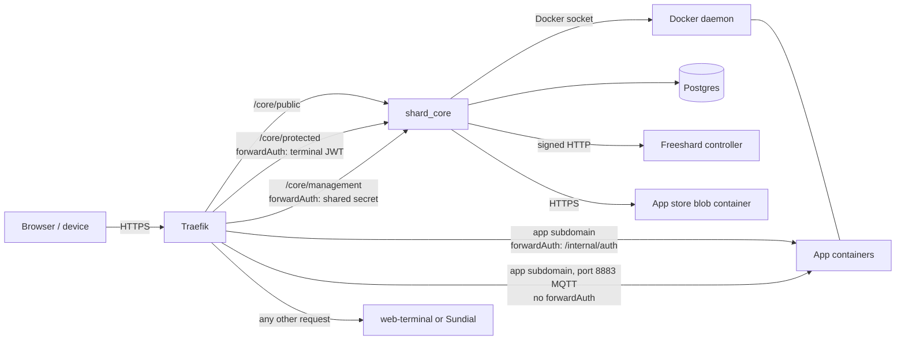

# Shard Core: concepts

This file records the theory shard_core is built on: what it is for, the invariants that hold across its modules, the constraints that were decided and cannot be read from the code, and one line of responsibility per module. Module directories get their own `CONCEPTS.md` as they are worked through.

Every statement here is an assertion the code can violate. Statements derived from the code carry no marker. Where the code cannot vouch for a statement, a marker names what does: `Confirmed <date>` for a maintainer's judgement, `Convention` with a source for an established engineering practice.

## What shard_core is for

A **shard** is one person's cloud computer: a VM, rented from Freeshard or self-hosted, that runs shard_core next to Traefik, Postgres, a web UI (web-terminal or Sundial) and the apps its owner installs. shard_core is the shard's control plane. It installs apps from the Freeshard app store as Docker Compose stacks, routes `<app>.<shard domain>` to them through Traefik, starts an app when someone opens it and stops it again when it sits idle, decides at the proxy who may reach what, pairs the owner's devices (**terminals**), backs the shard up, and talks to the **controller**, the central Freeshard service that provisions, bills and mails for hosted shards.

A shard's identity is an RSA-4096 key pair generated on first boot, and it is fixed for the shard's life: shard keys are never rotated (see Constraints). The code can hold further identities and switch which one is the **default identity**, the one flagged `is_default` that everything below refers to; no UI creates a second identity or switches the default, and doing so would break that rule (#293). The shard ID is the human-encoded SHA-512 hash of the default identity's public key, 103 characters long, and its first 6 characters are the short ID. The shard's domain is the ID's first `dns.prefix_length` characters, lowercased, under the DNS zone; at the default length of 6 that is the short ID, and hosted shards must keep that length, because their DNS names use the first 6 characters whatever the setting says. Every request to the controller, and every request an app sends to another shard (a **peer**) through `/internal/call_peer`, is signed with the default identity's key. A peer's answers are not signed: the peer-key refresh, `peer.update_peer_meta`, which runs on every peer write and every minute for peers whose key is known, is a plain GET of the peer's public `whoareyou` endpoint, and the answers to relayed requests are trusted on TLS to the peer's domain alone.

## Module map

`shard_core/service/` is flat apart from the `app_installation/` package. Its flat concerns share one module file, `shard_core/service/CONCEPTS.md`, with a section per concern. `app_installation/` and every other module directory get their own file, and the composition root, most of whose files sit at the package root, uses `shard_core/CONCEPTS.md`.

| Module | Where | Responsibility |
| --- | --- | --- |
| Composition root | `app_factory.py`, `settings.py`, `service/migration.py` | Owns process start and stop: the lifespan's step order, the set of background tasks, and configuration layered as `config.toml`, then `local_config.toml`, then `FREESHARD_*` environment variables, each layer overriding the one before, setting by setting. `local_config.toml` is for development and never ships in the image, so a deployed shard sees only `config.toml` and the environment its compose file maps. |
| HTTP surface | `web/` | Exposes four routers (`public`, `protected`, `internal`, `management`). Admission to `public`, `protected` and `management` is decided by the Traefik router in front of them, not by the handler; `internal` has no router in front of it and is reachable only on the `portal` Docker network. |
| Installation | `service/app_installation/` | Apart from the **boot-time database paths** in `database/` (migrations, the snapshot restore and the one-time TinyDB import), the only code that inserts or deletes an `installed_apps` row or creates or removes an app directory; turns install, uninstall and reinstall into queued tasks against that row. |
| App runtime | `service/app_tools.py`, `app_lifecycle.py`, `memory_pressure.py`, `pause_metrics.py` | The only code that changes an installed app's container state (create, start, pause, unpause, stop, down); runs the **control tick**, the periodic `control_apps` pass that stops idle apps and, with `apps.lifecycle.pause_enabled` (off by default), pauses them first and demotes one app under memory pressure; takes every app down when the core stops and prunes unused images. `app_tools.py` also holds the manifest reader (`get_app_metadata`) and the size and version predicates that other modules import. |
| Routing | `service/traefik_dynamic_config.py`, `data_model/traefik_dyn_config.py`, `data/traefik*.yml` | Compiles the complete dynamic configuration of shard_core's Traefik routers from the routable apps, the default identity, `traefik.disable_ssl` and `sundial.enabled`; `write_traefik_dyn_config` in `app_installation/util.py` is its only writer. Also owns the static Traefik config, which `app_factory.create_app` writes before the lifespan starts. |
| Identity and signing | `service/identity.py`, `crypto.py`, `human_encoding.py`, `signed_call.py`, `assets.py`, `avatar.py`, `data_model/identity.py` | Owns the shard's identity and its avatar images, derives the shard's ID and domain from the default identity, and signs every call to the controller and every `/internal/call_peer` request with it. |
| Terminals and pairing | `service/pairing.py`, `data_model/terminal.py` | Issues one-time pairing codes and terminal JWTs; a terminal's row is its credential. |
| People and owner email | `service/user.py`, `owner_email.py`, `data_model/user.py` | Owns the people on the shard and the owner's address as it moves between unverified candidate and verified address, and is the only code that writes the controller's copy of that address. Two other writers touch the address on the shard: `identity.enrich_identity_from_profile` seeds the candidate from the controller's profile, and the boot-time database paths seed or demote it. |
| OIDC provider | `service/oidc_provider.py`, `web/public/oidc.py`, `database/oidc.py`, `data_model/oidc.py` | Logs the shard's people into apps through an embedded OpenID provider, active only when `oidc.enabled` is set. |
| Peers | `service/peer.py`, `web/protected/peers.py`, `web/internal/call_peer.py`, `data_model/peer.py` | Keeps other shards' IDs and public keys, admits their signed requests to apps, and relays an app's requests to the same app on a peer. Dormant: no app uses it and neither UI links to it (both keep a peers screen reachable only by URL), though nothing in shard_core is switched off; open issues (#167, #188) plan further work on it. |
| Controller integration | `service/freeshard_controller.py`, `portal_controller.py`, `telemetry.py`, `app_usage_reporting.py`, `data_model/profile.py`, `data_model/backend/` | The exchanges service code has with the controller: profile, management shared secret, mail relay, address verification and the owner-address mirror, backup storage URL, telemetry. App usage reports still go to the dead previous management backend (#208). Three web handlers pass their callers' requests on: `/internal/call_backend` and the management passthrough `/protected/management/{rest}` forward arbitrary requests, and `/protected/feedback/quick` posts feedback. |
| Backup | `service/backup.py`, `database/db_snapshot.py`, `database/backups.py`, `data_model/backup.py`, `download_backup.sh` | Nightly rclone sync of `core/` and `user_data/`, encrypted with the shard's passphrase, to storage the controller issues, carrying a JSON snapshot of the database; restores a shard from that snapshot on its first boot. |
| Observability | `service/metrics.py`, `disk.py`, `websocket.py` | Samples CPU, memory and disk into in-memory snapshots and pushes state changes to connected terminals over a websocket. |
| Database | `database/` | Postgres access: one connection pool, one module per entity whose functions take the connection as first argument, yoyo migrations, and the order of the boot-time imports, the one-time TinyDB import and the restore of Backup's snapshot. |
| Data model | `data_model/` | Pydantic models for the shard's entities and for the app manifest, `app_meta.json`, which is versioned and migrated on read. |
| Utilities | `util/` | Background task loops, the signal objects, the subprocess runner and the compose command builder that pins every app compose call to one app's file and project, the revive throttle, the rate-limit window, the running-version reader, and the words of the backup passphrase. |

## Invariants that span modules

### Admission is decided at the proxy

shard_core has no authentication middleware, and no route declares an authentication dependency (the one FastAPI dependency in `web/` is the OIDC router's feature switch). Whether a request reaches a route is decided by the Traefik router it arrives through. `service/traefik_dynamic_config.py` compiles all of shard_core's routers:

| External route | Middleware | Admits |
| --- | --- | --- |
| `/core/public/...` | `strip`, `auth-public` | Everyone. Sets `X-Ptl-Client-Type` to `public` and removes `X-Ptl-Client-Id` and `X-Ptl-Client-Name`, so a caller cannot claim an identity. |
| `/core/protected/...` | `strip`, `auth-private`, forwardAuth to `/internal/authenticate_terminal` | A valid terminal JWT cookie. Passes the terminal on as `X-Ptl-Client-{Type,Id,Name}`. |
| `/core/management/...` | `strip`, `auth-management`, forwardAuth to `/internal/authenticate_management` | The controller's shared secret. |
| `<app>.<domain>` | `app-error`, `auth`, forwardAuth to `/internal/auth` | Per path, as the app's `app_meta.json` declares it: public, private (a terminal) or peer. |
| `<app>.<domain>` on port 8883 (MQTT) | none, a TCP router | Everyone. Traefik hands the connection to the app without asking shard_core. |
| `traefik.<domain>` | `auth-private` | A valid terminal JWT cookie. |
| Any other request | none, a catch-all router at the lowest priority | Everyone. Serves web-terminal or Sundial. |

The `/core/*` routers match on path alone, so they answer on every host: on the shard's bare IP and on every app subdomain, where rule length decides between them and the app's own router (#191). The static config also enables Traefik's Docker provider, so a container labelled for Traefik can add routers of its own; that provider is a leftover to be removed (see Constraints; #274).

`/internal` is never routed from outside. It is the surface Traefik and the apps call over the `portal` Docker network. A route is therefore exactly as protected as the router prefix it is mounted under.

The boundary holds only for traffic that comes through Traefik. Apps currently join the same `portal` network as shard_core and can call any route directly, and hardening for that is planned (#126). *(Confirmed 2026-11-08 — the code cannot distinguish an accepted gap from a permission.)* A handler that reads `X-Ptl-Client-*` (`web/protected/backup.py`) trusts a value any app on that network can forge. The same network reaches Traefik's own API: the static config serves it with `api.insecure: true`, where any app can read the full routing table without passing the `auth-private` router in front of `traefik.<domain>` (#198).

### The auth path does no per-request database work

`/internal/auth` runs on every request to every app. Its lookups of the app row and the default identity are served from in-process caches that signals invalidate, and in steady state it makes no database query. *(Confirmed 2026-11-08 — per-request database work here is a rejected alternative, since it exhausted the pool in #89.)* What it may do is debounced work: it awaits a write of the app's last access at most once a minute per app, which #133 keeps. No request to an installed app meets the invariant today. Every request without a valid terminal JWT reaches `peer.verify_peer_auth`, which reads and validates the whole `peers` table before it looks for a signature. Every admitted request, unless the disk is low, reads the stored profile in wake-on-access (`app_lifecycle.ensure_app_is_running`), whose VM-size check needs it. An authenticated request also reads the JWT secret and the terminal row and writes `last_connection` (#190).

### Un-pairing takes effect on the next request

A terminal JWT carries no expiry. The terminal's row is the credential: `pairing.verify_terminal_jwt` rejects a token whose row is gone, so deleting the row revokes the device on its very next request, for everything the proxy admits on a terminal's behalf: the `/core/protected` routes, `traefik.<domain>`, and the private paths of apps. A session an app issues itself is outside this, so an app whose root path is public keeps serving the device on its own session after un-pairing (#189). Connections opened before the un-pairing must end with it, because revocation must be immediate (see Constraints) and a websocket is admitted only once, at its upgrade request. Today nothing closes an un-paired terminal's socket to shard_core (#294), and app websockets admitted on a private path stay open as well. Any cache placed on the revocation path is invalidated by the event that changes or deletes the row, never by a timeout. *(Confirmed 2026-11-08 — the code cannot show that a TTL cache is forbidden here.)*

### Every change to an installed app is announced

Outside the boot-time database paths, which run before any receiver holds state, every insert, delete or status write on an `installed_apps` row is followed by `await signals.on_apps_update.send_async()`, sent after the writing transaction has committed, because receivers re-read the database on their own connection. The `/internal/auth` app cache has no other invalidation, so a missed announcement serves a stale admission decision, including a cached 404 for an app that was just installed; the same signal drives the terminals' live app list. The write sites that discharge this today are `_mark_running`, `docker_pause_app`, `docker_stop_app` and `docker_shutdown_app` in `app_tools.py`, `update_app_status` in `app_installation/util.py`, the two inserts in `app_installation/__init__.py`, and the delete in `worker._uninstall_app`. The signal also fires without a row write, after a zip is unpacked and from `docker_shutdown_app(set_status=False)`. Every signal whose receivers read the database, or drop a cache that reloads from it, follows the same rule; `edit_terminal` and `init_default_identity` send inside their transaction, so a terminal rename pushes the old list (#281).

Each signal is synchronous or asynchronous throughout: every receiver of a signal sent with `send()` is a plain function, and every receiver of one sent with `send_async()` is a coroutine function. blinker 1.9 raises `RuntimeError` at the first send otherwise, which aborts the sender. A receiver also handles its own failures. blinker calls the receivers one at a time inside the send, in an order it leaves undefined (today, the order they connected in), and a receiver's exception propagates into the sender, which has already written, and skips the receivers after it; blinker's documentation assumes "correctly implemented receivers will not raise". Today `websocket.send_apps_update` can raise, and it runs before the auth cache's invalidation, so one failing push also leaves that cache stale. Signal names do not tell the send mode: two of the seven asynchronous signals carry an `async_` prefix and five do not. `on_peer_auth` has never had a receiver.

### An app's status has one owner

An app's `Status` (`data_model/app_meta.py`) decides which operations may touch it: revive (bring the app back up, unpausing or starting it as its container state requires), pause, stop, tear down, route, include in the control tick, resume at boot, and run a queued install or reinstall. That mapping from status to permitted operations is one concept with a single owner. *(Confirmed 2026-11-08 — the code cannot tell a leaked concept from coinciding local decisions.)*

The code spreads it over five files (#271):

- `app_tools.py`: `_REVIVABLE_STATUS` in `start_app`, and the allow-lists in `docker_pause_app`, `docker_stop_app` and `docker_shutdown_app`, plus one in `docker_unpause_app`, which nothing calls.
- `app_lifecycle.py`: the installing-status exclusion in `control_apps`, and the `RUNNING`/`PAUSED` branches in `_control_app_time` and `_demote_lru`.
- `app_installation/util.py`: `NOT_ROUTABLE_STATUS`.
- `app_installation/__init__.py`: the status filters of `reconcile_interrupted_uninstalls` and `reconcile_interrupted_installs`.
- `app_installation/worker.py`: the three `assert_app_status` preconditions.

Two issues came from these sites being decided separately: no teardown gate accepted `REINSTALLING` (#199), and `ERROR` is both non-revivable and non-routable (#200). An app leaves `ERROR` through a reinstall, an uninstall, or a **clean stop** of the core (a shutdown that runs the lifespan's exit, as every core upgrade does), which returns it to `DOWN` when its compose file is still there and is meant to retry it. *(Confirmed 2026-11-09 — the code cannot tell an intended retry from an incidental overwrite.)*

### One app's unreadable manifest costs only that app

`get_app_metadata` raises when an app's `app_meta.json` is missing, unreadable or rejected by the running core's model, which can follow a failed install, a downgrade or a custom upload. Wherever shard_core reads the manifests of all apps, such an app is skipped or shown without its manifest, and the rest of the shard carries on. *(Confirmed 2026-07-17 — #158, for the boot.)* *(Confirmed 2026-10-09 — #242, for an app a downgrade leaves ineligible.)* Only `write_traefik_dyn_config` meets this for every kind of failure (#280). The apps announcement and the app list route meet it for a missing or unparsable file, and fail for every app when the running core's model rejects one manifest; the boot-time compose re-render stops the boot, and the control tick's pass ends before its pressure demotion.

### Deployment mode is explicit

**Deployment mode** means whether a shard is hosted (a controller provisions, bills and mails for it) or self-hosted. It is one explicit concept, and no feature infers it from how the controller behaves, because a controller outage would then silently change what the shard does. *(Confirmed 2026-11-08 — the code cannot tell a deliberate per-feature inference from a leaked concept.)*

No deployment-mode switch exists yet. `email.enabled` is an explicit switch for one capability, whether the shard can send mail, deliberately not named after the deployment, since a managed shard may want mail off and a self-hosted one may gain its own SMTP (5101509); the self-hosting compose file gives no way to set it (#300). Everything else assumes a hosted shard. `freeshard_controller.base_url` defaults to Freeshard's controller, so a self-hosted shard sends it signed requests at boot, on pairing, whenever a UI refreshes the profile, nightly for a backup and on every change of the owner's address, the address included (#286). The app size gate, `size_is_compatible`, which refuses an app whose `minimum_portal_size` exceeds the shard's VM size, infers the mode from the controller's answer (#270). It admits every app when the stored profile is `None`, which `portal_controller.refresh_profile` stores when the controller answers 401, as it does for a shard it does not know, and it refuses every app when no profile was ever stored. The profile persists in the database, so this hits a shard that has never reached the controller: a self-hosted shard in that state starts no app at all until a refresh succeeds. Refreshes happen at boot, whenever a pairing leaves exactly one terminal, on `GET /protected/management/profile?refresh=true`, which both UIs send routinely, and on a plain `GET /protected/management/profile` when no profile is stored. Other features meet an unreachable controller each in their own way: a backup fails to start (an HTTP error becomes `BackupStartFailedError`, a connection error propagates), and on a self-hosted shard it fails every night while both UIs say a backup runs nightly; the management passthrough fails with a 500; and pairing the first terminal fails with a 500 after it has spent the code and written the terminal row, so the device gets no cookie; only a 401 from the controller is logged and passed over (#194).

### An app is started only where it can run

Three predicates decide whether an app may run on this shard: the disk is not low, the shard's VM size is at least the app's `minimum_portal_size`, and the running version satisfies `minimum_freeshard_version`. The disk is the filesystem that holds `user_data/`. It is sampled every 30 seconds, counts as low below 1 GiB free, and keeps its last answer when a measurement fails; the boot disk is not watched. Wake-on-access (`app_lifecycle.ensure_app_is_running`) and the `always_on` branch of the control tick refuse to start an app that fails any of the predicates, and the splash (`web/internal/app_error.get_splash_behaviour`) names one failing predicate, preferring version over size over disk, unless the app's response status or its container state replaces the message. The three sites agree. Low disk additionally stops every app on the control tick, `always_on` apps included.

### Paths are resolved on the side that uses them

`settings().path_root` is where shard_core itself reads and writes: `/` in the container, `run/` in local development. `settings().path_root_host` is the same tree as the host sees it, as the compose file sets it through `FREESHARD_PATH_ROOT_HOST`; in development and tests it keeps its default, `/home/shard`. It is used only for the `fs.*` paths rendered into app compose files, because the host's Docker daemon resolves those. `render_docker_compose_template` is its only reader. A compose file rendered with `path_root` would mount directories that do not exist on the host.

### An app's name is unique ignoring case

An app's name names its row, its directory, its compose project and its host name. shard_core lowercases the name into the compose project name, and host names ignore case, so two apps must not differ only in case (#296). The installer compares names exactly and the name pattern admits upper case, so today two such apps would share one compose project and one host name. Every store app's name is lower case.

### Work that must survive a restart is a row

shard_core restarts on every core upgrade, and nothing held in memory survives. The installation queue lives in memory only, so an install, uninstall or reinstall in flight is represented by its row's status, and the lifespan re-derives the work from the rows before the worker starts. Interrupted uninstalls are re-enqueued. An interrupted install is re-enqueued from its zip when the zip is still on disk, re-enqueued as a store install when its installation reason is store, config or unknown, and set to `ERROR` otherwise. Interrupted reinstalls are set to `ERROR`, including one still waiting in the queue whose installed version is untouched (PR #178; see Constraints). A clean stop undoes part of this (#282). It writes `DOWN` over every row whose app directory holds a compose file, whatever its status, and a row without one keeps its status. So after a core upgrade, an uninstall or reinstall that had not yet removed the app's files is lost and the app comes back `DOWN`, an install or reinstall that had rendered its compose file finishes on the first revive, and only work caught without a compose file reaches the reconciliation.

Every other module-level value is a cache, an accumulator or coordination state that starts empty, among them the auth caches, the `metrics` and `disk` snapshots, the counters in `telemetry` and `pause_metrics`, the per-app operation locks in `app_tools`, and `app_lifecycle.last_access_dict`. The last has a visible cost. After an unclean restart, every non-`always_on` app whose row still says `RUNNING` counts as idle since the epoch and is paused or stopped on the first control ticks. #133 records the decision that the persisted `installed_apps.last_access` becomes the single source of last access, and PR #175 implements it.

### The lifespan order is load-bearing

Before the lifespan, `app_factory.create_app` configures logging and writes the static Traefik config, which Traefik reads only when it starts, after shard_core reports healthy. The steps in `app_factory.lifespan` then run in this order, and the order is load-bearing where noted:

1. Database: migrations, pool, TinyDB import, snapshot restore.
2. The default identity, then the owner user, which copies the identity's name and must exist before any pairing.
3. Reconciliation of interrupted uninstalls and installs.
4. The Traefik config, after reconciliation so a row reset to a non-routable status is excluded.
5. The compose templates, registry logins, the legacy `migration.migrate()` hook (a no-op today), initial apps, and the backup passphrase, which must follow the restore so that a rebuilt shard keeps its passphrase.
6. A profile refresh whose connection, HTTP and validation errors are logged and ignored; any other error aborts the boot. It has no timeout, because `signed_request` sets none, so a controller that accepts the connection and never answers holds up the boot.
7. Only then the background tasks, the installation worker among them.

Steps before the worker starts may enqueue installation tasks but must not await their completion, which would deadlock the boot. Neither an outside service nor one app may stop the boot: a failed registry login, a profile refresh that cannot connect or gets an HTTP or validation error, and an app the Traefik write cannot read are logged and passed over, and a first boot comes up while the app store is unreachable and retries its initial apps on a later start. *(Confirmed 2026-11-10 — the maintainer's answer for the first boot; #158 and 4d6e30f record the same rule for one app and for registry logins.)* Today the compose re-render stops the boot on one app's broken template or manifest (#280), the initial-apps step stops a first boot whenever the store cannot confirm an app (#279), and the profile refresh holds the boot up on a controller that never answers (#277) and stops it on any other error (#290).

The stop is ordered as well, and has to fit the grace period its compose file gives (30 s in this repository's compose; freeshard-controller#494 for hosted shards). The lifespan's exit runs only after every in-flight request has finished. Then the background tasks are stopped and awaited, every app is taken down, and the database is closed. The take-down must follow the control tick and the installation worker, which would otherwise race it, and precede the database close, because it writes statuses. Work spawned and left running, a backup run from the backup cron or a wake-on-access revive from `/internal/auth`, is neither stopped nor awaited and can outlive the database close.

### The controller is one signed counterparty

The controller authenticates a shard by its signature. Every request to it goes through `service/signed_call.signed_request`, signed with the default identity's key using HTTP Message Signatures (RSA-PSS-SHA512, key ID = short ID), against one base URL, `settings().freeshard_controller.base_url`. Only the controller manages shards; what remains of the previous management backend is dead. *(Confirmed 2026-11-10 — the code still carries that backend's settings and one sender.)* The controller intends to reject request bodies that declare no Content-Type once every shard sends one (freeshard-controller#272), so every body the shard sends declares one.

A shard's signature carries the authority of shard_core and its owner, and shard_core decides what it lends to others: a caller gets the signature only for what it needs. *(Confirmed 2026-11-10 — the code cannot show how far lending was meant to go.)* Today `/internal/call_backend`, the management passthrough and `/internal/call_peer` lend it far more broadly than that; narrowing them belongs to the planned app-isolation hardening (#126).

The code diverges from the single-counterparty rule in three ways. Controller calls are built in four places: two client modules, `freeshard_controller.py` (callers pass the `api/` prefix) and `portal_controller.py` (it adds the prefix itself), and two web handlers, `/internal/call_backend` and `/protected/feedback/quick`. The client modules are what is left of two backends: shard_core repointed both at freeshard-controller in July and August 2025 (f9c9a08, 69bde77) without merging them. App usage reports were not repointed and still go to the old backend's `management.api_url`, whose host no longer resolves (#208).

The missing Content-Type has a different origin. The management passthrough has forwarded raw request bodies since 2023 (f2fa588), and telemetry has sent them since it was added (73f0102), neither declaring a Content-Type; this became a divergence when the controller started parsing bodies strictly (#93). `/internal/call_backend` has declared its Content-Type since #93. The passthrough, whose one write with a body is the resize POST from web-terminal and Sundial, and the telemetry sender still do not (#269).

### A backup restores the shard as it was

Postgres data lies outside the rclone backup set (`core/` and `user_data/`). Before each backup, `database/db_snapshot.py` dumps every non-yoyo table it discovers at runtime into `core/db_snapshot.json`. When the database holds no identity, `init_database` restores that snapshot before the default identity is generated, so a restored shard keeps its key, ID and domain, and its devices, apps, app secrets and passphrase; whatever changed after the snapshot, an un-pairing included, is undone. The restore is all or nothing, and a rejected row stops the boot.

A backup is restored on the core version that wrote it and upgraded afterwards; a snapshot from another version is refused at boot with a clear message (#224). *(Confirmed 2026-11-10 — the code cannot tell which versions a restore was meant to cross.)* Today the snapshot does not record its version, and the restore runs after the migrations, so a snapshot written by 0.40.1 to 0.41.3 that holds a terminal fails on 0.42.0, and every boot fails with it. Under this rule the handling of older snapshots the restore carries (#224) is unnecessary.

An app's data in a backup is a state the app can start from, so each running app is frozen or stopped while its directory syncs. *(Confirmed 2026-11-10 — the code cannot tell a file mirror from a restorable backup.)* Today apps keep running during the copy, so a database an app keeps in its data directory is copied mid-write (#275).

### Types shared with the controller are copied, never written

`data_model/backend/` is a verbatim copy of the controller's models, regenerated by `just get-types` and checked by CI's drift job against controller `origin/main`. A change to those models starts in freeshard-controller. The drift job sees only files that were copied once (#232). Because the shard parses the controller's answers strictly, a new enum value must reach every shard before the controller emits it (#231). One hand-written twin exists: `VMSize` in `data_model/app_meta.py`, which `Profile.from_shard` converts by value from the copied `VmSize`. Once the copy learns a size the twin lacks, the boot's profile refresh stops with a `ValueError` the boot does not tolerate (#290).

## Constraints

Recorded from the maintainer on 2026-11-08 unless dated otherwise. None of these can be read from the code.

**Prohibitions.** shard_core's container port is never published; only Traefik exposes ports (80, 443, 8883). Nothing that decides whether a terminal is still paired caches with a timeout, because revocation must be immediate. Shard keys are never rotated (a maintainer ruling recorded in freeshard-controller#345, 2026-07-04).

**Permissions.** shard_core mounts the host Docker socket read-write and drives the daemon directly. The read-only app registry credentials and the default Postgres password are committed in `config.toml` on purpose, with the reasoning in comments there. Hardening of the checked-in credentials is planned; for the Postgres password it is part of #126.

**Gaps with planned hardening.** Two things a reader might take for permissions are current state with hardening planned: apps sharing the `portal` network with shard_core (#126), and the non-sandboxed Jinja environment that renders app compose templates and per-path header templates (#252, #264). Neither is a property to build on.

**Rejected alternatives.**

- Authelia as the identity provider (PR #86, closed unmerged). The embedded Authlib OIDC provider was built instead.
- Moving hosted shards to Traefik v3. They stay on v2.11, as decided when PR #112 was closed, and v3 is backlog (freeshard-controller#321). This repository's own `docker-compose.yml` pins v3.6, so the dynamic config shard_core generates has to load under both. It does, with one rule that changes meaning under v3: the dashboard router's `HostRegexp`, written in v2 syntax, which v3 reads as a Go regular expression. The static config shard_core renders names ACME's legacy `azure` DNS provider, which current v2.11 patches reject (#146). freeshard-controller#321 lists both.
- Per-request database lookups on `/internal/auth`. Signal-invalidated caches replaced the app and identity lookups after #89.
- Resuming an interrupted reinstall at boot. `_reinstall_app` deletes the app's files before re-downloading, so a boot with the store briefly unreachable would destroy a working install. It is settled to `ERROR` and retried by the user.
- Routing apps through Docker labels (2026-11-10, #274). The file provider replaced it in 2022; the Docker provider the static config still enables is a leftover, to be removed together with Traefik's Docker-socket mount.

**Unconfirmed.** Two rules appear in this repository's agent documentation but were not confirmed as standing on 2026-11-08: "no shell on shards", which the `freeshard-change-control` skill calls non-negotiable, and "no thread pools", which `agents.md` states while the code bridges synchronous libraries with `asyncio.to_thread` or `run_in_executor` at seven sites (#210 audits them).

## Pattern glossary

- **Forward authentication** ([Traefik ForwardAuth](https://doc.traefik.io/traefik/v2.11/middlewares/http/forwardauth/)): the proxy asks an authentication service before forwarding a request; a 2xx admits it and copies the named response headers onto it. Predicts that the service behind the proxy checks nothing itself.
- **Observer** ([Observer pattern](https://en.wikipedia.org/wiki/Observer_pattern)), implemented with [blinker](https://blinker.readthedocs.io/en/stable/) signals declared in `util/signals.py`: producers announce changes and receivers react, without a producer calling its receivers directly. Predicts that a producer which forgets to announce leaves every receiver stale, and that a receiver which raises breaks its producer.
- **Cache-aside** ([Cache-Aside pattern](https://learn.microsoft.com/en-us/azure/architecture/patterns/cache-aside)): the auth caches load from Postgres on a miss and are dropped when the underlying rows change. Predicts that correctness depends on every write invalidating.
- **HTTP Message Signatures** ([RFC 9421](https://www.rfc-editor.org/info/rfc9421/)): the protocol behind every signed request between shard, controller and peers. Predicts that the verifier needs only the signer's public key, which here is resolved from the key ID.
- **Self-certifying name** ([Self-certifying File System](https://en.wikipedia.org/wiki/Self-certifying_File_System)): the shard ID is derived from the public key, so anyone can check a key against an ID without asking a third party. Predicts that a binding is only as strong as the part of the ID that is compared.

## Unresolved forks

In each of these the readings lead to the same observable behaviour for traffic that comes through Traefik, so they were recorded without being put to the maintainer. A later audit may raise them as candidates; it may not assert them as findings.

- **Layering.** `service/` is the usual path from `web/` to `database/`, but several routes call `database/` directly, and three `data_model` modules persist: `app_meta.update_last_access`, `terminal.update_terminal_last_connection`, and `profile`'s get and set. Whether `service/` is meant to be the only path is undecided.
- **Two Docker clients.** Container state changes go through the `docker` CLI via `util/subprocess.py`, while `web/internal/app_error.py` reads container state and `web/internal/call_peer.py` reads container IP addresses through the Docker SDK.
- **Caller identity on `/protected`.** Some handlers trust `X-Ptl-Client-Id` as set by forwardAuth (`backup.py`); others verify the cookie again to resolve the user (`users.py`).
