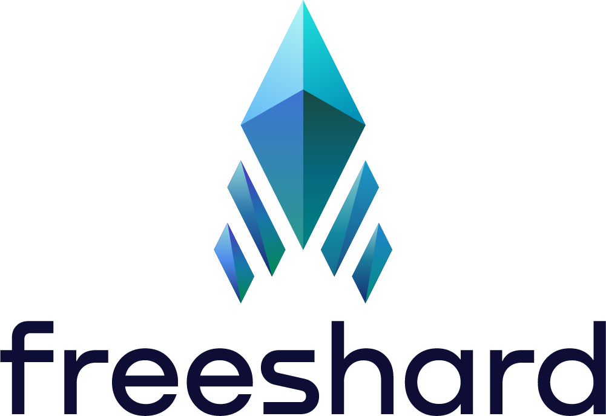
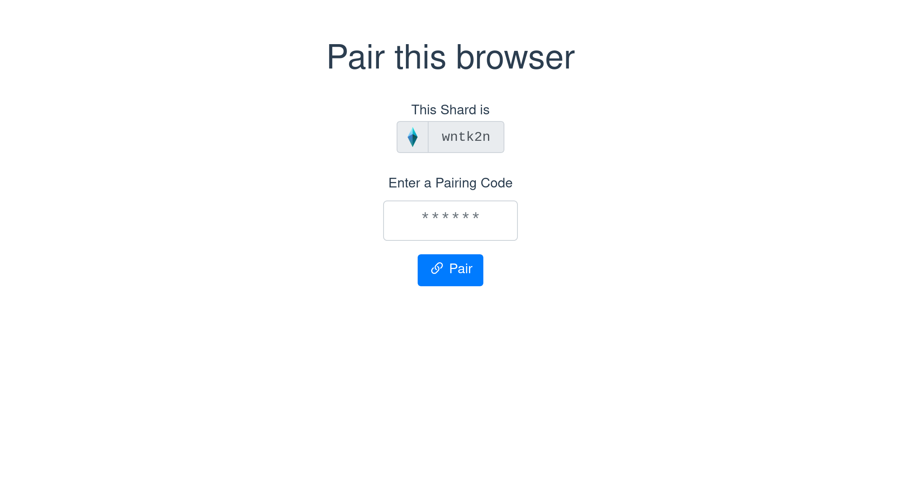
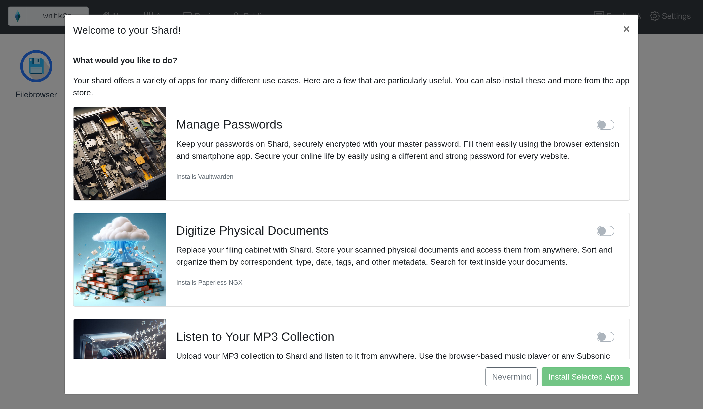
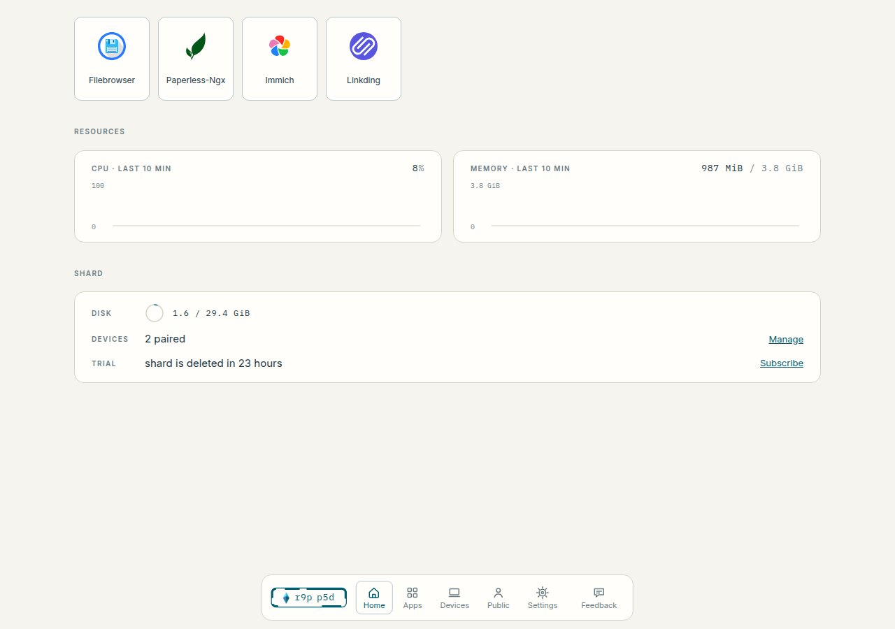
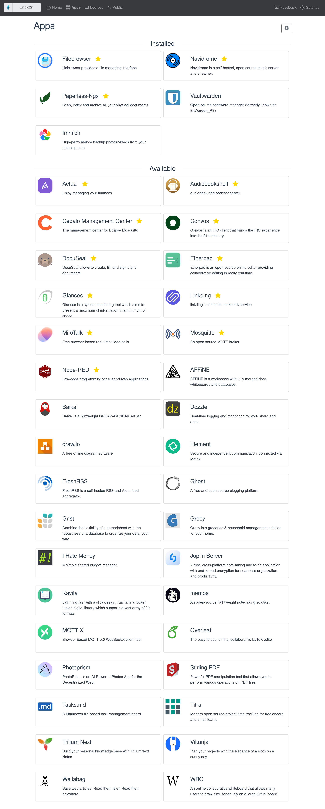
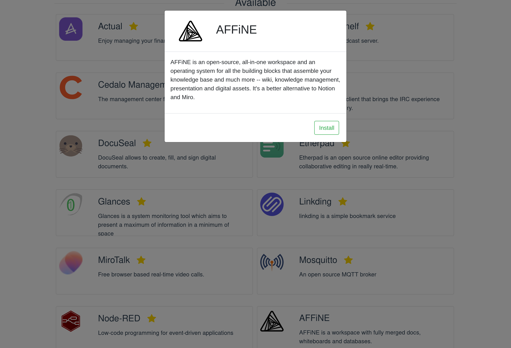
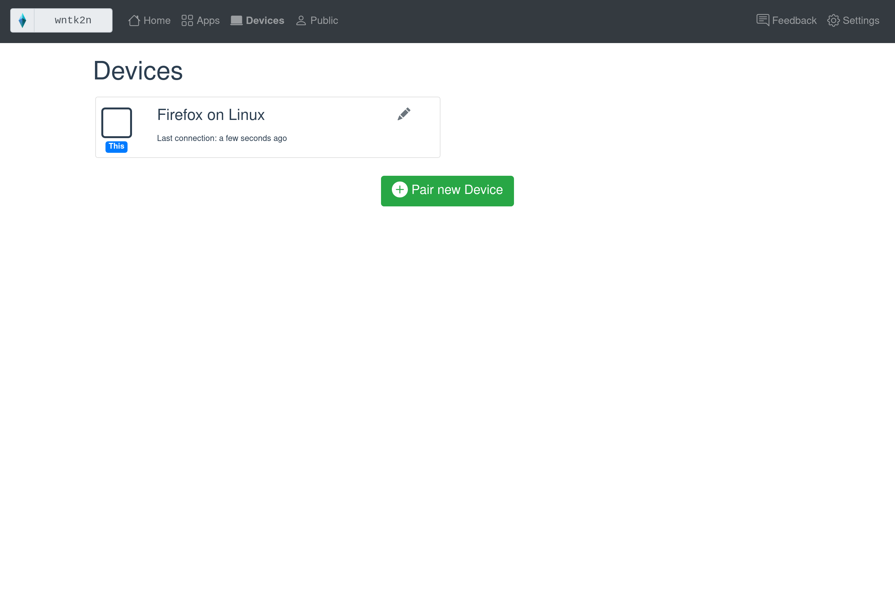
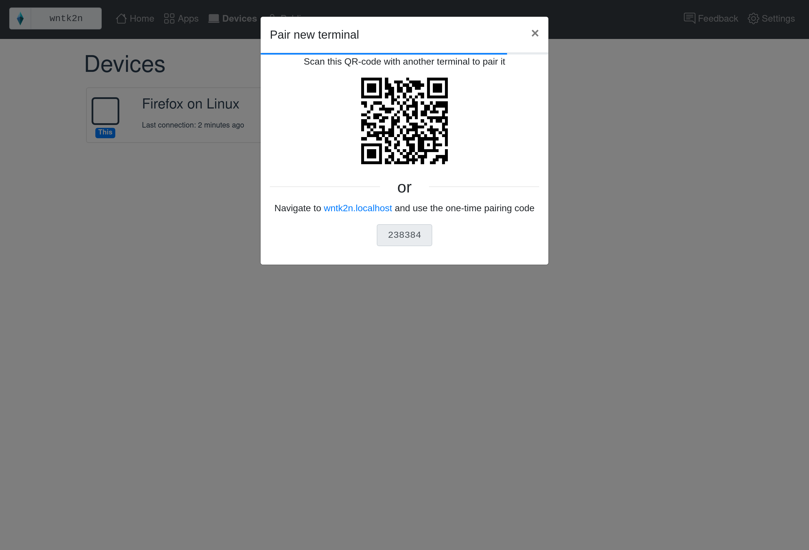
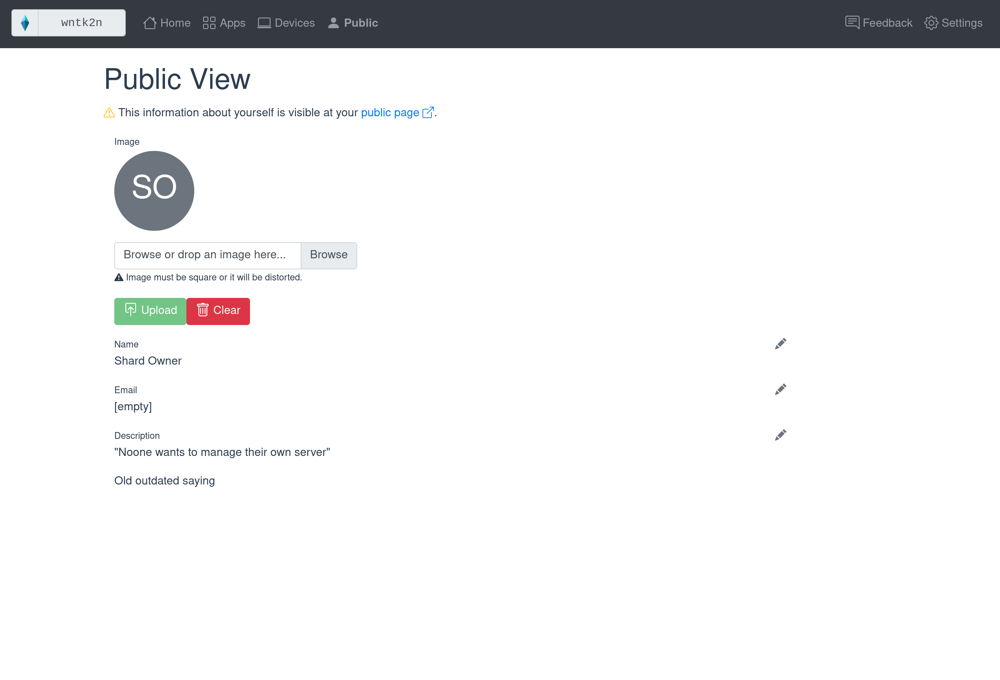
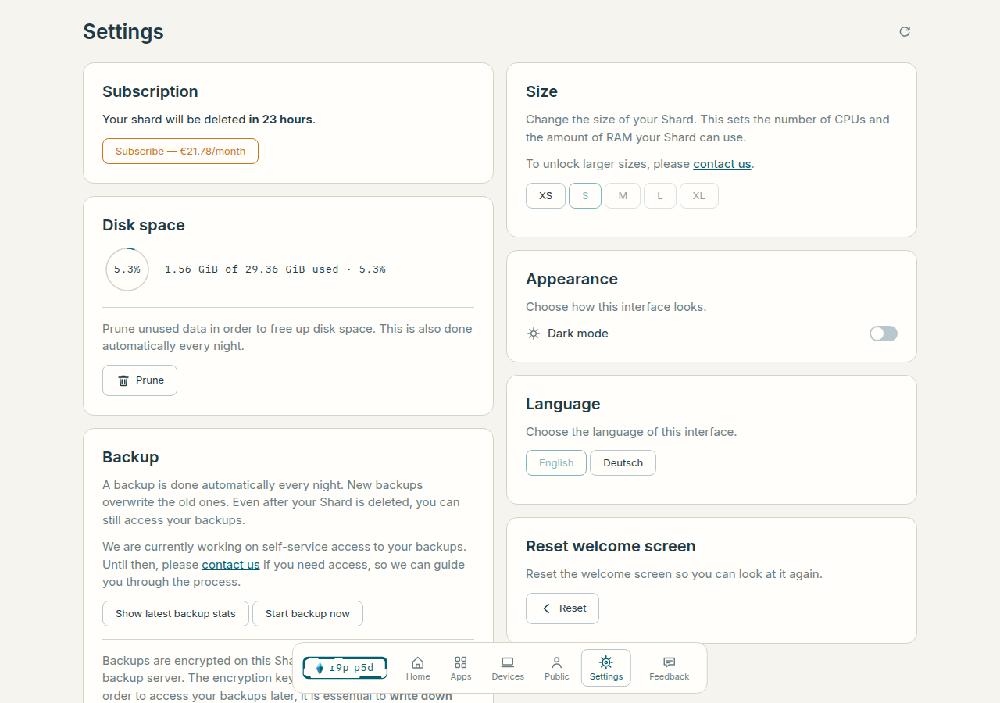

<p align="center">
<picture>
    <source media="(prefers-color-scheme: dark)" srcset="readme/Freeshard_logo_for_dark.png">
    <source media="(prefers-color-scheme: light)" srcset="readme/Freeshard_logo_for_light.png">
    
</picture>
</p>

> [!NOTE]
> Freeshard used to be called _Portal_. Don't be confused if you see the old name in the code or documentation.
> Our goal is to update everything as soon as possible.

# Freeshard

Freeshard is a personal cloud computer that a consumer can rent for a small monthly fee (or selfhost) and which is as simple to use as a smartphone. Its aim is to restore people's sovereignty regarding the data they consume and produce - to give them a home on the internet.

It is built by a small team working with coding agents. [ai-declaration.md](ai-declaration.md) states where AI is used and how far it goes.

<div align="center" style="display: flex; flex-wrap: wrap; gap: 10px;">
    <a href="readme/gallery/pairing.png" target="_blank">
        
    </a>
    <a href="readme/gallery/welcome.png" target="_blank">
        
    </a>
    <a href="readme/gallery/home.png" target="_blank">
        
    </a>
    <a href="readme/gallery/appstore.png" target="_blank">
        
    </a>
    <a href="readme/gallery/app.png" target="_blank">
        
    </a>
    <a href="readme/gallery/devices.png" target="_blank">
        
    </a>
    <a href="readme/gallery/pairnew.png" target="_blank">
        
    </a>
    <a href="readme/gallery/public.png" target="_blank">
        
    </a>
    <a href="readme/gallery/settings.png" target="_blank">
        
    </a>
</div>

# Shard Core

This is the core application of the freeshard project. A machine running it (virtual or physical) is called a Shard.

The overall documentation of the project can be found at [docs.freeshard.net](https://docs.freeshard.net/).

## Overview

The following are the most important concepts and tasks that are performed by the Shard Core.

### Shard ID

Each Shard has a unique ID that is generated during the first start.
This ID is exposed to the user and is expected to be used similar to a phone number.
The understanding should be that a Shard ID corresponds to a person - the owner of the Shard.
For hosted Shards, the ID is also part of the domain name.

The Shard ID is a hash of the Shard's public key.
Therefore, it can be used to authenticate the Shard during communication or to verify data signed by the Shard.

Its full length is 103 characters, but it is usually shortened to 6 characters for easier handling.
This is seen as a compromise between security and usability.

### REST API

Shard Core provides a REST API separated into four parts which are accessible at different paths:

* `/public` - Public API, available without authentication
* `/protected` - Protected API, can only be called from paired terminals
* `/management` - Management API, can only be called from the management backend and is only relevant for hosted shards
* `/internal` - Internal API, only accessible from the same machine e.g. by apps or the reverse proxy

Each shard serves the API docs for the version it is actually running, at `/redoc` and `/docs`, with the OpenAPI schema at `/openapi.json`.

### App Management

Shard Core manages installing, uninstalling, updating, and running apps.
For each app, it creates a docker compose file from a template during installation and reconfigures the reverse proxy to route traffic to the app.
When the app is accessed, it uses docker to start the app's container(s).
After some time of inactivity, the app is stopped to save resources.

### Terminal Pairing and Management

Terminals are devices that have been paired with the Shard.
Shard Core offers a public endpoint where a new terminal can get paired, provided it has a valid pairing code.
That one-time code must be acquired from a protected endpoint by a previously paired terminal.
During pairing a JWT for subsequent authentication is issued and stored as a cookie in the terminal.

### Peer Management and Peer-to-Peer Communication

> [!NOTE]
> Since apps need to explicitly support peer-to-peer communication and no app currently does, this feature is currently disabled.

Shard Core allows the user to add other Shards as peers.
Apps can then use the internal section of the API to list and communicate with peers.
All communication is encrypted and authenticated using the shard IDs as trust anchors.

## Hosting

Shard Core can run on your own machine instead of a hosted shard.
The guide is on the documentation site: [Self-Hosting](https://docs.freeshard.net/self_hosting/).
It covers the prerequisites, a local test, a full server deployment, certificates, updates, uninstalling, and what a self-hosted shard still gets from Freeshard's infrastructure.

The [`docker-compose.yml`](docker-compose.yml) and [`.env.template`](.env.template) in this repository are the files the guide uses.

## Backup and Restore

Hosted shards back up nightly via rclone: the `core/` and `user_data/` directories are synced, encrypted with the shard's backup passphrase, to Azure Blob Storage (self-hosted shards have no controller to issue a storage URL and must snapshot their `${FREESHARD_DIR}` themselves).

All persistent state other than the on-disk app data lives in PostgreSQL — the shard's identity (including its private key, from which the shard ID and domain are derived), paired terminals, installed-app records, and the backup passphrase itself. The Postgres data directory is a sibling of `core/`/`user_data/` and is not synced by rclone. To close that gap, right before each backup shard_core dumps every application table to `core/db_snapshot.json`, so the database state rides along inside the encrypted backup.

To restore, point a fresh shard's `${FREESHARD_DIR}` at the decrypted backup (so `core/` contains `db_snapshot.json`) and start the stack. On first boot, before generating a new identity, shard_core detects the empty database and imports the snapshot — restoring the original identity (same shard ID and domain), paired terminals, and installed-app state. Backups taken before the 0.38.0 Postgres migration instead carry `core/shard_core_db.json` (TinyDB), which is imported by the same first-boot mechanism.

## Development

Make sure to set up your Python environment and install dependencies using the tools of your choice.

Configuration is loaded from `config.toml`, overlaid per-field by `local_config.toml` if that file exists in the working directory, and overridden by `FREESHARD_*` environment variables (nested options use a double underscore, e.g. `FREESHARD_DNS__ZONE`).
You can modify `local_config.toml` to your needs, e.g. to set different log levels.
Both files are read relative to the working directory, so start the server from the repository root.

Run development server with 
```shell
fastapi dev --port 8080 shard_core/app.py
```

Or - if you use [Just](https://just.systems/) - run `just run-dev`.

Then, access API-doc at [http://localhost:8080/docs](http://localhost:8080/docs)

If you also want to run the web UI locally, pull it from [here](https://github.com/FreeshardBase/web-terminal) and follow the instructions in its README.

> [!NOTE]
> When developing, you will typically run backend and frontend locally and without a reverse proxy. This means that you will not be able to start apps, since they rely on being accessed through the reverse proxy.
