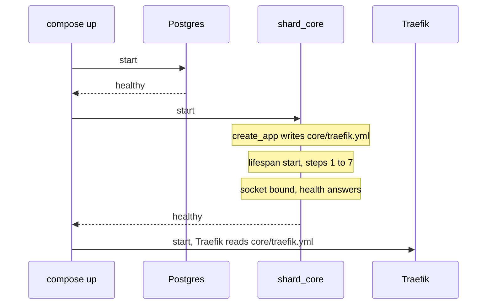
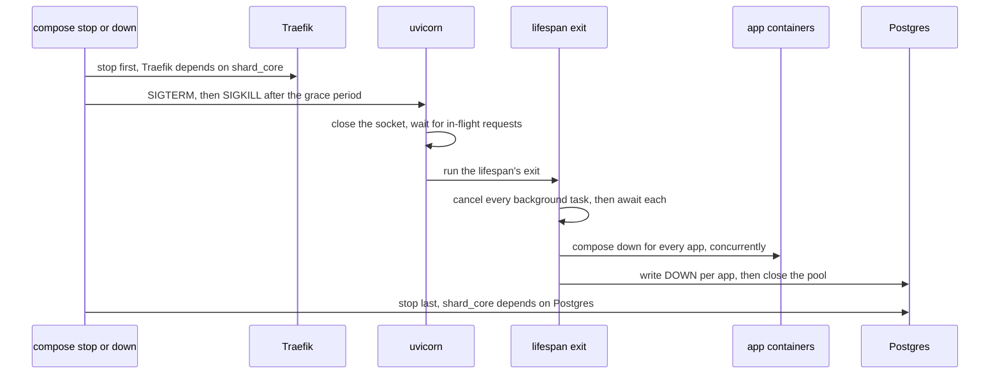

# Composition root: concepts

The composition root is the code that builds and runs the shard_core process: `app.py`, `app_factory.py` and `settings.py` at the package root, `service/migration.py`, and the configuration they read (`config.toml`, `local_config.toml`, `tests/config.toml`, and the environment a compose file maps). This file records its theory. The repo-wide theory is in the root `CONCEPTS.md`, including the order of the start and of the stop, which this file extends without restating.

The composition root owns process start and stop: the lifespan's step order, the set of background tasks, and configuration layered as `config.toml`, then `local_config.toml`, then `FREESHARD_*` environment variables, each layer overriding the one before. It is the program's [composition root](https://blog.ploeh.dk/2011/07/28/CompositionRoot/), the one place where the modules are put together: it builds the settings, mounts the four routers, attaches every signal receiver by importing the modules that declare one, and starts every long-lived task. No other module starts a loop of its own. The only other tasks are per operation: a revive in `app_lifecycle.background_tasks` and a backup run in `backup.background_tasks`.

## The process

`app.py` calls `create_app()` at import, and both entry points load it: the image runs `fastapi run --port 80 shard_core/app.py` under tini, and `just run-dev` runs `fastapi dev`. Exactly one shard_core process serves a shard. Everything that coordinates work lives in that process: the signals and the auth caches they invalidate, the installation queue, the per-app operation locks and the revive throttle. A second worker would run a second control tick and a second installation worker, and its caches would never hear the first one's announcements. `fastapi run` starts one worker unless told otherwise, and this repository's compose passes no `--workers`.

In development, `fastapi dev` restarts its worker process on every code change. Each restart is a clean stop, so every app is taken down on each save.

## Configuration

### Sources

Settings come from four sources, merged per leaf: a leaf set by a higher source replaces that leaf alone, and the rest of its section still comes from below.

| Priority | Source | Read from |
| --- | --- | --- |
| 1 (highest) | Constructor arguments | `Settings(...)`; only tests pass any |
| 2 | Environment | `FREESHARD_` prefix, `__` between nesting levels, names case-insensitive |
| 3 | Override file | `local_config.toml`, if it exists in the working directory; tests read `tests/config.toml` in its place |
| 4 | Base file | `config.toml` in the working directory, which must exist |

Below these sit the model defaults in `settings.py`. Each TOML file is a source of its own because pydantic-settings merges several files within one source only shallowly by default ([pydantic-settings](https://docs.pydantic.dev/latest/concepts/pydantic_settings/)), which is the reason the comment in `settings_customise_sources` gives. A list counts as one leaf: a layer that sets `apps.initial_apps` or `apps.registries` replaces the whole list. The dotenv and secrets-directory sources are dropped, so shard_core never reads a `.env` file. The `.env` beside a compose file feeds only the compose file's interpolation.

All of this resolves against the working directory: the two TOML files, the templates under `data/` (Traefik's static config, the welcome banner, the splash page, the passphrase word list) and the yoyo `migrations/` directory (9559f37). The image sets `WORKDIR /app`, and the README tells developers to start the server from the repository root.

### Which layers a shard sees

A deployed shard sees two layers. The image carries `config.toml`, and `.dockerignore` keeps `local_config.toml` out of it; neither compose file mounts one. `local_config.toml` is a development overlay: it points `path_root` at `run/` and the DNS zone at `localhost`, and sets log levels. A deployment changes shard_core only through the `FREESHARD_*` variables its compose file maps.

Tests build `_TestSettings`, which reads `tests/config.toml` in place of `local_config.toml`, pass `path_root` and `db` as constructor arguments, and swap the instance per test with `set_settings`. The API-reference job in `pages.yml` runs `create_app()` in a checkout, where `local_config.toml` applies.

This repository's compose sets `path_root_host` from `FREESHARD_DIR`. Nothing sets it in development or in tests, where it keeps `config.toml`'s `/home/shard` while `path_root` points at `run/` or at a temporary directory, so an app started there mounts directories under `/home/shard` on the developer's machine.

### `config.toml` holds the production values

`config.toml` names nearly every leaf, including the leaves the model gives a default; for the pause tier's options the stated reason is that operators should see the production values (3be7a5f). Where a leaf has both, `config.toml` is what a shard runs with, and a default changed in `settings.py` alone reaches no shard. A model default is reached only for a leaf `config.toml` leaves out, today `terminal.pairing_code_deadline`, `terminal.jwt_secret_length` and `traefik.disable_ssl`.

The control tick waits 10 seconds between two passes: `config.toml` sets `apps.lifecycle.refresh_interval` to 10, and neither compose file nor the controller's per-shard overrides change it. *(Confirmed 2026-11-10 — the code holds two values for this leaf and cannot say which one is meant.)* The model default does not match yet. `settings.py` still says 30 and `agents.md` documents 30 seconds; both are to follow `config.toml`. Every other scalar leaf the two copies share agrees.

### A misnamed setting stops the boot

A name the settings model does not know stops the boot with an error that names it, whether it is a key in any table of a TOML file or a `FREESHARD_*` variable. *(Confirmed 2026-11-10 — the code shows only which names it rejects today, not which it should.)* The code meets this only for a top-level TOML key, which the root model forbids. The nested models ignore unknown keys, and the environment source looks up declared names only, so a variable with one underscore where the nesting needs two, `FREESHARD_DNS_ZONE`, leaves the zone at `freeshard.cloud` without a word. Misnamed overrides have broken a configuration twice this way: the self-hosting compose's DNS zone and ACME email (5de2998), and a development recipe that kept talking to the production controller (#128).

### Read once per process

`settings()` builds one `Settings` on its first call and returns it for the rest of the process; `create_app()` makes that first call. The instance is module-level because scheduled tasks need it outside any request (#41). No module reads settings at import, so `set_settings` reaches every consumer, which is what lets tests swap configuration per test.

A running shard never re-reads its configuration, so a change takes effect at the next process start. On a hosted shard a configuration change and a core upgrade both recreate the shard_core container. That is a clean stop followed by a boot, and the clean stop takes every app down.

A configuration that does not validate stops the process inside `create_app()`, before the lifespan: a missing `config.toml`, a missing required section, or a mapped variable that resolves to an empty string where a boolean is expected. A compose mapping for a variable that a deployment may leave unset therefore carries a default, as `${PAUSE_ENABLED:-false}` does (139cb14, #182).

### What each deployment sets

Two compose files start shard_core. This repository's `docker-compose.yml` is the self-hosting template that the README tells self-hosters to copy. Hosted shards run the **core compose**, the compose file the controller ships with each core version (freeshard-controller#368, freeshard-controller#494). Per-shard overrides reach shard_core as variables in the shard's core `.env` (#182); `PAUSE_ENABLED` and `SUNDIAL_ENABLED` are the two override keys.

| Setting | Self-hosting compose (this repository) |
| --- | --- |
| `dns.zone`, `traefik.acme_email`, `path_root_host` | from `DNS_ZONE`, `EMAIL`, `FREESHARD_DIR` |
| `traefik.disable_ssl` | from `DISABLE_SSL`, default false |
| `apps.lifecycle.pause_enabled`, `sundial.enabled` | from `PAUSE_ENABLED`, `SUNDIAL_ENABLED`, default false |
| `oidc.enabled` | from `OIDC_ENABLED`, default false |
| `telemetry.enabled`, `apps.pruning.enabled` | not mapped, so false |
| `email.enabled` | not mapped, so true |

Beyond settings, the self-hosting compose mounts neither the host's cgroup tree nor its pressure files, which the App runtime needs, and gives shard_core 30 seconds to stop.

The README tells self-hosters to set `email.enabled` to false in `local_config.toml`, which a container never reads, so a shard started the way it describes keeps mail enabled, and setting the owner's address fails with HTTP 502 (root, *Deployment mode is explicit*; #300).

## Before the lifespan

`create_app()` does three things before any lifespan step runs.

It configures logging: a handler on stdout, and the levels `log.levels` names, where the key `root` stands for the root logger. `basicConfig` leaves the root logger at WARNING and `config.toml` raises no shard_core logger, so a deployed shard drops every `log.info` and `log.debug` line, "Startup complete" included (#201). The welcome banner is printed, not logged, and always appears.

It writes Traefik's static config to `core/traefik.yml` under `path_root`, rendering `data/traefik_no_ssl.yml` when `traefik.disable_ssl` is set and `data/traefik.yml` otherwise, with `traefik.acme_email` filled in. Because building the app writes this file, every caller outside a deployed shard points `path_root` at a scratch directory: tests at a temporary one, the development server and the API-reference job at `run/` through `local_config.toml`.

It builds the FastAPI app and mounts the four routers. Importing `app_factory` has already loaded every module that declares a signal receiver, so every receiver is attached before the first lifespan step sends a signal.

Traefik reads its static config only when it starts. shard_core relies on its compose file to start Traefik only once shard_core reports healthy, as this repository's compose does, and shard_core can report healthy only after the lifespan's start has finished: the health route answers unconditionally, and uvicorn binds its socket only after the lifespan's start has returned. A fresh start of the stack therefore brings Traefik up on the static config the running core has just written, with the dynamic config of step 4 already in place. A change to `traefik.disable_ssl` or `traefik.acme_email` reaches Traefik only when Traefik itself restarts.

## The start

The root lists the lifespan's steps. Their order is load-bearing in more places than the root notes:

- The default identity comes before the owner user, the Traefik config and the compose re-render, because all three read the default identity's row (the owner user step only when it has to create the owner).
- The reconciliation comes before the initial apps. `refresh_init_apps` inserts its rows in `INSTALLATION_QUEUED`, and a reconciliation after it would take them for interrupted installs and enqueue each one a second time; the second task would then fail its status precondition.
- The compose re-render comes after the identity and before anything brings an app up. It exists so that every rendered compose file reflects the current settings, identity and paths after a restart, a changed DNS zone included (0cf179b).
- The registry logins come before the installation worker and the control tick, which pull images.
- The backup passphrase exists before the backup task starts.
- The welcome banner comes last, after the background tasks have started.

### A boot fails only on configuration and the database

A boot fails, and the container restarts under `restart: always`, only when the configuration does not validate or the database cannot be initialized (migrations, pool, TinyDB import, snapshot restore). Every later step degrades: it logs what it could not do, and the boot continues. One malformed or half-removed app must never keep the core from booting (#158), nor may an unreachable registry or a controller answer that fails validation (4d6e30f, 17a3da5); the boot-time app migration of 2023 skipped apps the store no longer had for the same reason (07239df). A step that fails on every boot keeps the shard down until someone repairs the host, because while the core is down the owner reaches neither the web UI's API nor the uninstall route.

Two configuration errors pass the settings model and fail the boot later, inside the lifespan: a malformed cron expression in one of the task schedules, when step 7 builds the cron tasks, and a malformed `freeshard_controller.base_url`, whose error escapes step 6's catch. Both belong in the settings model's validation.

The code does not meet this in three places.

The compose re-render and the initial-apps step (step 5) are recorded in Installation's file, under *The compose file* (#280) and *Initial apps* (#279), and in the root's *The lifespan order is load-bearing*.

The profile refresh (step 6) catches connection, HTTP and validation errors, and a 2xx answer whose body is not JSON, or whose body read breaks off, raises past all three. The missing timeout the root records holds the boot up without failing it.

### The welcome banner

The banner prints the shard's short ID and URL at every boot. While no terminal is paired it also creates a pairing code and prints a link carrying it, which is how a self-hosted owner pairs the first device. The code is valid for 10 minutes, fixed both in the call and in the banner's text, whatever `terminal.pairing_code_deadline` says (600 seconds by default). A shard holds one pairing code at a time, so the banner's code replaces any code issued before the boot, a code the controller fetched through `GET /management/pairing_code` among them.

## Background tasks

The lifespan starts eleven tasks together, after the profile refresh:

| Task | Primitive | When it runs | Its switch |
| --- | --- | --- | --- |
| Installation worker | `InstallationWorker` | Whenever a task is queued | none |
| Control tick, `control_apps` | `PeriodicTask` | `apps.lifecycle.refresh_interval` seconds after each pass | none; `apps.lifecycle.pause_enabled` selects its behaviour |
| Peer key refresh | `PeriodicTask` | 60 seconds after each pass | none |
| App usage tracking | `CronTask` | `apps.usage_reporting.tracking_schedule` (`0 2 * * *`) | none |
| App usage report | `CronTask` | `apps.usage_reporting.reporting_schedule` (`0 3 1 * *`) | none (#208) |
| Image prune | `CronTask` | `apps.pruning.schedule` (`0 4 * * *`) | `apps.pruning.enabled` |
| Backup | `CronTask` | `services.backup.timing.base_schedule` (`0 3 * * *`) plus up to `max_random_delay` seconds | none |
| Disk sampler | `PeriodicTask` | 30 seconds after each pass | none |
| Metrics sampler | `PeriodicTask` | `metrics.sample_interval_seconds` after each pass | none |
| Websocket worker | `WSWorker` | Per queued message; its 30-second heartbeat loop is dead, so no heartbeat is sent every 30 seconds | none |
| Telemetry | `PeriodicTask` | `telemetry.send_interval_seconds` after each pass | `telemetry.enabled` |

The set does not depend on configuration or on deployment mode. Every task is created on every shard, and a switch is read inside the task's body on each run, so a disabled feature costs one wake-up per period. Four of the switchless tasks serve three features that do not apply to every shard: the backup, whose start fails on a shard the controller does not know (root, *Deployment mode is explicit*), the app usage pair, and the peer key refresh, which reads the `peers` table every minute while the Peers module is dormant.

A periodic task runs its first pass as soon as it starts and sleeps its interval after each pass, so its passes never overlap and its period is the interval plus the pass. A cron task waits for the next cron time. Both log an exception from a pass and carry on, the cron task since #58. The installation worker and the websocket worker are module-level objects that exist from import and accept work before they start, which is what lets the steps before step 7 enqueue.

## The stop

The root records the order of the lifespan's exit. Around and inside it:

uvicorn runs the lifespan's exit only after it has closed its socket and every in-flight request has finished, and `fastapi run` sets no deadline on that wait. A terminal's websocket does not hold it up: uvicorn closes the socket with code 1012 and the handler returns.

Stopping a background task cancels it, so a pass in progress ends at its current await, and a subprocess awaited through `util/subprocess.py` is killed. The lifespan then awaits each task. The websocket worker's heartbeat task ended long before (see the table above), and `WSWorker.wait` never reaches it, because it stops at the cancelled message task.

The **take-down**, `docker_shutdown_all_apps(force=True)`, runs `compose down` for every app concurrently and logs a failing app without holding up the others; an app without a compose file fails its down this way and keeps its status. It reads the app list from Postgres and writes `DOWN` back, so Postgres must still be up. In this repository's compose shard_core depends on Postgres and Traefik on shard_core, and Compose stops a service before the services it depends on ([Docker](https://docs.docker.com/compose/how-tos/startup-order/)), so Traefik stops first and no request arrives through it during the stop. Nothing provides this order when the containers are stopped any other way.

Two kinds of task are not part of the stop. A revive in flight is the App runtime's concern. The lifespan's exit neither cancels nor awaits a backup run in flight: the run keeps syncing during the take-down, its rclone process is cut off when the container stops, and the next nightly run syncs again.

The whole stop must finish within the stop grace period of the compose file the shard runs from, after which Docker kills the process ([`stop_grace_period`](https://docs.docker.com/reference/compose-file/services/#stop_grace_period), 10 seconds by default). A stop killed before the take-down leaves app containers running with nothing left to stop them. The self-hosting compose gives 30 seconds (751678d); for hosted shards' grace period see freeshard-controller#494. shard_core bounds no part of the stop itself: a request waiting on a controller that does not answer, and `signed_request` gives such a request no timeout, holds up everything behind it until the kill.

## The legacy migration hook

`service/migration.migrate()` logs one line and returns. It was added in 2023 to reinstall the apps of TinyDB's old `apps` table (ef71d3a) and has done nothing since the move to Postgres (2980bfb). The TinyDB import does not cover that case: it ignores a pre-2023 `apps` table. Its place in step 5 constrains nothing.

## Boundaries

The composition root owns the order of the process's start and stop, the background task set, the settings model and its sources, the logging setup, Traefik's static config file and the welcome banner.

It relies on the compose file a shard runs from: for a mapping, with a default where it may be unset, of every setting the deployment changes; for the stop grace period; for the dependency order of Postgres, shard_core and Traefik; for the mounts of `core/`, `user_data/` and the Docker socket, plus the cgroup tree and pressure files the App runtime needs; and, through the image, for a working directory holding `config.toml`, `data/` and `migrations/`. It relies on the controller to apply a configuration change or a core upgrade by recreating the container. It relies on the Database for `init_database`, on Installation for a reconciliation and an initial-apps step that only enqueue, on the App runtime for the take-down and the control tick, and on Utilities for `PeriodicTask` and `CronTask`, whose catch-alls keep a task alive after a failed pass, and for a subprocess runner that kills its child on cancellation.

Of the root invariants it keeps true:

- *The lifespan order is load-bearing*: it owns both orders.
- *Work that must survive a restart is a row*: the reconciliation runs before the worker starts, and the worker's queue exists from import.
- *Deployment mode is explicit*: configuration is where a deployment sets its switches. For `email.enabled` the self-hosting compose gives no way to set it.
- *Paths are resolved on the side that uses them*: `path_root` and `path_root_host` come from configuration, and the second is the host's view only where a compose file sets it.

## Constraints

From the written record, each with its source:

- One broken app never blocks the boot (#158, PR #166).
- A failed registry login does not fail the boot (4d6e30f).
- Rejected: a stop pass before the take-down, which spent the grace period on what `compose down` already does (751678d).
- Rejected: gconf, YAML configuration, and a `CONFIG` variable that selects the configuration files (#41).
