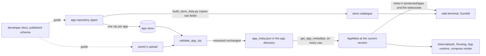

# Data model: concepts

The data model holds the Pydantic models of the shard's stored entities and of the app manifest, `app_meta.json`, whose format carries a version in its `v` field and is migrated to the current version every time a manifest is read.

## Files

`app_meta.py` holds the manifest, `AppMeta`, with its parts `Entrypoint`, `Path`, `Lifecycle`, `StoreInfo` and `OidcMeta`; the installed-app row, `InstalledApp`, and `InstalledAppWithMeta`, the row together with its manifest; the enums these use, `Status`, `InstallationReason`, `Access`, `EntrypointPort` and `VMSize`; the receiver `update_last_access`; and, as the module's `__main__`, the generator of the published JSON schema. `app_meta_migration.py` holds the steps between format versions. `auth.py` holds `AuthState`, the identity `/internal/auth` derives for a request to an app.

The other files belong to the modules the root map names, and appear here only for the conventions they share: `identity.py` (Identity and signing), `oidc.py` (OIDC provider), `peer.py` (Peers), `profile.py`, `app_usage.py` and `backend/` (Controller integration), `terminal.py` (Terminals and pairing), `traefik_dyn_config.py` (Routing), `user.py` (People and owner email) and `backup.py` (Backup).

## The manifest and its counterparties

A manifest reaches a shard inside an app's zip: from the store, which app-repository fills from its `apps/` directory, or from an upload by the owner. By default every shard installs from the same store, whatever core it runs, so a store manifest may be read by any core version in use. The install puts the manifest through the running `AppMeta` and extracts the zip unchanged (Installation). The stored `app_meta.json` is therefore the file as published. Nothing writes a migrated form back, so a core that is downgraded reads what the store published, not a newer core's rewrite of it.

Every use reads the file again. `get_app_metadata` (App runtime) parses it and validates it through `AppMeta`, migration included, and nothing caches the result: `/internal/auth` reads it on every request to an app, the wake-on-access receiver reads it again on every admitted one while disk is not low, and the control tick reads the manifest of every app not being installed on every pass.

The UIs see a manifest in two forms. Before an app is installed they show the store catalogue, which app-repository's `build_store_data.py` copies from the raw files without looking at `v`: `name`, `pretty_name` (the titlecased `name` when the file has none), `app_version`, `icon`, `minimum_portal_size`, `minimum_freeshard_version` and `store_info`. Once the app is installed they show the shard's migrated manifest, which `/protected/apps` and the terminals' websocket carry as `meta`. Where a migration step changes a field, the two forms disagree (see *Format versions*).

| Field | Required | Read by |
| --- | --- | --- |
| `v` | Yes | The migration chain only |
| `app_version` | Yes | Both UIs, which offer an update when the store lists a different one |
| `name` | Yes | The upload, which takes the app's name from it (Installation); everywhere else the row's name counts |
| `pretty_name` | From 1.1 on; a 1.0 file gets the titlecased `name` | Both UIs |
| `icon` | Yes | The icon route and the splash, as a file in the app directory |
| `entrypoints` | Yes, may be empty | Routing, one router and one service per entrypoint |
| `paths` | Yes, may be empty | `/internal/auth`, which applies the access rule and header templates of the longest matching prefix |
| `lifecycle` | No; every field has a default | The control tick and the pressure demotion (App runtime) |
| `minimum_portal_size` | No; `xs` | The start gate and the splash (root, *An app is started only where it can run*) |
| `minimum_freeshard_version` | No; no requirement | The start gate and the splash; Sundial's store, from the catalogue |
| `store_info` | No; the catalogue builder requires it | Both UIs |
| `upstream_repo`, `homepage` | No | No code in shard_core, either UI or app-repository's scripts; app-repository's add-app and update-apps skills read `upstream_repo` |
| `oidc` | No | The compose render, which registers the app's OIDC client |

Apart from `v` and the upload's use of `name`, shard_core reads seven of the fourteen fields: `icon`, `entrypoints`, `paths`, `lifecycle`, `minimum_portal_size`, `minimum_freeshard_version` and `oidc`. `app_version`, `pretty_name` and `store_info` pass through to the UIs. No code in shard_core, either UI or app-repository's scripts reads `upstream_repo` or `homepage`; app-repository's add-app and update-apps skills read `upstream_repo`.

## Format versions

| `v` | Introduced | First release that reads it | Step from the version before |
| --- | --- | --- | --- |
| 1.0 | The first format with a version | 0.21.0 | |
| 1.1 | `pretty_name` | 0.26.0 | `migrate_1_0_to_1_1` sets `pretty_name` to the titlecased `name` |
| 1.2 | `homepage`, `upstream_repo` | 0.30.2 | `migrate_1_1_to_1_2` changes only `v` |
| 1.3 | `idle_for_pause`, `idle_for_stop` and `skip_pause` in place of `idle_time_for_shutdown` | 0.40.0 | `migrate_1_2_to_1_3` moves `idle_time_for_shutdown` to `idle_for_pause` unless `always_on` is set |

`v` names the format a file is written in, and `CURRENT_VERSION`, 1.3, is the format `AppMeta` holds. The migration runs in a `mode="before"` model validator, so it runs on every validation of raw data. It looks up the step for the file's `v`, applies it, and repeats until `v` is current. Each step is a function of the dict alone and sets `v` to its target; the loop raises once it has run more steps than there are migrations, so a step that forgets to advance `v` makes the migration fail and cannot loop forever. A validated `AppMeta` always carries the current `v`, so nothing downstream can tell which format a file was written in. The steps change the dict they are handed, so a caller that kept its parsed JSON would find it migrated; both callers parse a fresh dict for each validation.

The chain runs only forward. A core cannot read a format newer than its own: `migrate` finds no step for that `v` and raises `KeyError`, as it does when `v` is missing or written as a number. The [developer documentation](https://docs.freeshard.net/developer_docs/app_meta_json/) states the consequence for 1.3: shards older than 0.40.0 cannot read 1.3 files. At install time `validate_app_zip` turns that `KeyError`, like any other failure of the model, into an `InvalidAppZip` ("app_meta.json is invalid: '1.4'"). On later reads of an installed manifest it reaches the reader's callers as it is (App runtime).

Every version after 1.0 has been a minor one, and a minor version is optional for an app: every core migrates the formats before its own on read, so a file may stay at any earlier one. Store manifests use only formats that every core in use can read, so 1.3 is deferred for the store. There has been no major version yet; what one involves is to be decided when it comes. *(Confirmed 2026-11-10 — the code cannot show which formats the store may publish.)*

No store manifest was regenerated when a format changed (see *Constraints*). At app-repository dc736ca every manifest is at 1.0, 1.1 or 1.2, so every store app passes through at least one step on every read. app-repository's authoring guide tells authors to write 1.2, and the four apps added since 0.40.0 follow it. Two statements contradict the rule today. The developer documentation says `v` should be 1.3 and gives store apps no caveat. The reevaluation step of app-repository's add-app skill flags a `v` older than the documentation's current format as drift (app-repository #92).

`v` is authoritative. A manifest holds only the fields of its declared format, each step may rely on that, and a field of a newer format in an older file is unsupported. *(Confirmed 2026-11-10 — the code cannot tell a step that relies on its declared format from one that overwrites a declared field by mistake.)* The steps rely on it: `migrate_1_0_to_1_1` sets `pretty_name` to the titlecased `name` whether or not the file declares one, and `migrate_1_2_to_1_3` sets `idle_for_pause` from `idle_time_for_shutdown` whether or not the file also declares `idle_for_pause`. A field added outside the chain (see *How a field is added*) belongs to no format, and the rule does not cover it.

Store files do not all keep to the rule. Some declare 1.1's `pretty_name` under `v: "1.0"`, which the 1.0 to 1.1 step replaces with the titlecased `name`, so the store lists one name and the installed app shows another; others carry 1.2's `homepage` or `upstream_repo` under an older `v`, which no step touches today. These are publisher defects, tracked in app-repository#97.

The 1.2 to 1.3 step maps the legacy idle time onto the pause threshold, so that an app tuned for an early stop pauses at that time and stops at the global default (c697b99, which changed 979eb49's mapping onto the stop threshold in review). With the pause tier off, the legacy value therefore has no effect, and the app stops after `apps.lifecycle.default_idle_for_stop`. The [developer documentation](https://docs.freeshard.net/developer_docs/lifecycle/) says that a legacy value is treated as `idle_for_pause`, and that with pausing switched off, apps are only stopped after `idle_for_stop`. A legacy value above that default inverts the two thresholds (#226).

## How a field is added

A field that older cores may ignore is added without changing `v` (#246, c58a19c). It is optional, its default means "no requirement" or "no behaviour", and an older core drops it, because no model in `AppMeta` forbids unknown keys, which Pydantic then ignores ([`extra`](https://docs.pydantic.dev/latest/api/config/)). `minimum_freeshard_version` (0.41.3) and `oidc` (0.42.0) were added this way, and #214 proposes a `core_access` field of the same kind, whose absence grants nothing. `homepage` and `upstream_repo` (1.2, 2024) were the last purely additive change that bumped `v`. A new `v` is for a change an older core must not misread: a rename, a removal or a changed meaning, as 1.3's lifecycle rework was. It comes with a step from the version before, and from then on every older core is unable to read files written in it.

An optional field needs an explicit default. Pydantic 2 treats `X | None` without one as required (078fd19), and a new required field makes every existing manifest invalid.

Ignoring unknown keys also hides typos and legacy keys. A 1.3 file that still writes `idle_time_for_shutdown` loses it without an error, because no step runs on a current-format file, and the published schema allows unknown keys as well, so an editor does not flag it either.

A core that ignores a field cannot honour it. An app that depends on a field's behaviour, or on any newer core feature, declares `minimum_freeshard_version`, which every release from 0.41.3 on enforces (0.41.2 has the code, but no image carries the `0.41.2` tag; only a branch snapshot tagged `release-0.41.2` exists).

Because every read validates again, a rule added to the model applies to manifests already installed: an installed app whose manifest fails a new rule cannot be read by the core that introduced it. A rule can therefore only be tightened for values no published or installed manifest uses. That is why #246 could validate `minimum_freeshard_version` eagerly: no store app used the field yet (da7bdf0).

Field names are part of the published contract, and they keep their old names. `minimum_portal_size` and the templates' `portal.*` predate the rename from Portal to Freeshard, which the developer documentation explains as kept for compatibility. A rename on one side alone loses its reader: web-terminal changed its reads of an installed app's size requirement to `meta.minimum_vm_size` in 2025 (web-terminal 9e34c27), a field no manifest has had, Sundial took the same read over, and both UIs therefore treat every installed app as fitting the shard; the shard's own start gate still refuses it.

## What the model rejects

| Input | Raised |
| --- | --- |
| No `v`, or a `v` without a step: a newer format, a typo, a number | `KeyError` |
| A 1.0 file without `name` | `KeyError` |
| A 1.0, 1.1 or 1.2 file whose `lifecycle` is neither an object nor empty | `AttributeError` |
| A missing required field, a wrong type, a value outside an enum (matched case-sensitively), a broken lifecycle rule, a `minimum_freeshard_version` that is not a PEP 440 specifier set | `ValidationError` |

Only the last row is Pydantic's own error. The others come from the chain indexing the raw dict, so the model offers no single exception for "this manifest is invalid". `validate_app_zip` treats them alike by catching every exception; readers of installed manifests do not (App runtime).

The lifecycle rules: `always_on` excludes every other lifecycle field, `skip_pause` excludes `idle_for_pause`, both idle times are at least 5 seconds, and `idle_for_pause` is below `idle_for_stop` when both are set. An unset threshold falls back to `apps.lifecycle.default_idle_for_pause` or `apps.lifecycle.default_idle_for_stop`, and no rule compares an explicit pause threshold with the default stop threshold (#226).

`minimum_freeshard_version` is a `packaging` `SpecifierSet`. It needs an operator (`">=0.41.3"`, not `"0.41.3"`) and may state a range, as the maintainer asked in #246's review; `None` means no requirement. Its `PlainSerializer` writes it back as its string wherever the model is serialized, and the model is serialized on every `/protected/apps` response; without the serializer those responses fail. Its `WithJsonSchema` gives the published schema a string type, which Pydantic cannot derive for a `SpecifierSet` (#265).

`VMSize` orders the sizes by declaration order, `xs` below `s` below `m` below `l` below `xl`, so a new size must be declared at its rank. It also types the shard's VM size in the stored profile, converted from the controller's own enum by value (Controller integration). `Access` names the three per-path rules, `public`, `private` and `peer`, and `/internal/auth` decides what each admits. `EntrypointPort`'s values decide whether Routing builds an HTTP router (`http`) or a TCP router (`mqtt`); its member names, `HTTPS_443` and `MQTTS_1883`, never reach a file, and the second names the standard MQTT port, not 8883, where Traefik listens for MQTT.

The developer documentation and app-repository's guide both require a `""` path as the default, but the model accepts `paths` without one, and a request whose path no declared prefix covers then fails in `/internal/auth` with a 500, which the visitor sees as the splash. The app name's pattern is `validate_app_zip`'s check (Installation).

## The published schema

`python -m shard_core.data_model.app_meta` writes `schemas/schema_app_meta_<CURRENT_VERSION>.json` from `AppMeta.model_json_schema()`, and the release workflow's Pages job publishes it, next to the API reference, at https://freeshardbase.github.io/freeshard/schemas/schema_app_meta_1.3.json (#265). Every deploy replaces the whole site, so the URL shows the model of the release the job last ran for, normally the latest, and only that release's format has a schema there. Its file name carries only the format version, so an additive field changes the content of a schema whose name stays the same: the 1.3 schema of 0.42.0 has `oidc`, a field the 1.3 model of 0.41.3 did not have.

The schema describes the model after migration. It leaves `v` unconstrained, requires `pretty_name` (which a 1.0 file may omit), allows unknown keys, and leaves out the lifecycle rules and the specifier syntax. It is an aid for writing a current-format file, not a statement of what a core accepts.

No test generates it, so a field type without a JSON schema passes CI and fails only the release's Pages job, which runs after the image has been pushed. `minimum_freeshard_version` was such a type from da7bdf0 until #265. The developer documentation still links the 1.2 schema at its former location, with a note that it still describes version 1.2 and does not know the 1.3 lifecycle fields or `minimum_freeshard_version`.

## The installed-app row

`InstalledApp` is the shape of an `installed_apps` row: `name`, `installation_reason`, `status`, `status_message` and `last_access`, filled from the row by column name. `installation_reason` is typed, so a row whose value is outside `InstallationReason` fails to load. `status` is a plain `str`, as it has been since 89113f9 (2021), with `Status.UNKNOWN` as its default, and the column is `TEXT` without a constraint, so nothing checks a stored status against the enum when a row is read.

`InstalledAppWithMeta` adds `meta`, the migrated manifest, or `None` when the app directory or its `app_meta.json` is missing or is not JSON (`enrich_installed_app_with_meta`). A manifest that exists but fails validation raises instead, so the type cannot express an installed app whose manifest is invalid. It is the response model of `/protected/apps` and the element of the terminals' app list, so every `AppMeta` field is also part of the HTTP API, which Sundial copies into its client and checks for drift.

`Status` has twelve members, each valued as its name in lower case. The `str` mixin lets `row.status == Status.RUNNING` and membership tests work on the plain strings rows hold. The values are the wire format between the database, the API, the websocket and both UIs, which compare against the literals: the six queued and in-progress statuses as busy, and `running`, `stopped`, `down` and `error`, among others, by name. A value can be added without a database migration, as 979eb49 added `PAUSED`; renaming one breaks both UIs and every row that holds it. The declaration order carries no meaning. `UNKNOWN` is the model's and the column's default. Which operations each status permits is the root's *An app's status has one owner* (#271), with the App runtime's and Installation's accounts of the statuses each writes.

## Last access

`update_last_access` is a receiver of `on_request_to_app`, which `/internal/auth` sends after it has admitted a request and awaits, together with the App runtime's wake-on-access and telemetry's request counter. It writes `installed_apps.last_access` at most once per `apps.last_access.max_update_frequency` seconds per app, 60 by default.

The debounce compares against `last_access` on the `InstalledApp` it is handed, and sets that field after the write. It holds across requests because `/internal/auth` hands every request for an app the same object from its app cache; when an announcement drops the cache, the reloaded row carries the time just written. The write is not announced, since it is not a status write (root, *Every change to an installed app is announced*).

Nothing in shard_core uses the column but the debounce, and neither UI shows it. The control tick's idle clock is `app_lifecycle.last_access_dict` (root, *Work that must survive a restart is a row*). #133 records the maintainer's direction: the column becomes the single source of truth, the write keeps its debounce, and the read gets a short time-bound cache, so that loading an app's assets stays off the database. Open PR #175 implements it. That the receiver persists from the data model is the root's layering fork.

## AuthState

`AuthState` is the identity `/internal/auth` derives for a request to an app: a terminal when the request carries a valid terminal JWT, a peer when it carries a valid peer signature, anonymous otherwise. Its constructor's parameters are named after the `X-Ptl-Client-*` headers that manifests usually fill from it, but it is built only from those verifications, never from request headers, as it has been since it was `AuthValues` (39699d5).

Its `header_values` is the `auth` context of the manifest's per-path header templates: `client_type`, which is `terminal`, `peer` or `anonymous`, and `client_id` and `client_name`, which are empty when there is no such client. `/internal/auth` renders those templates for every admitted request, with the default identity as `portal` beside `auth`, in the unsandboxed Jinja environment (root, Constraints, #252). The developer documentation publishes those names and values, and store manifests use them, so they change only as part of the manifest's contract. `ClientType` also types the `type` of `/public/meta/whoami`, which both UIs compare with `anonymous`. It has no member for the `public` that the `auth-public` middleware writes into `X-Ptl-Client-Type` on `/core/public`; that header vocabulary never reaches an `AuthState`. Outside `backend/`, and enums aside, `AuthState` is the one class in `data_model/` that is not a Pydantic model.

## Conventions across data_model/

Every entity is a Pydantic 2 model. Enums mix in `str`, so their values compare and serialize as strings; the copies in `backend/` use `StrEnum`, `AuthState.ClientType` is a plain `Enum`, and `Role` is kept equal to the SQL enum `user_role` by a comment. A nullable field declares its default, apart from three that are required: `InstalledAppWithMeta.meta`, `BackupInfoResponse.last_report` and `BackupInfoResponse.last_passphrase_access_info`. No model forbids unknown keys, apart from some of the generated Traefik models.

A row model mirrors its table's columns by name and is built from a psycopg dict row with `Model(**row)` or `Model.model_validate(row)`, so the model validates every row it reads.

An entity model can carry a secret, `Identity.private_key` or `User.email_token_hash`, and such an entity leaves through a route only under a response model that lacks it, `OutputIdentity` or `OutputUser`, which FastAPI uses to drop every other field. `Input` models are request bodies. `SafeIdentity` is the default identity as the compose templates, the header templates and the Traefik compile see it. Models that one route or service uses alone may live beside it instead (`OutputWhoAmI`, `OutputSettings`, the metrics and disk models).

`backend/` is the controller's copy and is never edited by hand (root, *Types shared with the controller are copied, never written*). `traefik_dyn_config.py` was generated in 2022 and is patched by hand (deddb3d), so it is never regenerated (Routing).

`data_model/` is not a leaf. `identity.py` and `peer.py` import `service.crypto`, and `terminal.py` imports `service.human_encoding`. `app_meta.py` and `identity.py` read the settings when used, so `Identity.domain` follows the DNS settings at every access. `app_meta.py` and `terminal.py` connect signal receivers when imported, which registers them because the HTTP surface imports both. Three modules persist, `app_meta.py` and `terminal.py` importing the database inside their receivers and `profile.py` at module level (root, the layering fork).

## Boundaries

The data model owns the manifest's format: its fields and their validation, the format versions and the steps between them, and the generator of the published schema. It also owns the shape of the `installed_apps` row, the values of `Status`, `InstallationReason`, `Access`, `EntrypointPort` and `VMSize`, `AuthState`, and the debounced last-access write.

It relies on the App runtime's `get_app_metadata` to read a manifest from the app directory, and on Installation's `validate_app_zip` to put every new manifest through the model, catching every exception, before anything is installed. It relies on the HTTP surface to build `AuthState` only from verified credentials and to send `on_request_to_app` with the app cache's object; on the Database for the `installed_apps` columns; on Utilities for the signal; and on the release workflow to publish the schema.

Outside shard_core it is the contract with app-repository, which publishes the store's manifests, each in a format every core in use reads and holding only its declared format's fields, and builds the store catalogue from them unmigrated; with the developer documentation, which states the format, its versions and the template variables `auth.*` and `portal.*`; with the users of the published schema; and with web-terminal and Sundial, which read `meta` from the API and the catalogue's fields from the store, and compare `Status` and `ClientType` values as literals.

Of the root invariants it keeps true:

- *Admission is decided at the proxy*: the manifest's `paths` are the per-path rules the proxy applies to an app, and `AuthState` carries the derived identity into the header templates. The model does not require the `""` default, so a path no prefix covers fails with a 500 and is never decided.
- *The auth path does no per-request database work*: `update_last_access` writes at most once a minute per app, not once per request.
- *An app is started only where it can run*: the model guarantees that `minimum_portal_size` is a `VMSize` and that `minimum_freeshard_version` parses, so the size and version predicates never meet a malformed requirement.

## Constraints

From the written record, each with its source:

- A field that older cores can ignore is added without changing `v`, so that older cores still read the file and drop the field (#246).
- New format versions attempt to stay backwards compatible: a core can still process the previous format and translate it to its own (the developer documentation's Versioning section).
- Store files are not regenerated when the format changes; the migration runs on every read (the code comment on the 1.2 to 1.3 step, 979eb49).
- Rejected: mapping the legacy `idle_time_for_shutdown` onto `idle_for_stop`, as 979eb49 first did. It maps onto `idle_for_pause`, so that an app tuned for an early stop pauses at that time (c697b99).
- Rejected: a `minimum_core_version`, and capability lists such as `requires: [...]`, for what an app needs from the shard. An app declares `minimum_freeshard_version`, compared with the freeshard version the shard runs (#242).
- `minimum_freeshard_version` is a typed, self-validating PEP 440 specifier set, so an app can state a range (the maintainer's review on #246).
- The database column `installed_apps.last_access` is to be the single source of an app's last access, written with a debounce, and its read may sit behind a short time-bound cache, so that loading an app's assets stays off the database (#133). That permission contrasts with the revocation path, where no cache may expire on a timeout (root, Constraints).
