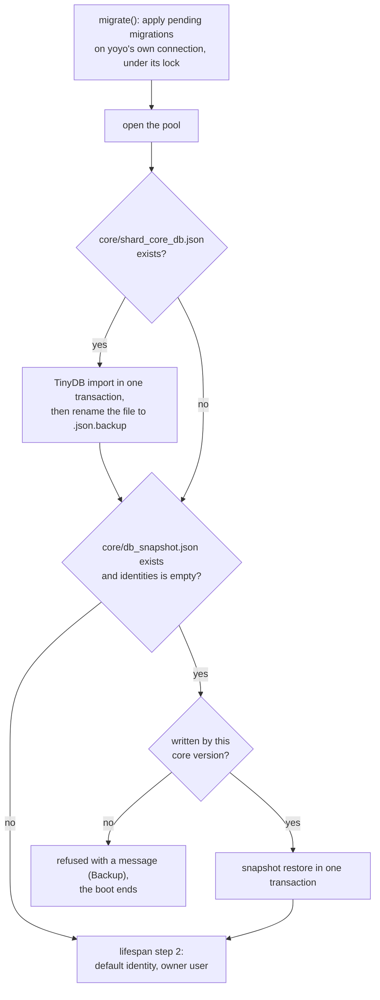

# Database: concepts

The Database module is the only code in shard_core that speaks SQL: it brings the Postgres schema up to date on every boot, fills a new database from a backup's snapshot or a TinyDB-era file before anything else reads it, keeps the one connection pool every other module borrows from, and gives each table a module of functions that run statements on a connection the caller passes in.

`database/oidc.py` and `database/terminals.py` serve the OIDC provider and Terminals and pairing; this file covers them only where they follow or break the module's conventions. `database/db_snapshot.py` lives here too, but what the snapshot contains, when it is written and when it is refused belong to Backup (`shard_core/service/CONCEPTS.md`). This file covers its place in the boot.

## Files

`connection.py` holds the pool and the two ways to borrow from it: `db_conn()`, and `with_conn(fn, *args)`, which runs one connection-first function on a connection of its own and exists for the OIDC provider's thread bridge (moved here from the provider in dd79d02). `database.py` holds `init_database`, `shutdown_database` and three key-value wrappers that each borrow their own connection. `migration.py` runs yoyo. One module per table holds that table's SQL: `installed_apps`, `identities`, `terminals`, `peers`, `users`, `backups`, `tours`, `app_usage` (for `app_usage_tracks`), `kv_store`, `app_secrets`, and `oidc` for the three OIDC tables. `tinydb_migration.py` is the one-time TinyDB import. `errors.py` defines `InsertError` and `UpdateError`, which nothing raises or catches; they came with the pattern #25 asked to copy from the controller's database layer and were never used.

No SQL text exists outside `database/` and `migrations/`, and nothing else in shard_core imports psycopg.

## A connection block is one transaction

Apart from the migrations, which run on yoyo's own connection, every database access runs inside `async with db_conn() as conn`. The pool's connections are not in autocommit mode, and the [psycopg_pool `connection()` context](https://www.psycopg.org/psycopg3/docs/api/pool.html) commits when the block exits normally and rolls back when it raises. No code in shard_core calls `commit()` or `rollback()` or opens a nested transaction, so a block's extent is exactly a transaction's (#25 described callers committing explicitly; none does). An entity function runs its statements on the connection it is given and never borrows one itself. Three rules follow from this.

Writes that must land together are made in one block. `identity.make_default` demotes the old default identity and promotes the new one in one block, so no other connection sees zero or two defaults. Un-pairing a terminal revokes its OIDC tokens and codes and deletes its row in one block; `oidc.revoke_for_terminal` issues two statements and relies on its caller's block to make them atomic.

A block holds a pooled connection and an open transaction for as long as it runs, so a block contains database calls only. Slow work, such as a docker call, a request to the controller or a mail, runs between blocks. Where an operation spans such work, each of its database steps is a single statement that is safe on its own. `users.claim_email_token` spends a confirmation token and reads its candidate address in one `UPDATE`, so a link submitted twice promotes once; `users.promote_pending_email` promotes only while the candidate is still the one confirmed; `oidc.redeem_code` consumes an authorization code in one `UPDATE`. Each is an `UPDATE ... WHERE <expected state> RETURNING *`, and an empty result means another writer got there first. `installed_apps` breaks this: its one status write, `update_status`, overwrites whatever status the row holds, which is how a runtime status write can replace one of Installation's (App runtime's theory records those races).

A change is visible to other connections only once its block has exited, so a change is announced after the block that made it. The receivers read on connections of their own: the websocket pushes for `on_apps_update` and `on_terminals_update` reload their table and broadcast it, and the `/internal/auth` caches reload on their next miss. An announcement sent inside the writing block reaches a receiver that still reads the old row, and an auth cache refilled in that window keeps the old row until the next announcement. Every announcement of a database write is sent after its block, except two. `identity.init_default_identity` announces the new identity inside its block, which is harmless because it runs at boot, before any request can have filled the identity cache. `edit_terminal` (`PUT /protected/terminals/id/{id}`) announces inside its block, so its `terminals_update` push carries the terminal list as it was before the edit, and connected UIs keep showing the old name and icon. One more block holds a connection across other work: `enrich_identity_from_profile` keeps its block open while `identity.update_identity` borrows a second connection, commits the new name and announces it, so the handler holds two pool slots at once and its two writes are separate transactions.

The database layer itself sends no signal and imports nothing from `service/`, `web/` or `util/`. Announcing is the caller's duty.

## The pool

There is one `AsyncConnectionPool` per process. `init_database` opens it and `shutdown_database` closes it, and `db_conn()` raises `RuntimeError` before the one and after the other. Its maximum size and the time a caller may wait for a free connection are set explicitly; a caller that waits longer gets `PoolTimeout`, which a request handler turns into a 500. Both limits came from #89, where the library's defaults turned a page load's burst of forwardAuth requests into a batch of 500s. The same fix (1e0e7c1) made `/internal/auth` cache its lookups, and the root invariant *The auth path does no per-request database work* is what keeps such a burst away from the pool; the pool's size bounds only what the caches let through. The pool checks no connection before handing it out: after Postgres restarts under a running core, each idle connection fails the first operation that draws it and is replaced when it comes back.

The pool belongs to the event loop that opened it. Code running in a worker thread reaches it by scheduling a coroutine on that loop and waiting for the result, as the OIDC provider's `_run` does with `with_conn`. Its bridge timeout equals the pool's wait (dd79d02), since waiting longer than the pool will wait for a connection cannot help.

The pool builds its connection string from `settings().db` with psycopg's `make_conninfo`, which quotes every field. `migrate()` builds a second one from the same settings (see Migrations).

## The entity modules

Each table's SQL lives in one module, a [Table Data Gateway](https://martinfowler.com/eaaCatalog/tableDataGateway.html) made of functions: each takes the connection as its first argument and runs one statement, apart from `oidc.revoke_for_terminal`, which runs two. Values always travel as bound parameters, and every static statement is annotated `LiteralString`. The only SQL composed at run time in these modules is the `SET` list of the five partial-update functions (`identities.update`, `users.update`, `terminals.update`, `peers.update_by_id`, `peers.update_by_id_prefix`). Each checks every column name against its module's `_UPDATABLE_COLUMNS` and raises `ValueError` for any other before it interpolates the name. The snapshot code composes its statements with `psycopg.sql.Identifier`, which quotes every name. No caller-supplied string reaches SQL text except as an allow-listed column name or a quoted identifier. The gateways are not the only writers: the migrations and the two boot-time imports, the TinyDB import and the snapshot restore, write tables directly.

`users` and `oidc` return Pydantic models through `class_row`. The other modules return dict rows, which callers validate into models themselves; #25 asked for models throughout, and #217 tracks typing both the returns and the inserts. `backups.get_latest` also renames its columns to the camelCase of `BackupReport`.

`installed_apps.update_status` writes the status and the status message in one statement, so a status written without a message clears the previous one and a message never outlives the status it was written with (#202). Which statuses carry a message is Installation's decision; only `ERROR` does.

## The key-value store

`kv_store` maps a string key to a JSONB value. Each key is named in the one module that writes it: `profile` in `data_model/profile.py`, `backup_passphrase` and `backup_passphrase_last_access` in `service/backup.py`, `terminal_jwt_secret` and `pairing_code` in `service/pairing.py`, `freeshard_controller_shared_key` in `service/freeshard_controller.py`, `initial_apps_installed` in `service/app_installation`, and `oidc_provider_jwk` in `service/oidc_provider.py`. Other modules that read a key use its owner's constant. `get_value` raises `KeyError` for an absent key and returns `None` for a stored JSON null, so a key never written and a key written as nothing stay distinguishable. A datetime is written as its ISO string and read back as that string; the reader parses it. Several values are the shard's secrets, stored in plaintext like everything else in the database (#211 keeps it so until shard_core has a general secret-management mechanism).

## What the schema enforces

| Rule | Enforced by |
| --- | --- |
| A terminal belongs to a user | `terminals.user_id NOT NULL REFERENCES users` (0002) |
| Usernames are unique; a role is `owner` or `member` | `UNIQUE` and the `user_role` enum (0002) |
| A confirmation token's digest and expiry are set together | the `users_email_token_paired` check (0005) |
| An app has at most one OIDC client, and its client, codes and tokens go when its row goes | `oidc_clients.app_name UNIQUE ... ON DELETE CASCADE` and the cascades below it (0004) |
| Un-pairing keeps a terminal's OIDC codes and tokens, with `terminal_id` cleared | `ON DELETE SET NULL`, deliberately not `CASCADE` (0004's comment) |
| There is one default identity | Code only. `init_default_identity` inserts a default into an empty table only, and `make_default` swaps in one block; nothing serializes two concurrent `make_default` calls |
| There is one owner | Code only. `ensure_owner_user` and the TinyDB import create one only when none exists, and `get_owner` returns an arbitrary one of several |
| An app's status is a `Status` value | Code only; the column is `TEXT` (#218) |
| An app's secrets outlive the app | No foreign key from `app_secrets` to `installed_apps`, so an uninstall keeps them and a reinstall reuses them |

## Migrations

The schema is the chain of [yoyo](https://ollycope.com/software/yoyo/latest/) migrations in `migrations/` at the repository root, read relative to the working directory (`/app` in the image). Each is a plain SQL file named `shard-core-NNNN-<slug>.sql`, whose first line repeats its name and whose `-- depends:` header names the migration before it, so the six form one line. `init_database` applies the pending ones on every boot, before the pool opens, on a synchronous connection of yoyo's own and under yoyo's lock. yoyo runs each migration in a transaction of its own, so a migration that fails leaves nothing behind and ends the boot. There are no rollback files; migrations only go forward. #206 tracks that nothing checks the numbering, after two pairs of migrations claimed the same number on one day.

yoyo identifies a migration by its file name alone. Editing an applied migration changes nothing on a shard that applied it, and a renamed migration is applied again. That has happened once: the 0.41 release line shipped the app secrets table as `shard-core-0002-app-secrets` (a784ef5) while main ships it as `shard-core-0006-app-secrets` (c5714d7), so a shard upgrading from 0.41.2 or 0.41.3 to 0.42.0 applies it a second time, and `CREATE TABLE IF NOT EXISTS` makes that a no-op. yoyo also records a migration as applied in a second transaction after the migration's own commit, and a process that dies between the two applies it again on the next boot. Four of the six migrations survive a second run; 0002 and 0005 do not. A migration that can reach a shard under a second name must therefore keep its name on every release line or survive a second run.

yoyo's lock is a row it inserts before applying and deletes afterwards. A migrator killed while it holds the lock, or one whose connection drops before the delete, leaves the row behind, and every later boot waits 10 seconds for it and fails with `LockTimeout` until someone deletes the row by hand. The lock guards against a second migrator, and a shard cannot run one: this repository's compose file names the container `shard_core`, and Docker allows one container per name.

`migrate()` builds a connection URL of its own from `settings().db`, without the quoting the pool's connection string gets, so it does not accept every password the pool accepts, and its error logging can write the credentials to the log. Neither matters while the committed default password is in use (root, *Constraints*); the hardening #126 plans for that password has to change `migrate()` as well.

Two migrations carry data rules besides schema. 0002 creates the owner from the default identity and binds every terminal to it. 0005 turns the default identity's address into the owner's unverified candidate, clears the owner's `users.email` and drops `identities.email`. A data rule acts only on the rows present when it runs, which is why `tests/test_migration_0005.py` replays the chain on seeded rows: the ordinary suite only ever migrates empty tables.

Rows that arrive through the boot-time imports never pass through the migrations, because the imports run after them: whatever a migration does to existing rows, it did before these rows arrived. A snapshot written by another core version is therefore refused, never imported: a backup is restored on the core version that wrote it, and upgrading the core then takes the restored database to the current schema through the migrations, data rules included. Backup holds the rule and the refusal. *(Confirmed 2026-11-10 — the code cannot tell whether a restore across core versions is meant to work.)* Today the restore refuses nothing. A snapshot records no version (#224), and the restore imports whatever it finds, with counterparts of its own for two schema changes: it applies 0005's data rule to a snapshot it recognises by the `email` field on its identity rows, and it skips a dropped column with a warning. For 0002 it has none, so a snapshot written before 0.42.0, the first release to ship 0002-users, fails at its first terminal, whose insert lacks `user_id`. A table a later migration dropped would stop it the same way, its rows reduced to an insert without columns. The TinyDB import is a cross-version import by nature and carries its own copies of 0002 and 0005; #225 plans its removal (see Constraints).

## Filling an empty database at boot

`init_database` runs four steps in a fixed order, and the lifespan runs it before anything else.

The version check is Backup's rule and does not exist yet (see Migrations).

The migrations run first because both imports write the current schema and the restore reads the live catalogue to order its tables and adapt its values. The pool opens second because the imports borrow from it; `migrate()` does not. Both imports finish before the default identity and the owner user are ensured (root, *The lifespan order is load-bearing*), so an imported identity is kept and no new one is generated.

Each step either completes or ends the boot. An exception from any of them propagates out of the lifespan, and the import and the restore each run in one transaction, so a failed attempt leaves the database as it was and the next start tries again. The boot must not continue past a snapshot that was refused or could not be applied: the next step would generate a new identity on the empty database, and the next backup would write a new snapshot over the one that holds the old identity. Today a pre-0.42.0 snapshot ends the boot this way on every start, with the database's constraint error as its only message.

The TinyDB import runs whenever `core/shard_core_db.json` exists, whatever the database already holds, and renames the file to `shard_core_db.json.backup` only after its transaction has committed. The import only reads the file, so the renamed file is the backup #25 asked for, and the rename marks the import done. The import keeps only the columns each table still has, parses TinyDB's `{TinyDate}:` datetimes, and inserts with `ON CONFLICT DO NOTHING`, except into `backups` and `app_usage_tracks`, which have no natural key. It creates the owner from the default identity, gives it the identity's address as an unverified candidate, and binds every terminal to it. #225 plans to remove the import: the file can only exist where its data never reached Postgres, on a shard upgraded in place from a TinyDB core or on a fresh shard given a backup from before 0.38.0.

The snapshot restore runs when `core/db_snapshot.json` exists and the `identities` table is empty. That file stays on disk and is rewritten before every backup, so the emptiness check is what keeps every boot from restoring it again; the TinyDB file needs no such check because the import renames it. The two never both apply: a backup written by a TinyDB core carries the TinyDB file and no snapshot, and one written later carries no TinyDB file, because the import renamed it and the backup's `rclone sync` removes it from the remote. If both were present, the TinyDB import would win, because it fills `identities` first.

`shutdown_database` closes the pool, and the lifespan calls it last, after every app has been taken down (root, *The lifespan order is load-bearing*). Nothing reopens it, so a task still running at that point, a revive in flight for instance, fails at its next `db_conn()`.

## Boundaries

The Database module owns every SQL statement, the schema and its migrations, the pool, the order and the failure behaviour of `init_database`, the TinyDB import, and the key-value store's mechanics. It hosts `db_snapshot.py`, whose contents, write timing and refusal rule are Backup's; the restore's place in `init_database` is this module's.

It relies on its callers to scope transactions: to make writes that must land together in one block, to keep slow work out of blocks, and to announce a change only after the block that made it has exited. It relies on the composition root to run `init_database` first and `shutdown_database` last. It reads `settings().db` and `settings().path_root`, and needs the working directory to be the repository root. It needs the core's compose file to start shard_core only once Postgres accepts connections, since `migrate()` makes a single attempt; this repository's file waits for `pg_isready`. It takes `User`, the OIDC models and `BackupReport` from Data model.

Of the root invariants it keeps true:

- *A backup restores the shard as it was*: the restore runs on an empty database before the default identity is generated, and a snapshot from another core version is refused (Backup). Today none is refused, and a snapshot written before 0.42.0 that holds a terminal fails the boot on every start (see Migrations).
- *The lifespan order is load-bearing*: the database is step 1 of the start and the last step of the stop.
- *Every change to an installed app is announced*: the database layer announces nothing itself and commits when the block exits, which is what makes a send placed after the block a send after the commit.
- *Work that must survive a restart is a row*: a write is durable once its block has exited, and not before.
- The owner's address as the boot-time database paths touch it (root module map, People and owner email): the TinyDB import seeds the candidate, and 0005 and the restore demote an unverified address to one.

## Constraints

From the written record, each with its source:

- shard_core reaches Postgres through psycopg3, with hand-written SQL (#25, by the maintainer).
- Every database function takes the connection as its first argument, and the caller owns the connection's lifecycle (#25, by the maintainer).
- Connections come from `db_conn()` (#25, by the maintainer).
- The TinyDB data is migrated to Postgres once, at startup, and the TinyDB file is backed up first (#25, by the maintainer).
- An old install reaches the current schema through an intermediate core version. No compatibility code is kept to import an older format into the current schema (#225).
- An app's secrets are kept when the app is uninstalled or upgraded (#138, by the maintainer).
