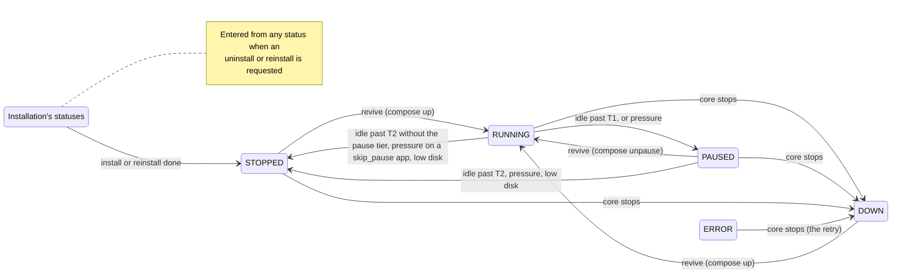
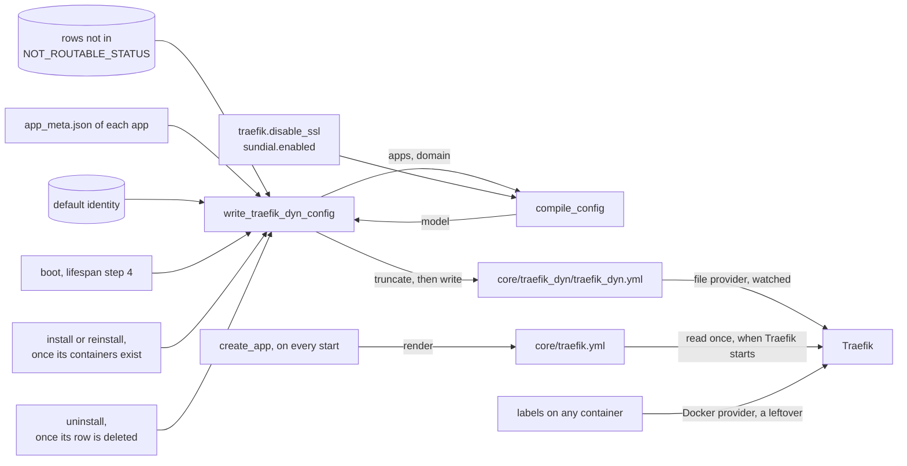
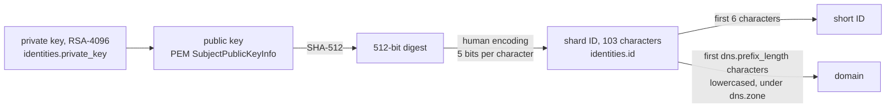
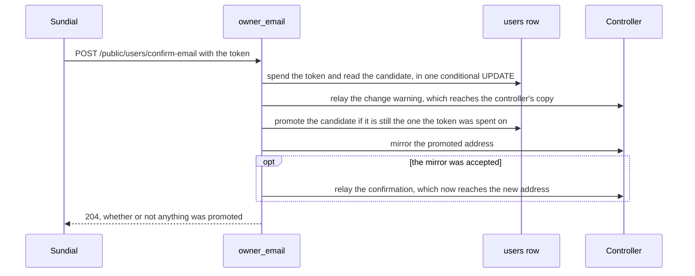
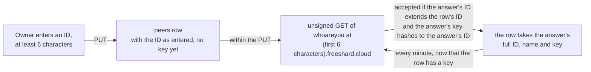
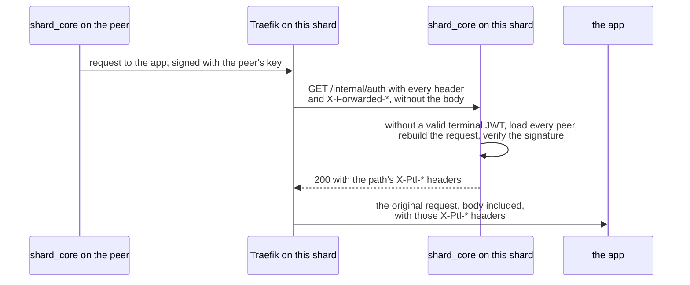
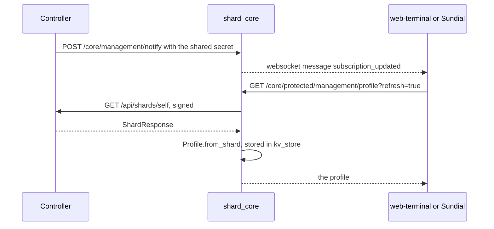
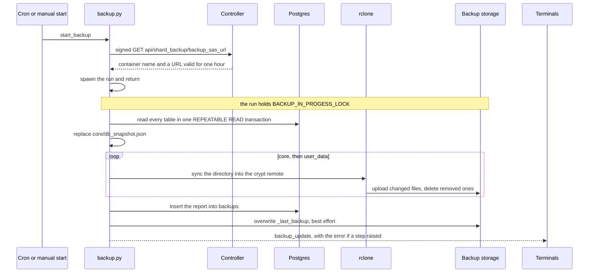
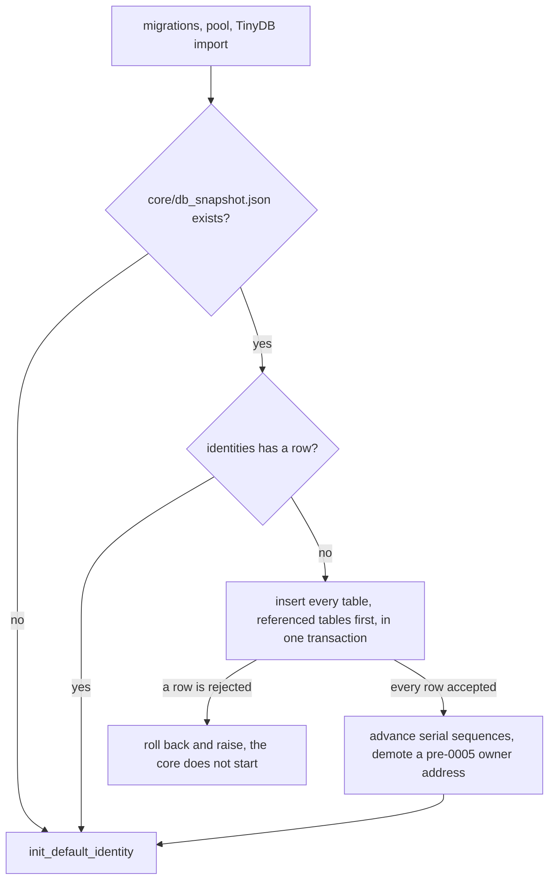
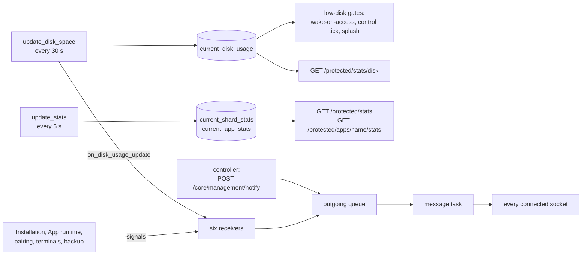

# Service concerns: concepts

The flat concerns of `shard_core/service/` share this file, one section each, in the order of the root module map, added as each concern is worked through; Terminals and pairing and the OIDC provider are not written yet. The repo-wide theory, including the invariants these sections refer to as "root", is in the root `CONCEPTS.md`.

## App runtime

App runtime is the only code that operates an installed app's containers and the only code that moves an app among the four statuses an app rests in between installation tasks (`RUNNING`, `PAUSED`, `STOPPED`, `DOWN`, the code's `_REVIVABLE_STATUS`): it revives an app when it is opened and on the control tick, pauses and stops idle apps, demotes one app per tick under memory pressure, takes every app down when the core stops, and provides the create and teardown primitives Installation calls.

### Files

`app_tools.py` holds the docker primitives. It also hosts three things other modules import that change no container: the manifest reader (`get_installed_apps_path`, `get_app_metadata`, `MetadataNotFound`, `enrich_installed_app_with_meta`), the size and version predicates that the start gate and the splash share, and the image prune. `app_lifecycle.py` holds the wake-on-access receiver and the control tick. `memory_pressure.py` reads memory pressure and pages a frozen stack out to swap. `pause_metrics.py` holds the accumulators for the **pause tier**, the `PAUSED` step between `RUNNING` and `STOPPED` that `apps.lifecycle.pause_enabled` switches on (#81). The file is kept apart from `telemetry.py` so that recording a transition does not import the controller client, whose import chain is cyclic.

Every compose call on an app goes through `util/subprocess.app_compose_command`, pinned to that app's compose file and project. The docker calls outside this module leave app containers untouched: the metrics sampler's `docker ps`, the splash and `call_peer` reading through the Docker SDK, and the registry login.

### Which statuses the runtime writes, and over what

The runtime writes only the four revivable statuses, and a write lands only on a row that still holds the status the operation was gated on. Every other status belongs to Installation. Installation takes a row by writing one of its statuses (an uninstall or reinstall request is accepted whatever the row holds) and hands it back by writing `STOPPED` at the end of an install or reinstall, by deleting it, or by leaving it in `ERROR`. Installation's statuses are its record of work in flight: the boot-time reconciliation reads them (the root invariant *Work that must survive a restart is a row*), and the worker's install and reinstall tasks refuse to start unless the row reads `INSTALLATION_QUEUED` or `REINSTALLATION_QUEUED`. A runtime write over one of them loses that record: a restart no longer resumes the work, and a reinstall still waiting in the queue is rejected when its turn comes. `UNKNOWN` is the model's default value; only the TinyDB import writes it.

A clean stop of the core also returns a row in `ERROR` to `DOWN` when its app still has a compose file. That is `ERROR`'s intended retry (root, *An app's status has one owner*), and the one write over a status outside the four revivable ones that the runtime is meant to make.

Three paths break the write rule today. The core's stop writes `DOWN` over every row whose app directory still holds a compose file, whatever its status, Installation's in-flight statuses included. `_uninstall_app` lets `docker_stop_app` and `docker_shutdown_app` write `STOPPED` and then `DOWN` over its own `UNINSTALLING` row before it deletes the row, and the tick's low-disk stop writes `STOPPED` over an `UNINSTALLING` row the same way. And every runtime write is an unconditional `UPDATE` issued after a docker call that can take seconds, so a status Installation writes in the meantime is overwritten.

The operations this module gates, and what decides how each one acts:

| Operation | Acts when the row holds | How it acts is decided by |
| --- | --- | --- |
| Revive, `start_app` | `RUNNING`, `PAUSED`, `STOPPED`, `DOWN` | The daemon's view of the containers |
| Pause, `docker_pause_app` | `RUNNING` | Nothing further |
| Unpause, `docker_unpause_app` | `PAUSED` | Nothing further |
| Stop, `docker_stop_app` | `RUNNING`, `PAUSED`, `UNINSTALLING` | The daemon, for the unfreeze before the stop |
| Down, `docker_shutdown_app` | `STOPPED`, `UNINSTALLING`, or any status with `force` | The daemon, for the unfreeze before the down |
| The control tick | Every row except `INSTALLATION_QUEUED` and `INSTALLING` | The tick's own snapshot, re-gated by each operation |

The row decides whether an operation may run; the daemon decides how a revive or a teardown acts (#185, #199). The status-to-operation mapping as a whole is one concept with one owner (root, *An app's status has one owner*).

### The revive

`start_app` is the only code that starts or wakes an app. Wake-on-access and the `always_on` branch of the control tick are its only callers. It acts only on a revivable row and then dispatches on the containers' real state. A running stack is left alone, and the row is set to `RUNNING` if it said otherwise. A paused stack is unpaused; if the unpause fails (some containers already exited), the revive falls back to `compose up -d`. Any other stack (exited, never started, or without containers) is brought up with `compose up -d`. Every path that acts ends with the row at `RUNNING` and an `on_apps_update` announcement. A revive is idempotent: on a running stack with a `RUNNING` row it does nothing. `_compose_up` recovers from two failures the Docker CLI reports by message text, a stale network reference (d66d889) and a container name already in use (#63), by running `compose down` and then `up -d` again.

A revive holds the per-app lock that Installation's uninstall and reinstall also hold across their teardown, so a revive can never recreate containers an uninstall or reinstall has just removed (#185). It runs at most once per five seconds per app: `@throttle(5)` is keyed on the app name (5c46231) and drops a call inside the window without retrying it, so a dropped revive waits for the next request, or for the next tick if the app is `always_on`. The throttle is what bounds the cost of waking an app. Every admitted request spawns a revive task, and without the throttle a page load of thirty parallel requests would start thirty compose processes. The revive reads the row fresh on every call that passes the throttle.

`ensure_app_is_running` is a receiver of `on_request_to_app`, which `/internal/auth` sends after it has admitted a request, and the handler awaits its receivers. Everything the receiver does before it spawns the revive task therefore runs on the auth path and is bound by the root invariant *The auth path does no per-request database work*. Today it is not met: while disk is not low, `size_is_compatible` reads the profile from `kv_store` through the pool on every admitted request. The receiver and the tick's `always_on` branch are two of the three sites of the root invariant *An app is started only where it can run*; the receiver refuses to revive on low disk, on a shard too small for the app, and on a shard too old for it. It records the access in `last_access_dict` only when those checks pass. That dictionary is the tick's idle clock; it lives in the process only (root, *Work that must survive a restart is a row*, and #133).

### The control tick

`control_apps` runs in a loop with `apps.lifecycle.refresh_interval` seconds between passes. It reads every row except those in `INSTALLATION_QUEUED` or `INSTALLING` once, runs one pass per app concurrently, and then makes at most one pressure demotion. A pass decides on the snapshot, and each operation it calls re-reads the row and re-applies its own gate, so a stale snapshot can cost an action but cannot cause one the row no longer permits.

Within one app's pass the order is fixed. Low disk stops the app and ends the pass; it applies to `always_on` apps too. An `always_on` app is then handed to `start_app` on every tick, provided the size and version predicates pass. Because the revive dispatches on the real state, an `always_on` app whose row says `RUNNING` while its containers are gone comes back without anyone opening it (#239). Every other app is placed by its idle time against two thresholds. T1, the pause threshold, is the manifest's `lifecycle.idle_for_pause` or `apps.lifecycle.default_idle_for_pause`. T2, the stop threshold, is the manifest's `lifecycle.idle_for_stop` or `apps.lifecycle.default_idle_for_stop`. With `apps.lifecycle.pause_enabled` off, or for an app that declares `skip_pause`, a `RUNNING` app is stopped at T2. With the flag on, a `RUNNING` app is paused at T1 and a `PAUSED` app is stopped at T2; #227 proposes dropping the timed stop of a paused app and leaving that transition to pressure alone. The manifest validator requires T1 below T2 only when the manifest sets both, so an app with an explicit T1 above the global T2 pauses at T1 and stops one tick later (#226).

With the flag off no code pauses an app, and the idle pass never stops a `PAUSED` row: such a row waits for a request, for low disk, or for the core's stop. That is the backout behaviour #145 chose for switching the tier off. Because the flag reaches shard_core through its environment, switching it also restarts the core, and a clean stop takes every app down.

Under memory pressure, with the flag on and the [PSI](https://docs.kernel.org/accounting/psi.html) `some avg10` value of `/host/pressure/memory` above `apps.lifecycle.psi_threshold`, the tick demotes one app by one tier and leaves the rest to the next tick, so a spike frees memory gradually. The victim is the [least recently used](https://en.wikipedia.org/wiki/Cache_replacement_policies#LRU) app, chosen among `RUNNING` apps first and among `PAUSED` apps only when no running candidate is left; pausing costs a user less than stopping, and paused apps would otherwise mostly look least recently used. `always_on` apps are never demoted. Neither is an app accessed within `RECENT_ACCESS_GRACE`, five seconds. A `RUNNING` victim that declares `skip_pause` is stopped. The grace must not be shorter than the revive throttle's window: an app demoted inside that window would have its next revive dropped, and the request would wait on a frozen stack.

An app whose manifest the tick cannot read must not cost the shard its demotion (root, *One app's unreadable manifest costs only that app*), because the demotion is what the pause tier relies on to free memory when the host runs short. The code does not meet this yet (#280): each pass and the demotion read the app's manifest first, the per-app passes run under an `asyncio.gather` without `return_exceptions`, and a single row without a readable `app_meta.json` (an `ERROR` row whose download failed, a reinstall that failed after deleting the old files) makes every tick end before the demotion, while the other apps' passes still run. `write_traefik_dyn_config`, which reads the same manifests, skips such an app with a warning.

### Pausing and paging out

A pause freezes the stack with `compose pause` and then pages its memory out. For each container `compose ps` lists, it writes the container's `memory.current` to the cgroup's [`memory.reclaim`](https://docs.kernel.org/admin-guide/cgroup-v2.html), off the event loop because the write blocks while the kernel pages out. Asking for all of `memory.current` practically always reclaims less than asked, and the kernel then answers `EAGAIN`, so `EAGAIN` is the expected end of a page-out and only other errors are logged as warnings. The recorded pause latency includes the page-out. An unpause is a `compose unpause`; the kernel pages memory back in as the app touches it.

The tier depends on two host mounts that the core's compose file must provide: the host cgroup v2 tree, read-write at `/sys/fs/cgroup`, and `/proc/pressure` at `/host/pressure`. The controller's core-version compose file mounts both (freeshard-controller#246). This repository's own `docker-compose.yml` mounts neither. It maps `PAUSE_ENABLED` only because the controller injects that variable, and #183 left it out of the self-hosting template on purpose. Without them, pressure reads 0.0 and never triggers a demotion, and a pause freezes the stack without paging it out, with one warning per container. `find_cgroup` is shared with Observability's metrics sampler.

### Teardown and the core's stop

`docker_stop_app` and `docker_shutdown_app` both unfreeze the stack first when the daemon reports it paused, because a frozen container can be neither stopped nor removed. A failed unpause (a partly paused stack) is logged and the teardown continues. This unfreeze is deliberately not recorded as a pause-tier transition: the stack is on its way down, not back to `RUNNING`. The allow-lists in the table above are also what keeps the control tick's low-disk stop, which calls `docker_stop_app` on every row the tick reads, off an app that is being reinstalled. That is why #199 passed `force` to the reinstall's teardown and left the lists unwidened. `set_status=False` lets a caller that owns the row's status for the whole of its task, today only the reinstall, change the containers alone; the primitive still announces. `force` exists for the two callers that must tear down whatever the row says: the reinstall and the core's stop.

`get_app_container_state` reduces a stack to one state: `paused` if any container is paused, `running` if all are running, `missing` if there are none, `exited` otherwise. It reports `missing` also when `compose ps` or `docker inspect` fails, so that a probe hiccup degrades a revive into a plain `up` (9f03ca6). A caller cannot take `missing` as proof that the containers are gone. It raises `ComposeFileNotFound` when the app has no compose file.

When the core stops, the lifespan first stops the background tasks, the tick and the installation worker among them, then calls `docker_shutdown_all_apps(force=True)`, and closes the database only after that. Every app with a compose file is taken down, whatever its status, so no app container outlives the core that manages it. The controller relies on this when it upgrades or moves a shard (freeshard-controller#494). A row in a revivable status becomes `DOWN`, which is what it then is, and so a clean restart does not leave `RUNNING` rows for the first tick to count as idle since the epoch. Revives already in flight are not part of the stop: their tasks sit in `app_lifecycle.background_tasks`, which the lifespan never awaits, and the down takes no lock.

The pause, stop and down primitives take no lock either. A revive that races a pause can leave the row at `PAUSED` over running containers; the next revive that passes the throttle finds them running and sets the row back, and that divergence is tolerated. A runtime write that replaces one of Installation's statuses is not tolerated (see above).

### Pause-tier telemetry

`pause_metrics` accumulates only while `telemetry.enabled` is set. It keeps per-app transition counts, the first 1000 pause and the first 1000 unpause latencies, and the first 120 pressure snapshots of a reporting interval. `telemetry.send_telemetry` packages them as the `pause_tier` field and resets them after a successful send; a restart loses them like every other counter. Transitions are recorded as `running_to_paused` for each pause, `paused_to_running` for each real unpause (a revive of a paused stack included), and `<status>_to_stopped` for each stop that writes its status. Cold starts and downs are not counted. The model's docstring, copied from the controller into `data_model/backend/`, describes `pause_tier` as absent from shards with the flag off; a stop records its transition whatever the flag says, and an uninstall's stop records `uninstalling_to_stopped`.

### Image prune

`docker_prune_images` runs `docker image prune -fa`, which removes every image no container references: with an age filter of `apps.pruning.max_age` hours on the `apps.pruning.schedule` cron schedule when `apps.pruning.enabled` is set, and without a filter from `POST /protected/settings/prune-images`. An app in `DOWN` has no containers, so a prune can remove its images and its next revive then pulls them again.

### Boundaries

App runtime owns the transitions among the four revivable statuses, every docker operation on an app's containers, the page-out of a frozen stack, the control tick and its pressure demotion, the pause-tier accumulators, and the image prune. It hosts the manifest reader and the size and version predicates for the rest of shard_core.

It relies on Utilities for `app_compose_command`, which pins every compose call to one app's file and project and never relies on the working directory, and for `throttle`, the signals and `PeriodicTask`, whose catch-all keeps the tick running after a pass raises. It relies on the HTTP surface to send `on_request_to_app` only for admitted requests, the wake path's only trigger. It relies on Installation to create an app's containers with `docker_create_app_containers` while the row is in one of Installation's statuses, to hand the row over by writing `STOPPED`, and to hold the per-app lock across its own teardown. It relies on the composition root to start the tick after the boot-time reconciliation and the profile refresh, and to stop it before taking the apps down. From Observability it reads the disk snapshot's `disk_space_low`. Controller integration's telemetry sender reads and resets the accumulators, and from Controller integration it reads the stored profile for the size predicate (the root's *Deployment mode is explicit* records how that predicate infers the mode). From the host it needs the cgroup v2 tree, PSI and swap.

Of the root invariants it keeps true:

- *Every change to an installed app is announced*: its four write sites (`_mark_running`, `docker_pause_app`, `docker_stop_app`, `docker_shutdown_app`) announce.
- *An app is started only where it can run*: two of the three sites are here.
- *An app's status has one owner*: most of the sites the root lists are here, five gates in `app_tools.py` (one of them the uncalled unpause gate) and three branches in `app_lifecycle.py` (#271).
- *One app's unreadable manifest costs only that app*, for the control tick: currently broken, because one unreadable manifest ends every tick before its demotion (#280).
- *Deployment mode is explicit*, for `size_is_compatible`: currently broken, because the predicate infers the mode from the controller's answer (#270).
- *The auth path does no per-request database work*, for its wake-on-access receiver: currently broken by the profile read.
- *Work that must survive a restart is a row*: by writing only over the revivable statuses, currently broken by the three paths above.
- *The lifespan order is load-bearing*: the tick starts in step 7, after the installation worker, and the apps go down after the background tasks have stopped and before the database closes.

### Constraints

Recorded from the maintainer on 2026-11-09, from decisions taken at triage on 2026-06-29.

**Rejected alternatives.**

- Caching the app status for the revive, reverted in PR #90's review on 2026-05-22.
- Sablier middleware to hold requests while an app cold-starts (#71).
- CRIU checkpoint and restore to remove cold-start latency (#72).

Cold-start latency is addressed by the pause tier (#81) and by reducing apps' idle footprint (#109).

## Routing

Routing decides what Traefik does with every request that reaches the shard. It compiles every router, middleware and service shard_core needs, and the request for the one certificate they share, into a single file built from the routable apps, the default identity's domain and two settings. It rewrites that file at boot and whenever an install, reinstall or uninstall has finished with the app's containers, and it renders the static configuration Traefik starts with.

### Files

`service/traefik_dynamic_config.py` holds `compile_config`, which turns its inputs into the dynamic configuration without touching the database or the disk; it reads `traefik.disable_ssl` and `sundial.enabled` from the settings. `data_model/traefik_dyn_config.py` is the model it fills, generated in 2022 from the Traefik v2 file-provider JSON schema and then patched by hand with `authResponseHeadersRegex` (deddb3d). That patch is why `scripts/generate_traefik_dyn_config_model.py` refuses to run: a regeneration would drop the field the app middleware depends on. `write_traefik_dyn_config` and `NOT_ROUTABLE_STATUS` live in `app_installation/util.py`; the writer gathers the inputs, calls `compile_config` and writes the file. The static configuration is `data/traefik.yml`, or `data/traefik_no_ssl.yml` when SSL is disabled, rendered by `_copy_traefik_static_config` in `app_factory.py`.

### Two configurations, read at different times

The static configuration holds the entrypoints, the providers, the certificate resolver and the API. shard_core renders it on every process start, in `create_app` before the lifespan runs, to `core/traefik.yml`; its one template variable is `traefik.acme_email`. Traefik reads it once, when Traefik itself starts, from `$XDG_CONFIG_HOME/traefik.yml` ([v2.11 configuration overview](https://doc.traefik.io/traefik/v2.11/getting-started/configuration-overview/)): both compose files, this repository's and every core-version compose of the controller, set `XDG_CONFIG_HOME=/core` and mount the shard's `core/` directory at `/core` in Traefik as well as in shard_core. The dynamic configuration is `core/traefik_dyn/traefik_dyn.yml`, written under `settings().path_root` like everything else shard_core writes. Traefik's file provider watches the directory `/core/traefik_dyn` and reloads on every change. The paths inside the static file are Traefik's own view, as the root invariant *Paths are resolved on the side that uses them* requires.

Both compose files start Traefik only once shard_core reports healthy, which it can do only after the lifespan has finished, so a full start of the stack gives Traefik a freshly rendered static file and a written dynamic file. A restart or recreate of shard_core alone leaves Traefik on the static file it started with. A core upgrade takes the whole stack down and up, so a changed template reaches Traefik then. A change to `traefik.disable_ssl` or `traefik.acme_email` that recreates only shard_core does not reach it. For `disable_ssl` the two files then disagree: the dynamic file moves every router to the entrypoint and TLS setting of the new mode while Traefik still runs the old one, and the shard serves nothing until Traefik restarts.

The dynamic file is the complete routing table: Traefik routes what shard_core writes there and nothing else. The [Docker provider](https://doc.traefik.io/traefik/v2.11/providers/docker/) that the static configuration still enables is a leftover of the label routing that ended in 2022, when the app routers moved into the file (2568cad). It is to be removed together with Traefik's Docker-socket mount, which only the provider uses (root, *Constraints*, decided 2026-11-10, #274). *(Confirmed 2026-11-10 — the code cannot tell a leftover provider from one kept for containers outside this repository.)* No app in the store's history and no core service in any compose file carries a Traefik label. Until the provider is removed, the file is not the complete table: a labelled container on the host can add routers beside the file's, and on a shared host the provider picked up a neighbour's containers (#196).

### Entrypoints and certificates

The static configuration defines three entrypoints: `http` on :80, `https` on :443 and `mqtt` on :8883, the ports the root's Constraints allow Traefik alone to publish. The API's insecure mode opens one more listener, published nowhere but reachable from the `portal` network (root, #198). With SSL, `http` redirects every request to `https` at the entrypoint. Traefik implements that redirect as a router of priority MaxInt−1 ([v2.11 entrypoints](https://doc.traefik.io/traefik/v2.11/routing/entrypoints/)), so no router bound to `http` is ever reached, and every HTTP router binds `https`. The manifest's vocabulary differs from these names: an `entrypoint_port` of `http` means HTTPS on 443, and `mqtt` means MQTT over TLS on 8883.

`http` and `https` carry a `readTimeout` of 300 seconds and no `writeTimeout`, so that connections which never complete a request are reaped while long downloads and server-sent events run on (fd1d05b, #108). The `mqtt` entrypoint is TCP, where these timeouts do not apply.

Every router, HTTP and TCP alike, names the resolver `letsencrypt` and the same `tls.domains`: the shard's domain, with the SAN `*.<domain>`. `tls.domains` takes precedence over a router's Host rule ([v2.11 ACME](https://doc.traefik.io/traefik/v2.11/https/acme/)), so Traefik requests one certificate per shard, covering the domain, every app subdomain and `traefik.<domain>`, and installing an app needs no new certificate. A wildcard can be issued only over the DNS-01 challenge, so the resolver has to use a DNS challenge, as the README explains. Nothing ties the two files together on this point. The certificate and the ACME account live in `core/acme.json`.

The DNS provider is fixed in the template as `azure`, and the template ships inside the image. Traefik v2.11 documents `azure` as deprecated in favour of `azuredns`; the lego bundled with recent v2.11 patches refuses it unless `LEGO_AZURE_BYPASS_DEPRECATION=true` is set, and later patches removed it (#146). This holds the hosted shards off current v2.11 patches, and their compose sets that variable. This repository's compose runs v3.6 and sets neither the variable nor any DNS credentials, so as shipped, with SSL enabled, its resolver obtains no certificate.

### SSL disabled

`traefik.disable_ssl`, which the compose file sets from `DISABLE_SSL` in `.env` and the README reserves for local testing, switches both configurations. The static template becomes `traefik_no_ssl.yml`: `http` and `mqtt` only, with no `https`, no redirect and no resolver. Every HTTP router binds `http` and carries no `tls`. The two templates repeat their shared parts (the providers, the API, the timeouts), so a change to one of those has to be made in both, as fd1d05b did. A TCP router then loses its TLS but keeps its `HostSNI(<app>.<domain>)` rule, and Traefik accepts a host name in `HostSNI` only on a router with TLS ([v2.11 routers](https://doc.traefik.io/traefik/v2.11/routing/routers/)), so in this mode an app's MQTT entrypoint has no route. The same flag decides the scheme of the OIDC issuer and of the shard URL in the welcome log, outside this module.

### Which router serves a request

The file always holds five routers: `shard_core_public`, `shard_core_private` and `shard_core_management` for the three `/core/` prefixes, `traefik` for the dashboard, and the catch-all. Each routed app adds `<app>_http` if it has an HTTP entrypoint and `<app>_mqtt` if it has an MQTT entrypoint, each with a service of the same name. No fixed router or service name ends in `_http` or `_mqtt`, so no app name can collide with them.

| Request | Routers whose rule matches | Served by |
| --- | --- | --- |
| `<domain>/core/public/...`, `/core/protected/...` or `/core/management/...` | that core router, the catch-all | the core router |
| any other path on `<domain>` | the catch-all | the UI |
| `traefik.<domain>/...` | the dashboard router, a core router for `/core/...`, the catch-all | the dashboard |
| `<app>.<domain>/core/...` of a routed app | the app's router, the core router, the catch-all | whichever rule is longer (#191) |
| any other path of a routed app | the app's router, the catch-all | the app |
| any other host, the bare IP and subdomains without a router included | a core router for `/core/...`, the catch-all | shard_core for `/core/...`, the UI otherwise (#230) |

Only the catch-all carries an explicit priority, 1. Every other router has Traefik's default priority, the length of its rule string ([v2.11 routers](https://doc.traefik.io/traefik/v2.11/routing/routers/)). The dashboard's rule is longer than every core router's for any domain of nine characters or more, and longer than the rule an app named `traefik` would get, so such an app is routed but never reached; the name is reserved nowhere else.

The core routers carry no Host matcher, so they answer on every host. For `/core/public` that is load-bearing: the controller's provisioning reads the shard's `whoareyou` at its bare IP address, before the shard's DNS record exists. On an app's host, `<app>.<domain>`, the app's router serves every path: no client calls `/core/...` on an app's host, and both UIs call it on the host they are served from, the shard's domain. The code meets this only through rule length, which holds on `config.toml`'s zone but not on every zone a self-hoster may choose (#191).

An app has one host, so it can have one router of each kind. A manifest that lists two entrypoints of the same kind gets the last one, silently; no store app lists two.

### Middleware chains

The core routers apply `strip` first, which removes `/core/` so the path arrives as `/public/...`, `/protected/...` or `/management/...`, where the HTTP surface mounts its routers. They then apply the admission middleware the root's table lists. An app's HTTP router applies `app-error` and then `auth`.

`auth` asks `/internal/auth` and copies headers back with `authResponseHeadersRegex: ^X-Ptl-.*`. Traefik strips every request header that matches the expression and then copies the matching headers of the auth response onto the request ([v2.11 ForwardAuth](https://doc.traefik.io/traefik/v2.11/middlewares/http/forwardauth/)). So a per-path header in an app's manifest reaches the app only when its name starts with `X-Ptl-`, as every store app's does. Traefik passes the request's host and URI to `/internal/auth` as `X-Forwarded-Host` and `X-Forwarded-Uri`, and the middleware leaves `trustForwardHeader` unset. The HTTP surface takes the app's name from the first label of that host, the label the rule `Host(<app>.<domain>)` matched. A browser sends the host in lower case while the router's host and the app's row keep the name as written, so an app whose name contains a capital letter, which the zip validation allows, cannot be reached.

`app-error` hands every response with a status in 500–599, or 401, to shard_core's `/internal/app_error/{status}`, which renders the splash. Traefik forwards the client's Host header to it by default ([v2.11 ErrorPages](https://doc.traefik.io/traefik/v2.11/middlewares/http/errorpages/)), which is how the splash knows which app it is for. Because `app-error` comes before `auth`, it also covers the forwardAuth's own 401 and turns it into the "Access Denied" page. Since 8f9b4c3 (#235) all other client errors reach the browser as the app sent them. An app's own 401 is still replaced, and #236 proposes deciding by the client's `Accept` header instead.

No router forwards to shard_core outside the three `/core/` prefixes. The only requests that reach `/internal` through Traefik are those Traefik makes itself: the three forwardAuth checks and the error page. This is what keeps `/internal` unrouted (root, *Admission is decided at the proxy*).

### MQTT

An MQTT entrypoint becomes a TCP router on the `mqtt` entrypoint, matching the SNI `<app>.<domain>`. Traefik terminates TLS with the shard's certificate and opens a plain TCP connection to `<container_name>:<container_port>`, which is 1883 for the store's mosquitto. This TCP router carries no middleware, so the connection is admitted without asking shard_core. It never reaches `/internal/auth` either, so MQTT traffic neither wakes a stopped app nor counts as an access on the control tick's idle clock. An app whose clients arrive only over MQTT is therefore reachable only if its manifest declares `always_on`. The store's authoring guide asks this of messaging apps, mosquitto declares it, and nothing in shard_core checks it. When no routed app has an MQTT entrypoint, the TCP section is left out of the file, because, as the code records, Traefik cannot handle the empty objects (d36ba31).

### The root UI

The catch-all is named `web-terminal` whatever it serves: `PathPrefix(/)` at priority 1, pointed at the `sundial` service when `sundial.enabled` is set and at `web-terminal` otherwise. Both services are always defined, the unused one referenced by no router, and only the tests read the router's name. Sundial replaces web-terminal at the root and is not mounted beside it (see Constraints); it serves at `/` natively, so the swap needs no prefix stripping (PR #244). Settings are read once per process, so the switch takes effect at the boot that follows the change, whose rewrite carries it. Both UIs call the API at `/core/...` on the host they are served from and open an app at `<app>.<location.host>`, which is the app's host only when the UI is served from the shard's domain.

### When the file is rewritten

`write_traefik_dyn_config` reads every row whose status is not in `NOT_ROUTABLE_STATUS` (`INSTALLATION_QUEUED`, `ERROR`, `UNINSTALLATION_QUEUED`, `UNINSTALLING`) and loads each one's manifest. A manifest it cannot load is skipped with a warning, so that one broken row cannot stop the boot (155ee52, #158). It then reads the default identity, compiles, and writes the whole file. It has three callers. The lifespan calls it at step 4, after the reconciliation of interrupted installs and uninstalls (root, *The lifespan order is load-bearing*). The worker calls it at the end of `_install_app_from_zip`, once the app's containers exist (4c94e5e moved it after their creation), which every store install, zip install and reinstall passes through. And `_uninstall_app` calls it after deleting the row and before announcing the change. The boot's write completes before the worker starts, and the worker runs one task at a time, so two writes never overlap.

The routed set is therefore a snapshot taken at the last write. No status write rewrites the file, and `/internal/auth` admits a request without looking at the app's status, so `NOT_ROUTABLE_STATUS` takes effect only at the next write; #200 (its fourth item) proposes rewriting on every `on_apps_update`. `INSTALLING` and `REINSTALLING` stay routable because the install writes the file while the row holds them, and the row then becomes `STOPPED` without another write. An app being uninstalled keeps its router until its row is gone, unless a write from an earlier task in the queue, or a boot, drops it first. A reinstall that fails leaves its app routed in `ERROR` until the next write, which may come from an unrelated install. A clean stop's `DOWN` over an `ERROR` row (root, *An app's status has one owner*) gets the app routed again at the next boot, provided its manifest is still readable.

The domain is read at every write as well, and nothing writes when it changes. `POST /protected/identities/{id}/make-default` changes the default identity and announces `on_identity_update`, which the routing does not receive. The routers keep naming the old domain until the next write, which then moves every router, and the certificate request, to the new one. The settings change only with a restart, which the boot's write covers.

Traefik applies a write when its file provider is notified of it. After each reload it waits two seconds by default before taking further changes, and keeps only the latest of those ([v2.11 providers](https://doc.traefik.io/traefik/v2.11/providers/overview/)). The install sets `STOPPED` and announces it right after its write, so a client that opens the app straight away can reach the catch-all before the app's router exists (#230). The write itself truncates the file and then fills it in two writes (#228). A reload that lands in between sees no routers at all, shard_core's own included. A write that fails part-way leaves only a fragment of the file, and the previous configuration is lost.

### Boundaries

Routing owns the dynamic file and everything in it: the routers and their precedence, the middleware chains, the services and the certificate request. It also owns the routability filter and the static templates with their render. It keeps no state between writes; every write recomputes the whole file from its inputs.

It relies on Installation to call the writer once an app's containers exist and once a row has been deleted, and on the composition root to call it at step 4 and to run `create_app` before the lifespan. It reads manifests through App runtime's `get_app_metadata` and the domain through Identity's default identity and the `dns` settings. It relies on the HTTP surface for the four `/internal` endpoints its middlewares name, and for mounting the HTTP surface's routers at the paths `strip` leaves. From the compose files it needs the container names `shard_core`, `web-terminal` and `sundial` on the `portal` network, `core/` mounted at `/core` in both Traefik and shard_core, `XDG_CONFIG_HOME=/core`, Traefik starting after shard_core is healthy, the three published ports, and the DNS provider's credentials. From each app it needs a `container_name` on `portal` for every entrypoint, a name in lower case, per-path headers named `X-Ptl-*`, at most one entrypoint of each kind, and `always_on` if the app is reached only over MQTT. From the controller it needs the DNS record for the domain and a Traefik that still accepts `azure`.

Of the root invariants it keeps true:

- *Admission is decided at the proxy*: it compiles every router shard_core has, every HTTP app router carries `auth`, and `/internal` is reached through Traefik only by Traefik's own checks and the error page. Until the leftover Docker provider is removed, a labelled container can add routers beside these.
- *Un-pairing takes effect on the next request*: the dashboard sits behind `auth-private`.
- *An app's status has one owner*: `NOT_ROUTABLE_STATUS` is one of its sites, and it takes effect only when the file is written.
- *Paths are resolved on the side that uses them*: the static file's paths are Traefik's, the writer's are shard_core's.
- *The lifespan order is load-bearing*: the boot's write follows the reconciliation, and the static file is rendered before the lifespan begins.
- The Traefik v2/v3 constraint: the dynamic file loads under both, with the dashboard's `HostRegexp` as the one rule v3 reads differently. The static file's `azure` provider holds the hosted shards off current v2.11 patches and keeps this repository's v3.6 compose from obtaining a certificate.

### Constraints

From the written record, each decided by the maintainer:

- The root UI is switched between web-terminal and Sundial by a configuration override from the controller, and is never served at a path of its own (PR #171).
- shard_core does not proxy app traffic to enrich the splash page with the app's own response (PR #92, for #91).
- `data_model/traefik_dyn_config.py` is never regenerated from the schema, because the model was patched by hand (deddb3d).

## Identity and signing

Identity and signing owns the shard's RSA identities and their avatar images, derives the shard's ID and domain from the default identity, and signs every call to the controller and every `/internal/call_peer` request with it. What the rest of shard_core and every counterparty build on is that the shard's ID is the hash of its public key: the ID names the shard and authenticates it at once, so the key cannot change without the shard becoming another shard.

### Files

`identity.py` creates the default identity on first boot, reads it, updates an identity's name and description, switches the default, and seeds the default identity's name from the controller's profile when a pairing leaves one terminal. `crypto.py` wraps the `cryptography` package for RSA-4096 key generation, PEM serialization and the hash ID, and `human_encoding.py` turns the hash into characters; its `decode` has no caller outside the tests. Both were copied from the `common_py` library when shard_core dropped that dependency (433d371). The copy brought along a raw RSA-PSS sign and verify pair over SHA-256 and two AES-OFB helpers, which nothing outside the tests has ever called. `signed_call.py` signs outgoing HTTP requests. `assets.py` is a file store under `core/assets/`, and `avatar.py` finds an identity's avatar in it. `data_model/identity.py` holds four models: `Identity`, the stored row plus the computed `short_id`, `public_key_pem` and `domain`; `OutputIdentity`, what HTTP responses carry; `SafeIdentity`, what app templates see; and `InputIdentity`, the body of `PUT /protected/identities`. The routes that expose all of this, `web/protected/identities.py` and `web/public/meta.py`, belong to the HTTP surface.

### The shard ID

The ID is computed once, when `Identity.create` generates the key, and stored as the row's primary key; nothing on the shard recomputes its own ID from the key afterwards. The encoding maps every 5 bits to one of 32 characters, `abcdefghjklnpqrstvwxyz0123456789`, and pads the last group with zero bits, so a 512-bit digest becomes 103 characters, all lowercase.

The ID is a self-certifying name (root, *Pattern glossary*).

The derivation is a wire contract. The controller recomputes IDs with its own copy of the library that `crypto.py` and `human_encoding.py` were copied from, so the hash, the PEM serialization of the public key and the alphabet must stay as they are on both sides. A change to any of them breaks every recomputation of an ID: a new shard would fail the controller's check, and every existing peer key would be rejected. The stored ID itself is never recomputed. Nothing checks the two copies against each other, and the tests derive IDs only from freshly generated keys, so they would pass after such a change. The copies are kept in step by hand: both repositories pin `bitstring<5`, because bitstring 5 removed the `BitArray(bytes=...)` form that `human_encoding.encode` uses (6eb1ef8). The alphabet is module state, set by `init()` when the module is imported; calling `init()` again replaces it for the whole process, which only the tests do.

### The short ID and the domain

The short ID, the ID's first 6 characters, is the shard's name outside the shard. It is the key ID of every signature the shard makes, the prefix under which the controller and peers look the shard up, the DNS label the controller creates for a hosted shard, `portal.short_id` in app templates, and what people exchange to peer. The controller keeps it unique among the shards it manages (freeshard-controller#350).

The domain is not stored on the shard. `Identity.domain` computes it from the settings on every access: the ID's first `dns.prefix_length` characters, lowercased (a no-op for this alphabet), under `dns.zone`. A change of zone therefore takes effect at the next boot without touching a stored row. On a hosted shard the controller creates the DNS record from the first 6 characters whatever `prefix_length` says, and its uniqueness check mirrors that default, so `prefix_length` must stay 6 there; nothing sets it to anything else. Peers and both UIs address another shard as `https://<short ID>.freeshard.cloud` regardless of either setting (`peer.update_peer_meta`), and `call_peer` relays to `https://<app>.<id>.freeshard.cloud/<rest>` with the ID the caller passes. That holds for hosted shards only; the owner of a self-hosted shard would have to hand out its address (#167).

Every consumer of the default identity reads it at its own time:

| Consumer | Reads the default identity | Sees a change |
| --- | --- | --- |
| `whoareyou`, `GET /protected/identities/default`, `signed_request` | On every request or call | At once |
| The cookie domain a pairing sets | On every pairing | At once |
| `portal` in the per-path header templates of `/internal/auth` | Through `_identity_cache` | At the next `on_identity_update` |
| The Traefik dynamic config: app routes, dashboard rule, certificate domains | On every write: boot, install, reinstall, uninstall | At the next write |
| `portal` in compose templates and OIDC redirect URIs | On every render: every app at boot, one app at its install or reinstall | At the next render |
| The OIDC provider's issuer | Once per process, at the first OIDC request | At the next restart |
| The owner user's display name | Once, when the owner row is created | Never |

Outside the boot-time database paths, `on_identity_update` follows every write that can change the default identity's row (`init_default_identity`, `make_default`, `update_identity`), and its one receiver drops `_identity_cache`. That keeps the auth path's identity lookup out of the database (root, *The auth path does no per-request database work*). Nothing else reacts to the signal, which is sound only because the key does not change.

### One identity for the life of the shard

`init_default_identity` creates the first identity, flagged default, when the `identities` table is empty, and returns the default otherwise. It runs after the snapshot restore and the TinyDB import, so a restored shard keeps its key, ID and domain (root, *A backup restores the shard as it was*). Exactly one row is flagged default. The schema does not enforce this: `is_default` has no unique index, `get_default` returns whichever flagged row Postgres yields first, and a table without a flagged row makes every reader of the default identity raise, the boot included. Every reader also needs the default row to load as an `Identity`, and today the identity update does not guarantee that. The code keeps the single flag: the first identity is created flagged, and `make_default` clears one flag and sets the other in a single transaction.

The shard's key and its ID are fixed for the shard's life, and its domain follows from the ID and the zone setting (see Constraints). The counterparties are built on it. The controller binds the key to the full ID and checks it when a shard moves (freeshard-controller#345, #480). Peers pin a peer's key to its full ID after first contact; today the peer binding compares only the typed prefix, usually the short ID, which the Peers section records as a violation of that decision (see Peers).

Two operations contradict this. `PUT /protected/identities` without an `id` creates a further identity with its own key, and `POST /protected/identities/{id}/make-default` makes it the default. A further identity has no function: nothing signs with it, since `signed_request`'s `identity` parameter has had no caller since it was added (ff9d825); nothing publishes it; and neither web-terminal nor Sundial creates, lists or switches identities. A switch cuts the shard off from everything above. The controller knows no shard under the new short ID and answers every signed call with 401, so the next profile refresh stores no profile, which the size gate reads as admitting every app (root, *Deployment mode is explicit*). `whoareyou` changes at once, and new pairings set their cookie for a domain the browser is not on. On a hosted shard the app routes and the certificate move at the next Traefik write to a name with no DNS record, and the templates and the OIDC issuer follow at the next boot.

### What is public and what is secret

An identity is the shard's public profile. `GET /public/meta/whoareyou` publishes the default identity without authentication as an `OutputIdentity`: ID, name, description, `is_default`, public key and domain. The Public page of both UIs warns that name and description are public, and migration 0005 dropped the identity's email column because a personal address has no place there (see Constraints). The controller, peers and both UIs read the endpoint: a peer parses the whole `OutputIdentity` on every refresh, and the UIs read it to show the shard and to notice that it is back after a restart. Its fields are therefore an interface. The default identity's avatar is public as well, at `GET /public/meta/avatar`.

The private key leaves the `identities` table in two directions only: into `signed_request`, and into `core/db_snapshot.json`, which the backup writes before each run, keeps on disk between runs and carries off the shard encrypted. Both hold it in the clear, as the shard holds most of its secrets; the owner's email confirmation token and the OIDC codes and tokens are stored only as digests. #211 discusses that posture for the OIDC signing key, and why the AES-OFB helpers in `crypto.py`, an unauthenticated mode, are no answer to it. What keeps the key out of HTTP responses is the response model alone. Every route that returns an `Identity` declares `OutputIdentity`, and FastAPI drops the fields that model lacks; a route that returned an `Identity` without one would publish `private_key`.

Apps see the default identity as a `SafeIdentity`, rendered as `portal` into compose templates, per-path header templates and OIDC redirect URIs, and carrying no private key (0fc7cac). Its four fields, `portal.domain`, `portal.id`, `portal.short_id` and `portal.public_key_pem`, are documented for app developers ([docker-compose template](https://docs.freeshard.net/developer_docs/docker_compose_template/)), so renaming or dropping one breaks published apps. All four are public, so none of them is a secret; per-app secrets come from the templates' `secret()` function (#138).

### Signing

`signed_request` is `requests.request` with a signing hook, run in a worker thread. On every call it reads the default identity from the database, and the hook signs with [HTTP Message Signatures](https://www.rfc-editor.org/rfc/rfc9421.html#section-3.3.1) as `rsa-pss-sha512`, with the short ID as key ID. A signature covers the method, the authority, the target URI including its query, the `Date` header and, for a request with a body, a SHA-256 `Content-Digest` of it; `Content-Type` is not covered. It carries a `created` time and no nonce or expiry. A verifier must reject a replayed signature and one older than the call needs; neither the controller's (freeshard-controller#519) nor `peer.verify_peer_auth` does today. The request is sent with `stream=True`, which `/internal/call_backend` and `/internal/call_peer` need to pass the answer through as it arrives (5359ad2, #38), and with no timeout, so the caller waits as long as the counterparty holds the connection (root, *The lifespan order is load-bearing*). Callers catch the exception types of `requests`, so the HTTP client is part of the interface.

The authority a shard's signature carries, and how far shard_core may lend it, are set out in the root's *The controller is one signed counterparty*. App usage reports, which still go to the old backend (#208), are signed too. Of the exchanges with the controller and peers, the one without a signature is the peer-key refresh.

### The owner's name from the profile

`enrich_identity_from_profile` receives `async_on_first_terminal_add`, which the pairing route sends when a pairing leaves exactly one terminal. It refreshes the profile and, when the profile names an owner, sets the default identity's name to it, which seeds the shard's public profile with the name the controller recorded when it assigned the shard (798d758, "enrich default identity from profile during first pair"). The seed belongs to the shard's first pairing; afterwards the name is the owner's to edit on the Public page. The code meets this only at the first pairing. The signal fires again whenever every device has been removed and one is paired again, and the name is then reset to the controller's record over whatever the owner set. The same handler writes the owner's candidate address; People and owner email specifies that transition. What the handler does when the profile refresh fails is in that section too.

### Avatars

An identity has at most one avatar, the file `core/assets/avatars/<ID>.<extension>`, which lies under `core/` and so travels with the backup. `find_avatar_file` finds it by the ID; more than one file for an identity is logged and treated as none. An upload replaces the identity's previous avatar whatever that one's extension. Avatars are served from the shard's own origin: the default identity's to anyone at `/public/meta/avatar`, any identity's to a terminal at `/protected/identities/{id}/avatar`. So an avatar operation touches only the file of the identity it names, and an avatar is inert image data. The upload does not guarantee either today.

### Boundaries

Identity and signing owns the `identities` rows and the key material in them, the ID derivation and its codec, the signature on every request the shard sends as itself, the four identity models, and the avatar files.

It relies on Database for the `identities` table and for one transaction per `db_conn()` block, committed when the block exits. Others reach the table past this module: the HTTP surface inserts new identities itself (`put_identity`), and five sites read the default identity from `database/identities` directly, bypassing `get_default_identity`: the auth handler, the pairing route, the owner bootstrap, and the template render and the Traefik write in `app_installation/util.py` (root, Unresolved forks, *Layering*). It relies on the HTTP surface to declare `OutputIdentity` on every route that returns an identity, and on Backup for the only off-shard copy of the key. From Controller integration it uses `refresh_profile` and the profile's owner fields. The pairing route sends the signal the enrichment receives, and Terminals and pairing mints terminal IDs with `human_encoding.random_string`, which draws from the non-cryptographic `random` module (#253). People and owner email receives the pending email the enrichment seeds; its owner row took its display name from the default identity once, when the row was created, and the two names are independent after that. The controller, peers and both UIs read `whoareyou`. The controller and Peers recompute IDs, Peers with this module's code and the controller with the library it was copied from.

Of the root invariants it keeps true:

- *The auth path does no per-request database work*, for the identity lookup: every write to the default identity's row sends `on_identity_update`, the only invalidation of `_identity_cache`.
- *A backup restores the shard as it was*: the first identity is generated only on an empty table, after the restore.
- *The controller is one signed counterparty*: every request the shard sends as itself carries the default identity's signature and short ID.
- *The lifespan order is load-bearing*: the default identity exists before the owner user, the Traefik config and the compose templates, which are all built from it.

### Constraints

From the written record:

- Shard keys are never rotated, so a shard's key and ID are fixed for its life, and its domain follows from the ID and the zone setting (the maintainer ruling recorded in freeshard-controller#345, 2026-07-04).
- No personal address goes on an identity, because `whoareyou` publishes it (migration 0005, #220).

## People and owner email

People and owner email owns the people on the shard, today only its owner, and the owner's address as it moves from unverified candidate to verified address. It is also the only shard code that writes the controller's copy of that address, `shards.owner_email`, on its own behalf, and that copy is the one the controller mails. Two other writers touch the shard's copy: `identity.enrich_identity_from_profile` seeds the candidate from the controller's profile, and the boot-time database paths seed or demote it.

### Files

`service/user.py` holds `ensure_owner_user`, the lifespan step that creates the owner on a fresh shard. `service/owner_email.py` holds every runtime transition of the address but one, the first-pairing seed in `identity.py`. It also holds the confirmation token, the send budget, and the module's three calls into `freeshard_controller.py`: `send_verification_email`, `relay_email_to_owner` and `set_owner_email`. `data_model/user.py` holds `User`, the row; `OutputUser`, which carries the candidate and never the token; `InputUser`, the validation of what a client may write; and `Role`.

Two of the module's guarantees live in the SQL of `database/users.py`: `claim_email_token` spends a token in one conditional `UPDATE`, and `promote_pending_email` promotes only the candidate the token was spent on. The routes, `/protected/users/me` with its two sub-routes and `/public/users/confirm-email`, belong to the HTTP surface; this section records what the module needs from them.

### The people on the shard

The `users` table holds the shard's people. Today it holds exactly one, the owner, with role `owner` and username `owner`. Members are planned for the later phases of #141, and no code creates one. At most one owner can exist, because every path that creates one inserts the username `owner`, which is `UNIQUE`; `db_users.get_owner` selects by role.

The owner exists before any terminal can be paired, because pairing binds the new terminal to it and `web/public/pair.py` uses the owner row without checking for it. Each boot path creates it at a different point. On a fresh shard it is `ensure_owner_user`, which the lifespan runs right after the default identity (root, *The lifespan order is load-bearing*, step 2). On a shard upgraded to 0.42 it is migration 0002, which creates it from the default identity and binds every existing terminal to it. On a shard still holding its pre-Postgres data it is the TinyDB import's `_ensure_owner_user`, which #225 judges unreachable. On a restored shard it is the snapshot's own row; a snapshot written by 0.40.1 to 0.41.3 carries none, and one that holds a terminal fails to restore before anything could create one (see *Seeding from outside the module*).

Every terminal belongs to a user (`terminals.user_id` is `NOT NULL`), and the person behind a request is resolved through its terminal: `/protected/users/me` and the OIDC provider both read the terminal's `user_id`. Every pairing binds to the owner, so every terminal is the owner's.

A user's `id` is its OIDC subject: `sub` is the id as a string. It is a database counter and deliberately not derived from the shard's identity hash, because the shard and its owner are separate things (the maintainer's review of #147). Apps link their accounts to that `sub`, so the id must survive a restore, and it does: the snapshot restore inserts users with their ids and advances the sequence past them.

The owner's `display_name` is copied from the default identity's name when the row is created and is changed afterwards only through `PATCH /protected/users/me`; nothing keeps it in step with the identity. The OIDC provider emits it as the `name` claim. On a shard upgraded to 0.42 the copy is the name the identity held at the upgrade, set from the controller's profile at its first pairing or edited since on the public page. On a fresh shard the row is created before any pairing, so the copy is the identity's placeholder, `Shard Owner`, and the first pairing renames the identity but not the user. That placeholder is needed, because the controller usually does not know the owner's name at that point. A name the owner sets reaches every app automatically, and no app keeps the placeholder. *(Confirmed 2026-11-10 — the code cannot show whether the placeholder is meant to reach apps.)* How an app receives the name is the OIDC provider's design. Today nothing carries a rename to apps: the provider reports the current name only in the tokens and userinfo answers it issues afterwards, so an app that took the placeholder at its first login keeps it unless it asks again, and web-terminal has no control to rename the owner at all. Sundial edits the name and tells the owner it is separate from the public page's.

`disabled` and `password_hash` have no writer. They are scaffolding for the login page and the members of #141's later phases, and `password_hash` is not on the model at all. `disabled` is read in two places: every `/protected/users/me` route refuses a disabled user with 403, and the OIDC provider treats one as absent. Terminal admission does not consult it, so a disabled user's terminal would still pass every other `/protected` route. `Role` mirrors the Postgres enum `user_role` by hand, as the comments on both sides say.

### The owner's address

The address lives in two columns of the owner's row. `users.email` is the verified address. It holds only an address that somebody proved they can read by opening a link delivered to it, with one exception: with `email.enabled` off, the address the owner types is stored as typed. `users.pending_email` is the unverified candidate, at most one per user, and a new candidate replaces the old one. There is no verified flag; the column an address sits in is its state.

That invariant is what makes the OIDC provider's claim true. The provider emits `email` with `email_verified: true` for whatever `users.email` holds, and with nothing there it emits neither claim; there is no synthetic fallback. With mail off it therefore asserts verification for an address nobody confirmed, which #220 accepts because the owner controls the machine.

The owner always has a verified address. A new address replaces it only once the new one is verified, and only then is the old one cleared, on the shard and in the controller's copy. A verified address is never removed outright, and an unverified one never stands in for it. With mail off an address is taken as typed (see *Constraints*), so there a new address replaces the old one at once. *(Confirmed 2026-11-09 — the code implements the clear that #220 permitted, so it cannot vouch for the rule that supersedes it.)*

The code does not meet this rule yet. `ensure_owner_user` creates the owner of a fresh shard without an address, and the TinyDB import creates it with at most a candidate. Migration 0005 and the first pairing leave a hosted shard with no verified address and only a candidate: 0005 emptied `users.email` and moved the identity's unconfirmed address into the candidate, and the first pairing seeds the controller's address as one. And `clear_email`, the clear row below, removes a verified address outright, which #220 permitted and the rule supersedes. With only a candidate on file it also nulls the controller's copy, after one warning, and every mail about the shard stops (see *The controller's copy*).

Every write to the address, by operation:

| Operation | Code | `users.email` | Candidate | Token | Controller calls |
| --- | --- | --- | --- | --- | --- |
| Set, mail on | `set_email` | kept | the address | new | verification mail to the address |
| Set, mail off | `set_email` | the address | cleared | cleared | mirror of the address |
| Resend | `resend_verification` | kept | kept | new | verification mail to the candidate |
| Discard | `discard_pending` | kept | cleared | cleared | none |
| Clear | `clear_email` | cleared | cleared | cleared | warning relay with mail on, then mirror of null; no call and no write when neither address is on file |
| Confirm | `confirm_email` | the candidate | cleared | spent | warning relay, mirror, and a confirmation relay if the mirror was accepted |
| Pairing that leaves one terminal, no verified address | `identity.enrich_identity_from_profile` | kept | the profile's address | cleared | profile refresh |
| Upgrade to 0.42 | migrations 0002 and 0005 | emptied | the identity's address | none | none |
| Restore of a pre-0005 snapshot | `db_snapshot._demote_unverified_owner_email` | emptied | the default identity's address | untouched | none |
| TinyDB import | `tinydb_migration._ensure_owner_user` | empty | the TinyDB identity's address | none | none |

Outside `owner_email.py`, only the boot-time paths write `users.email`. Migration 0002 copied the identity's unverified address into it, and 0005 empties it again in the same upgrade, since both first shipped in 0.42.0. A restore writes back what a snapshot written by 0.42.0 or later holds. Every other path leaves it empty.

### The confirmation token

The shard mints the token with `secrets.token_urlsafe(32)`, 256 random bits, and stores only its SHA-256 digest, with an expiry one hour out. The two token columns are written together, and a `CHECK` constraint enforces that. The controller is asked only to deliver the token. It builds the link from the shard domain it already knows, `https://<shard domain>/?confirm_email=<token>`, so no URL the shard supplies is ever rendered into a mail. Where Sundial is the shard's UI, the link opens its confirmation view, which posts the token to `POST /public/users/confirm-email` when the owner clicks. There is no `GET`, because mail scanners and link prefetchers follow links and would spend a single-use token before the owner does. The route is unauthenticated on purpose: the token proves possession of the mailbox, which is the fact being verified.

`_claim_token` compares the digest with every stored one using `secrets.compare_digest`, then spends the match in one conditional `UPDATE` that also requires an unexpired token and a candidate on file, and returns the row. The spend comes before anything else, so a double-clicked link promotes once and the mails and controller calls that follow cannot be replayed. The route answers 204 to every well-formed token, matched or not, so it cannot be used to learn whether a candidate is pending. It counts only misses toward its limit of 20 a minute, so a flood of guesses earns a 429 but can never stop the owner's own link from working.

A confirmation promotes the address its own link was mailed to, or nothing. A token is bound to whatever candidate is on file when its link is opened: the claim returns the current candidate and the promotion takes that one. Every writer of `pending_email` retires the token whenever it replaces the candidate, which agents.md states as a rule. `set_email` writes candidate and token together. `discard_pending`, `clear_email` and the mail-off `set_email` clear both. The first-pairing seed clears the token (75bad37). The boot-time paths act only on data shapes that carry no token. The resend path does not keep the guarantee today.

### Confirmation

The old address is warned before the switch is mirrored, because the controller's relay only ever mails the address the controller holds; sent after the mirror, the warning would reach the new address. The promotion is guarded on the candidate the token was spent on, so a candidate set while the link was in flight survives. The confirmation then promotes nothing, after the warning has already gone out. When the mirror is refused or fails, the confirmation stands and the confirmation mail is skipped, since the relay would deliver it to the abandoned address.

Delivery to the controller is owed. When a mirror or a change notice fails, the shard retries it, or reconciles with the controller's copy when it next refreshes the profile. A retried or reconciled mirror goes out within the window in which the controller still accepts the address, and after that window only once the shard has verified the address again (freeshard-controller#435). *(Confirmed 2026-11-10 — the code's best-effort calls cannot tell a loss accepted by design from a missing retry.)* Today both are logged and dropped. After a failed mirror the controller keeps mailing the old address, which the warning has just told it receives its last message, and Sundial treats saving the address already on file as a no-op, so the owner cannot send it again. Because the warning must precede the mirror, a warning dropped before a mirror that succeeds can no longer reach the old address at all.

### The controller's copy

The controller keeps its own copy of the owner's address, `shards.owner_email`, and every mail about the shard goes to that copy, except the verification link: each relay the shard requests, and the storage warnings, billing notices and wind-down mail that #220 lists. When the copy is empty, the relay refuses and those mails stop.

The shard writes that copy on three events and no others. A confirmation mirrors the promoted address, a set with mail off mirrors the typed address, and a clear mirrors null. A set with mail on does not touch it, and neither do the boot-time paths, migration 0005 included. The controller refuses an address it has not itself sent a verification link to for this shard (freeshard-controller#435), so a set with mail off, which sends no link, cannot change the controller's copy. A self-hosted shard is unknown to the controller, so there every mirror fails and is logged as an error.

The rules in *The owner's address* and *Confirmation* make the controller's copy follow the verified address: the shard replaces it when a new address is verified, never clears it outright, and owes the controller every change. The code diverges from this on every hosted shard that migration 0005 or the first pairing left with only a candidate: the shard holds no verified address, while the controller still holds the address the owner signed up with and keeps mailing it. `clear_email` does nothing when the shard holds neither a verified address nor a candidate, so that a redundant clear cannot mirror a null over the signup address and silence every mail to a paying customer (75bad37).

### The mail switch

`email.enabled`, on by default, declares whether the shard can send mail at all. It is named for that capability and deliberately not for the deployment, because a hosted shard may switch mail off and a self-hosted one may gain its own (5101509). It is never inferred from a failed delivery, which during a controller outage would silently downgrade a security control (#220). `set_email`, `resend_verification` and the warning in `clear_email` read it, and `GET /protected/settings` publishes it as `email_enabled` so that a UI offers a resend only where a link can be sent (#223).

With mail off, `set_email` stores the address as typed and drops any candidate, `resend_verification` refuses, and a clear sends no warning. A candidate written by one of the seeding paths can then never be confirmed, and Sundial tells the owner to discard it and type the address again. This repository's `docker-compose.yml` maps no variable for the switch and mounts no `local_config.toml`, which the image excludes, so a shard started from it runs with mail on, where every send fails, unless the operator adds the variable by hand.

### Sending limits

Every verification mail costs the controller a real send, so `owner_email` rations them with one budget shared by both routes and the whole process, five per rolling hour (`_send_limit`); a shard has one owner, so a budget per client would only hand an attacker a fresh one per source address. The budget is charged before anything is written, so that a refused request cannot replace the token of a link already in the owner's inbox, and only where a send is attempted, so a shard with mail off is not rationed.

The controller may refuse a send the shard's budget admits (freeshard-controller#435). By then the shard has already replaced the token, so the owner's earlier link stops working, and both routes report the refusal as a failed delivery, with a 502. The warning and confirmation relays are not rationed by the shard. Both shard-side counters, this budget and the confirm route's miss counter, live in the process and start empty after a restart (root, *Work that must survive a restart is a row*).

### What a client may write

`InputUser` takes `display_name`, at most 200 characters and never null, and `email`, at most 254. An explicit `null` takes the clearing path, which the rule in *The owner's address* does not allow, and an omitted field leaves the address alone; the route tells the two apart with `exclude_unset`. An empty string is rejected, so a form that blanks its field cannot take the clearing path by accident. An address is checked with `email_validator`, without a deliverability lookup, which would block the event loop on DNS and prove less than the confirmation mail does, and without SMTPUTF8. The normalized form is what is stored, because it is what the OIDC provider asserts to third parties.

### Only the owner's address

Everything `owner_email` does is owner-global: the relay mails the controller's owner address and the mirror rewrites it. The address routes therefore refuse any user whose role is not `owner` with 403, and the service relies on that check and acts on whatever user it is handed. `_claim_token` matches tokens across all users, which is safe only because no one but the owner can obtain one. Giving members an address (#141) first needs the owner-global calls separated from the per-user columns, and #220 records that a self-hosted shard has no way to verify a member's address at all.

### Seeding from outside the module

`identity.enrich_identity_from_profile` receives `async_on_first_terminal_add`, which pairing sends whenever a pairing leaves exactly one terminal, and the pairing request awaits it. It refreshes the profile from the controller and, while the owner has no verified address, writes the profile's address as the candidate and retires any token, which leaves the shard with only a candidate (see *The owner's address*). It replaces whatever candidate is on file, the owner's own included; 75bad37 made it retire the token together with the candidate it replaces. A controller that cannot be reached fails that pairing (root, *Deployment mode is explicit*, and #194).

The snapshot restore applies the rule of migration 0005 to a snapshot whose identity rows still carry an address, in `_demote_unverified_owner_email`, which #224 means to retire. That rule can act only on a snapshot that carries a `users` table, and no release before 0.42.0 wrote one. A snapshot written by 0.40.1 to 0.41.3 has terminal rows without `user_id`, which 0002 made `NOT NULL`, and the restore inserts them as they are. On any such snapshot that holds a terminal, the whole restore rolls back and the boot fails, and it fails again on every restart, because the database stays empty. The TinyDB import seeds the candidate the same way and binds the terminals it imports to the owner it creates (0beeb89).

These paths leave in `users.email` only what a snapshot written by 0.42.0 or later already held there, never leave a token beside a candidate it was not minted for, and never write the controller's copy.

### Boundaries

People and owner email owns the users table's meaning, the two address columns and their transitions, the confirmation token and the send budget, and it is the only shard code that writes the controller's copy of the address on its own behalf. It hosts `ensure_owner_user` for the lifespan.

It relies on the pairing route, `web/public/pair.py`, to bind every new terminal to the owner and to send `async_on_first_terminal_add` when a pairing leaves one terminal, and on Terminals and pairing to resolve a request's terminal from its cookie. It relies on the HTTP surface to refuse a non-owner on the address routes, to answer the confirm route identically whether or not a token matched, to count only misses there, to offer no `GET` confirmation, and to publish `email_enabled`; the address routes inherit the shard-wide exposure of `/protected` writes to cross-subdomain requests (#247). It relies on Controller integration for three signed calls that declare their JSON bodies, and on the controller to deliver the link, to relay only to its own copy, and to accept a mirrored address only after mailing it (freeshard-controller#435). It relies on Identity for the default identity's name at owner creation and for the first-pairing seed, which lives in `identity.py`. It relies on the Database for the conditional `UPDATE`s that make a token single-use and a promotion guarded, for the `CHECK` constraint that pairs the token columns, and for migrations 0002 and 0005, and on Backup for a restore that keeps every user's id. From the composition root it needs the owner created after the default identity and before the first request, and `email.enabled` set where no mail can be sent. Only Sundial drives the flow; web-terminal shows the controller's copy from the stored profile as the owner's email.

The OIDC provider reads the people and the verified address: `display_name` as `name`, `username` as `preferred_username`, and `users.email` as `email` with `email_verified: true`, and it treats a disabled user as absent. This module is responsible for the column holding only a verified address and for the owner's current name; the provider trusts both, and how a rename reaches apps is its design.

Of the root invariants it keeps true:

- *The lifespan order is load-bearing*: the owner row is created after the default identity, whose name it copies, and before the first pairing, which binds to it.
- *Deployment mode is explicit*: whether the module may send mail is read from `email.enabled` and never inferred from how the controller answers.
- *The controller is one signed counterparty*: its three calls go through `post_json`, which signs them and declares JSON.
- *Work that must survive a restart is a row*: the candidate and the token are columns, so a link mailed before a restart still confirms after it; the two counters are accumulators that start empty.
- *A backup restores the shard as it was*: the people and their ids come back with a restore, which keeps every app's `sub` stable. Currently broken for snapshots written by 0.40.1 to 0.41.3 that hold a terminal.

### Constraints

From the written record, each with its source:

- There is no `GET` confirmation route, because mail scanners and link prefetchers would spend the single-use token before the owner does (#220).
- Whether the shard can send mail is never inferred from a failed delivery (the comment on `EmailSettings` in `settings.py`, #220).
- There is no synthetic `owner@<domain>` fallback: with no verified address the provider emits no email claim (#220).
- The identity carries no personal address, because `GET /public/meta/whoareyou` publishes it unauthenticated (migration 0005, #220).
- The confirm route answers identically whether or not the token matched (#220).
- Every writer of `pending_email` retires the token when it replaces the candidate (agents.md).
- User ids are plain database ids, not derived from the shard's identity (the maintainer on PR #147).
- The confirm route is unauthenticated, and the token is its only credential (#220).
- With mail off, an address is taken as typed (#220, README).
- Naming the mail switch after the deployment was rejected (5101509, PR #221).

## Peers

Peers keeps the owner's list of other shards, each known by its shard ID and by the public key fetched from that shard; it admits a request to an app as a peer's when a stored key verifies its signature, and it relays an app's requests to the same app on another shard, signed as this shard.

The module is dormant, and the word needs care. No app in the store declares a `peer` path or calls `/internal/call_peer`, and neither UI links its Peers page: web-terminal hides the navigation entry and Sundial keeps it hidden, while both still serve the page at its URL. The developer documentation calls the feature "deactivated currently" because no app uses it, "in order not to confuse users", and the README calls it disabled. Nothing in shard_core is switched off, and nothing ever was: `/protected/peers` and `/internal/call_peer` are mounted, the refresh runs every minute on every shard, and the peer branch of `/internal/auth` runs for every request to an app that carries no valid terminal JWT. Every element below describes live code.

### Files

`service/peer.py` fetches a peer's identity, refreshes each minute every peer whose key it knows, verifies a peer's signature for `/internal/auth`, and receives `async_on_peer_write`. `web/protected/peers.py` is the owner's list at `/protected/peers`, which the Peers page of both UIs uses. `web/internal/call_peer.py` is the relay that apps call. `data_model/peer.py` holds `Peer`, the stored row, whose validator checks the key against the ID, and `InputPeer`, the body of the PUT. The `peers` table and its gateway, `database/peers.py`, belong to Database; the peer branch of `/internal/auth` belongs to the HTTP surface; `async_on_peer_write` and `on_peer_auth` are declared in `util/signals.py`.

### A peer is the ID its owner entered

The owner adds a peer by entering at least the first 6 characters of its ID, normally the short ID people exchange. The owner never enters a key: since e6ac66e the PUT body has no key field, and the shard fetches the key from the peer's public `whoareyou`. The fetch is a plain GET of `https://<first 6 characters>.freeshard.cloud/core/public/meta/whoareyou`, whatever this shard's `dns` settings say, so only a hosted shard can be a peer. For hosted shards the ID maps directly to the URL by design (#167); a self-hosted peer would have to hand out its URL, and the list has no field for one. An answer is accepted only if the ID it reports extends the ID the row holds and the public key it reports hashes to that reported ID (`Peer.public_bytes_must_match_id`). The ID is a self-certifying name (see Identity and signing), but the binding compares only the characters the row holds, which before the first accepted answer are the typed prefix.

After the first accepted answer, the row holds the peer's full ID, which pins its key in the [trust on first use](https://en.wikipedia.org/wiki/Trust_on_first_use) shape: every later answer is checked against all 103 characters, so an answer with another key is rejected, and apps receive the full ID as `auth.client_id`. *(Confirmed 2026-11-10 — the code has kept the typed ID since 2980bfb, so it cannot show the pin.)* The pin costs nothing, since shard keys never change (see Identity and signing). The code has not met it since the move to Postgres (2980bfb): the refresh writes the name, the key and the reachability and never the ID, and the gateway's update allow-list has no `id` column. The row therefore keeps the typed ID, every refresh accepts an answer whose ID merely extends that prefix and stores its key, and apps receive the typed ID. Rows imported from a TinyDB-era shard keep the ID they held, which is the full one for every peer that had answered.

The peer's name is the name the peer publishes. Each accepted answer writes the name from `whoareyou` over the row's, including a name the owner entered (0d1b3a0, "pull name from peers", whose test expects the peer's own name after the owner set another). The name is the peer's claim about itself and identifies nothing; the ID does. `InputPeer.name` therefore lasts only until the first accepted answer, and neither UI sends one.

### The refresh

`update_all_peer_pubkeys` runs as a periodic task, started with the other background tasks, 60 seconds after each pass, and fetches `whoareyou` concurrently for every peer that has a key. Since #131 one peer's failure does not cost the others their refresh: a connection error or an HTTP error status marks that peer unreachable and keeps its key, and any other error, such as an answer with another ID or a malformed answer, leaves the row untouched and is logged as a warning. A peer without a key, because its first fetch failed or was rejected, is fetched again only when its PUT is sent again, which is what the per-peer refresh button on both UIs' Peers page does.

The PUT fetches inside the request. The route sends `async_on_peer_write` with `send_async`, its one receiver awaits the fetch, and the route answers only afterwards. An error the fetch does not catch escapes the PUT as a 500 after the row was written, so a peer whose answer names another ID stays in the list without a key, marked reachable. The fetch has no timeout. A fetch inside the PUT that never completes holds the PUT open and one thread of the default executor. A refresh fetch that never completes holds the refresh pass, which the periodic task awaits before it sleeps, so no peer is refreshed again until that fetch ends.

`is_reachable` records the outcome of the last fetch. Nothing in shard_core reads it, and neither UI shows it.

### Admitting a peer's request

For every request to an app that carries no valid terminal JWT, `/internal/auth` calls `verify_peer_auth`. It rebuilds the original request from the `X-Forwarded-Method`, `-Proto`, `-Host` and `-Uri` headers that Traefik's forwardAuth sets (b3610eb), together with every other header of the request, all of which Traefik copies because the `auth` middleware names no `authRequestHeaders`. It loads the whole `peers` table and validates every row into a `Peer`, which parses and hashes every stored key, before it looks for a signature; this is the per-request database work the root records against *The auth path does no per-request database work*. The signature's key ID must equal the first 6 characters of a stored ID exactly, which is the short ID that `signed_request` sends as key ID. The verifier requires the signature to cover the method, the authority and the target URI with its query, accepts it for a day after its `created` time, and remembers none it has seen (see Identity and signing). A request it verifies is a peer's: the client type becomes `peer`, with the row's ID and name as client ID and client name, and the app sees them only through the `X-Ptl-*` header templates its manifest declares for the path. A path declared `peer` admits only a peer, a `private` path only a terminal, and the terminal JWT is checked first, so a request carrying both is a terminal's.

The body of a peer's request is not verified. forwardAuth sends the authentication server no body: Traefik v2.11, which hosted shards run, has no option for it, and under v3 the `forwardBody` option is off by default and shard_core does not set it. The rebuilt request therefore has no body, and the verifier skips the comparison of the signed `Content-Digest` header with the body; its `VerifyResult.body` stays `None`. At the app, a peer's signature vouches for the method, the authority, the target URI and, from a shard_core signer, the `Date` and the digest header. The body itself is vouched for by TLS from the peer to Traefik, and by nothing else. This adds no exposure beyond the `portal` network gap the root records (#126).

After verifying, the branch reads the peer again by key ID through a prefix query and reports the first row the query returns, which is the row whose key verified as long as no two rows share their first 6 characters. It then sends `on_peer_auth` with `send()`. That signal has had no receiver since it was added (691379e, October 2022).

### Relaying an app's request

`/internal/call_peer/<id>/<path>` sends an app's request to the same app on another shard. Like every `/internal` route it is reachable only on the `portal` network (root, *Admission is decided at the proxy*). It identifies the calling app by the request's source address, which it maps to a container on `portal` through the Docker SDK, cached for the life of the process (#188). It takes that container's name for the app's name and sends the request, signed by `signed_request`, to `https://<app>.<id>.freeshard.cloud/<path>`. The developer documentation states the contract this serves: an app talks only to its namesake on a peer, and listens itself on every endpoint it calls there, so that the calls are symmetric. The relay does not consult the peers list. An app can address any shard, and only the receiving shard's list decides whether the request arrives as a peer's; the documentation's requirement that both shards add each other is what communication in both directions needs.

The relay is one of the lenders of the shard's signature that the root names (*The controller is one signed counterparty*). It signs any method, path and body that any container on the `portal` network sends, toward the namesake app on any shard, whether or not the owner listed that shard.

Three parts of the relay break the contract above. A container's name is its app's name only where the compose file names the calling container after the app, as the store does for every app's entrypoint container except immich's (`immich_server`). The signed request must reach the named peer's host, and nothing checks that the `<id>` segment the relay places in the host name is a shard ID. And the relay forwards the method, the path and the body, and nothing else: it drops the query string, every request header including `Content-Type`, and every response header, and passes the answer through one byte per chunk, the default of `iter_content`. The documentation presents the relay as a drop-in replacement for the peer's URL.

A peer's answer carries no signature. The requesting shard trusts it, like the refresh's `whoareyou`, on TLS to the peer's domain, so the DNS of `freeshard.cloud` and the web PKI stand between the ID people exchanged and the shard that answers. The README's "All communication is encrypted and authenticated using the shard IDs as trust anchors" holds for answers only through that chain.

### The owner's list

`/protected/peers` addresses a peer by any prefix of its stored ID. `GET /{id}` returns the first row whose ID starts with `id`. `PUT` updates every row whose ID starts with the entered ID, or inserts one with no key, marked reachable, and then fetches. `DELETE /{id}` removes every row whose ID starts with `id` and logs at critical level when that was more than one. Only the PUT requires 6 characters, and the prefix queries pass the entered ID to `LIKE` unescaped. Prefix addressing lets the owner refer to a row, which holds the full ID once the peer has answered, by its short ID, and while the controller keeps short IDs unique (freeshard-controller#350), a short ID matches at most one such row. Because rows keep the typed ID today, entering a longer, correct ID for a peer already in the list inserts a second row under the same short ID, and the auth branch then picks one of the two by table order. The PUT answers with the values it was sent, so its answer has the entered name and no key. `GET` with `name` searches the names; neither UI uses it.

Apps have no route of their own for the list. The developer documentation tells them to call `http://shard_core/protected/peers` directly, which works only because apps share the `portal` network with shard_core, a gap the root records as planned for hardening (#126). The README says apps list peers through the internal section of the API, which has no such route.

### Residue

Besides the design above, the module carries pieces that nothing in shard_core or either UI consumes: `on_peer_auth`, which never had a receiver; `is_reachable`, which nothing reads; `Peer.pubkey` and `database.peers.upsert`, which nothing calls; the name search; `InputPeer.name`, overwritten at the first accepted answer; the second lookup after verification, which the preload made redundant; and the critical log on a delete of more than one row.

### Boundaries

Peers owns the `peers` rows outside the boot-time paths, the fetch and refresh of peers' identities, the verification of peers' signatures, and the relay's choice of target.

It relies on Database for the `peers` gateway, whose partial updates accept only `name`, `public_bytes_b64` and `is_reachable`. The TinyDB import and the snapshot restore write the table directly, and the snapshot carries the peers and their keys with the backup. It relies on Identity and signing for `signed_request`, which signs the relay's requests with the default identity and the short ID as key ID, and for the ID derivation it re-runs on every peer's key (`PublicKey.to_hash_id`); this shard's own `whoareyou` is what other shards fetch. It relies on the HTTP surface to call `verify_peer_auth` only after the terminal check, to treat `InvalidSignature` and `KeyError` as an anonymous client, and to apply the `peer` access level, and on Routing for the `auth` forwardAuth middleware on every app router, which passes every request header and Traefik's `X-Forwarded-*` headers to `/internal/auth` and the `X-Ptl-*` headers of its answer to the app. The composition root starts the refresh with the other background tasks. The relay needs the Docker SDK and the `portal` network to identify its caller, and the relay and the refresh both need DNS and TLS for `freeshard.cloud`.

Of the root invariants it keeps true:

- *The auth path does no per-request database work*: currently broken by the table load and the key hashing in `verify_peer_auth`.
- *Admission is decided at the proxy*: the `peer` access level is decided at `/internal/auth`, from a signature Traefik delivers in the headers; the relay is one of the `/internal` routes apps reach directly on `portal`.
- The rule, under *Every change to an installed app is announced*, that each signal is synchronous or asynchronous throughout: `async_on_peer_write` has one coroutine receiver and is sent with `send_async`; `on_peer_auth` is sent with `send` and has no receiver, so a coroutine connected to it would fail every admitted peer request.
- *A backup restores the shard as it was*: `peers` is among the tables the snapshot dumps, so a restored shard keeps its peers and their keys.

### Constraints

From the maintainer's comment on #167 (2026-07-22) and the record named:

- There is no controller-run directory of shard keys. People exchange IDs, which for hosted shards map directly to URLs.
- Peers are addressed as `<short ID>.freeshard.cloud`. The owner of a self-hosted shard would have to hand out its URL.
- An unknown shard gets no permissions on first contact.
- Trust is never granted for recognizing a name, since owners would accept a familiar name without checking the ID. This one is tentative: the maintainer wrote that it needs deeper thought.
- Mapping user identities across shards is deferred; one user per shard stays the norm.
- Peering stays unoffered in the UIs until an app uses it (documentation 8628133, README ef3e9fe).

## Controller integration

Controller integration is the shard's half of every exchange service code has with the Freeshard controller (the profile, the management shared secret, the mail to the owner, the verification mail, the owner-address mirror, the backup storage URL and telemetry) and of the monthly app-usage report, which still goes to the old backend (#208); it keeps the shard's stored copy of what the controller knows about it, the **profile**, and the verbatim copy of the controller's models that the answers are parsed with.

### Files

`freeshard_controller.py` and `portal_controller.py` are the two client modules left from the two backends that were repointed at freeshard-controller in 2025 without being merged (root, *The controller is one signed counterparty*). `freeshard_controller.py` holds the shared secret, the three calls that serve the owner's address, and `call_freeshard_controller`, the generic call that telemetry and the management passthrough use. `portal_controller.py` holds the profile refresh and the backup storage URL. `telemetry.py` counts and sends telemetry, `app_usage_reporting.py` records which apps are installed and sends the monthly report, `data_model/profile.py` defines the profile and persists it in `kv_store`, `data_model/app_usage.py` defines the usage track and report, and `data_model/backend/` is the copy of the controller's models.

### The exchanges

| Exchange | Controller route | Shard function | Called from | A failed call |
| --- | --- | --- | --- | --- |
| Profile | `GET /api/shards/self`, parsed as `ShardResponse` | `portal_controller.refresh_profile` | The lifespan; `identity.enrich_identity_from_profile` on the first pairing; `GET /protected/management/profile` | A 401 stores `None`. Every other failure raises to the caller. |
| Shared secret | `GET /api/shards/self`, parsed as `ShardDb` | `freeshard_controller.refresh_shared_secret` | `validate_shared_secret`, from the forwardAuth route `/internal/authenticate_management` | Raises; the request is refused. |
| Mail to the owner | `POST /api/email_relay` | `relay_email_to_owner` | People and owner email, for the notices about an address change | Raises; the caller logs it and carries on. |
| Verification mail | `POST /api/email_verification` | `send_verification_email` | People and owner email, when an address is set or the link resent | Raises; the caller answers 502. |
| Owner-address mirror | `PUT /api/shards/self/owner-email` | `set_owner_email` | People and owner email, when an address is confirmed, cleared, or set without verification | Raises; the caller logs it and carries on. |
| Backup storage URL | `GET /api/shard_backup/backup_sas_url`, parsed as `SasUrlResponse` | `portal_controller.get_backup_sas_url` | `backup.start_backup` | Raises; Backup turns an HTTP error into `BackupStartFailedError`. |
| Telemetry | `POST /api/telemetry`, a `Telemetry` | `telemetry.send_telemetry` | A `PeriodicTask` every `telemetry.send_interval_seconds` | An exception keeps the batch for the next send; a rejection drops it. |
| App usage | `POST <management.api_url>/app_usage`, the shard's own `AppUsageReport` | `app_usage_reporting.report_app_usage` | A `CronTask` on the first day of each month | Up to ten attempts on HTTP errors; a 409 or a connection error ends the run. |

Every call is signed with the default identity and goes to `freeshard_controller.base_url`, except the app-usage report (root, *The controller is one signed counterparty*). No call sets a timeout, because `signed_request` sets none, so a controller that accepts the connection and never answers holds the caller until it does. The three calls that serve the owner's address go through `post_json`, which declares the body as JSON, and check the answer with `raise_for_status`. `call_freeshard_controller` sends a raw byte body that declares no Content-Type (#269) and returns the answer unchecked.

### The profile

The profile is the shard's stored copy of what the controller knows about it. `Profile.from_shard` projects the controller's `ShardResponse` onto the machine id, the VM size and the largest size the shard may be resized to, the volume size, the owner's name and address, the dates the controller keeps (`time_created`, `time_assigned`, and `delete_after`, which #79 renames), the subscription summary, and the billing settings the UIs need for PayPal. It lives in `kv_store` under `profile` in one of three states: absent until a refresh first stores something, the string `"None"` when the controller last answered 401, or the profile. The shard itself reads three of its fields. App runtime's size gate reads `vm_size` (root, *Deployment mode is explicit*). The first-pairing receiver copies `owner` into the default identity's name, and `owner_email` into the owner's address candidate when the owner has no verified address. Every other field is for the UIs, which read the whole profile through `GET /protected/management/profile`. Nothing keeps a copy of the profile in memory: every `get_profile` reads `kv_store`, which is why wake-on-access reads it on every admitted request (root, *The auth path does no per-request database work*).

The shard refreshes the profile only when something asks for it: at boot, when a pairing leaves exactly one terminal, and when a UI sends `?refresh=true` or finds no profile stored. No timer refreshes it, so a VM size the controller changes reaches the size gate with the next of those events. The controller keeps the UIs' view fresh through the shared-secret channel. When it changes something they show, today only a subscription, it posts the message type to `/core/management/notify`, shard_core broadcasts it to the connected terminals, and the UIs refetch the profile.

`refresh_profile` parses the whole `ShardResponse` with the copied models, most of which the shard then discards. Fields the controller adds are ignored. A value the controller adds to one of the enums inside it (`ShardStatus`, `VmSize`, `Cloud`, `Permission`, `SubscriptionStatus`) fails the parse and the profile refresh with it; for the first three it also fails the shared-secret refresh, which parses the same answer as `ShardDb` (#231). A value the controller adds to an enum the shard parses therefore reaches every shard in a released copy before the controller emits it. #231 kept the strict parse and ordered the releases that way.

`from_shard` converts the controller's VM size into the shard's own `VMSize` (`data_model/app_meta.py`, also the type of an app's `minimum_portal_size`) by value. Nothing checks that the two enums keep the same members. The todo above `VMSize` plans to replace it with the copied `VmSize` once that type can compare sizes, which the copy now does. Until then a size the controller adds and the copy receives raises a plain `ValueError` in `from_shard`. The lifespan tolerates three kinds of failure from its profile refresh, connection errors, HTTP errors and validation errors (root, *The lifespan order is load-bearing*), and any other failure aborts the boot, that `ValueError` and the `JSONDecodeError` of a 200 answer that is not JSON among them.

### The management shared secret

The shared secret authenticates the controller to the shard, the reverse direction of the signature. It sends it as the `Authorization` header with its requests to `/core/management/...`, today for an operator-issued pairing code and for `notify`. Traefik's `auth-management` middleware passes that header, with every other request header since it names no `authRequestHeaders` ([Traefik ForwardAuth](https://doc.traefik.io/traefik/v2.11/middlewares/http/forwardauth/)), to `/internal/authenticate_management`, which calls `validate_shared_secret`.

The shard fetches the secret from the controller the first time it needs one and stores it in `kv_store` under `freeshard_controller_shared_key`, from where it travels in the database snapshot. An unauthenticated request must not be able to make the shard call the controller without a bound on how often it may and without a timeout on the call *(Convention — https://owasp.org/API-Security/editions/2023/en/0xa4-unrestricted-resource-consumption/ and https://pages.nist.gov/800-63-3/sp800-63b.html#throttle)*; today it can.

### The owner's address and mail to the owner

Three calls serve People and owner email, which owns their order (agents.md, *The Owner's Email Address*). `relay_email_to_owner` asks the controller to mail the owner a subject and paragraphs, and the recipient is always the address the controller holds for the shard; the shard cannot name one. `send_verification_email` asks it to mail a confirmation link to a candidate address. The shard supplies the address and an opaque token, and the controller supplies the template and builds the link from the domain it holds for the shard, so no URL the shard supplies is ever mailed. `set_owner_email` mirrors a confirmed address, or a cleared one, to the controller's copy. The controller checks a new address against its own verification record (freeshard-controller#434). Everything the controller mails to the owner goes to that copy.

The notices and the mirror are owed to the owner even across a controller outage: a call that fails because the controller is unreachable is retried, or reconciled on a later profile refresh, within the controller's verification window or after the address is verified again. That duty belongs to People and owner email, which owns the address and its transitions and records the duty in its own theory; this module only carries the calls. Today the callers log a failed notice or mirror and let the change go ahead without retrying it, so the duty is not met yet. *(Confirmed 2026-11-10.)*

### The backup storage URL

`get_backup_sas_url` returns what Backup needs to write: the name of a container the controller chooses and creates for the shard, `shard-backup-<short ID>`, and a shared access signature (SAS) URL scoped to that container, which expires an hour after it is issued. The shard uses the name as given. Backup fetches one URL per run and uses it for every directory and for the marker blob it writes last, so a run has to finish within that hour.

### Telemetry

While `telemetry.enabled` is set, `record_request` counts every terminal authentication (`on_terminal_auth`) and every admitted request to an app (`on_request_to_app`). A request to an app that carries a valid terminal cookie sends both signals and counts twice, so the number is an activity signal and not a request count; telemetry was introduced to spot inactive shards (#75). Every `telemetry.send_interval_seconds`, 300 by default, `send_telemetry` sends the window that began at the previous send or at the process start, the count, and the pause-tier block built from App runtime's `pause_metrics`, which is absent when the window saw no pause-tier activity. A batch is discarded only once the controller has accepted it. An exception keeps the counters and the window's start, so the next send covers both intervals. A rejection is not handled that way yet: no status is checked, so a 4xx or 5xx answer resets the counters as if the batch had arrived (#269 names the 422 case). All of it lives in memory and starts over at a restart (root, *Work that must survive a restart is a row*). The controller stores each batch and shows it in the shard's record; nothing the controller does depends on it. `config.toml` leaves telemetry off, and the **core-version compose file**, the compose file the controller ships with each core version, switches it on for hosted shards (#208). That telemetry should be the owner's opt-in, off by default and controlled from the UI (#75), is a stated intent the code does not yet meet: there is no owner-facing switch, so on a hosted shard the core-version compose file decides it.

### App usage

At `apps.usage_reporting.tracking_schedule`, 02:00 daily, `track_currently_installed_apps` stores one row in `app_usage_tracks` that lists the name of every `installed_apps` row, whatever its status. At `apps.usage_reporting.reporting_schedule`, 03:00 on the first of each month, `report_app_usage` counts for every app the tracks of the previous calendar month that list it, one for each day the shard was up at 02:00, and posts the counts, signed, to the old backend's `management.api_url`. The tracks are never pruned, on purpose, so that a later report can still send old months (#208). The report body is the shard's own model, because the controller has no request model for it yet; the `AppUsageReport` in the copy is the row the controller stores. The previous management backend that `management.api_url` still names is dead (root, *The controller is one signed counterparty*), which is why these reports reach nothing (#208).

Three things about this exchange are recorded in #208 and freeshard-controller#432: its host no longer resolves, the controller has no route that receives it, and `telemetry.enabled` does not gate it. Today a 409 ends the run, an HTTP error is tried up to ten times, and a connection error, the case every shard meets now, ends the run at once.

### Calls the HTTP surface makes in the shard's name

Three web handlers reach the controller with the default identity's signature. Who may call them is the HTTP surface's to decide; what they send is listed here.

`/protected/feedback/quick` posts the text to `POST /api/feedback` with its own `signed_request` call.

`/protected/management/{rest}` forwards any method and any path below the base URL through `call_freeshard_controller`, so its callers write the `api/` prefix themselves. It forwards the raw body without a Content-Type (#269) and returns the controller's status and body without its headers; Sundial parses such an untyped answer itself. It is deliberately generic, so the UIs reach a new controller route without a shard_core release. Their calls through it today are `api/shards/self/prices`, `api/shards/self/resize`, `api/shards/self/resize/cancel` and `api/shards/self/subscribe`. The route beside it, `GET /protected/management/profile`, serves the stored profile and refreshes it on request.

`/internal/call_backend/{rest}` forwards any method, path, query and body with the caller's Content-Type (#93), and streams the controller's answer back with its headers. No app in the app store uses it.

The root's *The controller is one signed counterparty* holds that a signed request carries shard_core's and the owner's authority and must be lent to callers narrowly. These handlers lend it broadly: `/internal/call_backend` and the management passthrough each forward every method and path to a signed controller call, and `/internal/call_peer` does the same toward a peer. Narrowing them belongs to the planned app-isolation hardening (#126).

### Deployment mode

No exchange knows the deployment mode. `config.toml` points `freeshard_controller.base_url` at Freeshard's production controller, the self-hosting `docker-compose.yml` does not change it, and `email.enabled` turns off the shard's mail and nothing else: the verification mail and the change notices. Every other exchange is attempted on a self-hosted shard as well, and the controller refuses it with 401 because it does not know the shard. Such a shard therefore sends signed requests to Freeshard's controller at boot, on its first pairing, at every backup start, whenever a UI asks for a fresh profile, and whenever its owner sets or clears an address, and those last requests carry the address. The root's *Deployment mode is explicit* asks for one switch that every feature keys on; none exists yet.

The controller recognises a shard by its signature's key ID, the short ID. A hosted shard whose default identity changes is unknown to it from then on: every exchange answers 401, and the next refresh stores `None`, which the size gate reads the way it reads a self-hosted shard.

### The copy of the controller's models

`just get-types` regenerates `data_model/backend/`: it deletes the directory, copies every file of the controller's `data_model/` into it, and puts a `DO NOT MODIFY` line at the top of each, except an empty `__init__.py`, which has no first line for the header to go before. At the controller's current `main` the copy matches file for file. CI's drift job reruns the recipe against controller `main` on every pull request and fails on a difference in tracked files, so it catches a changed or deleted model and misses a model the controller adds that was never copied (#232).

The shard imports seven of the copied models: `ShardResponse` for the profile, `ShardDb` for the shared secret, `SasUrlResponse` for the backup URL, `ShardBase` and `ShardSubscriptionSummary` for the profile's projection and its subscription field, and `Telemetry` with `PauseTierTelemetry` for the telemetry body. `shard_model` loads `permission_model`, `subscription_model` and `telemetry_model` with it. The remaining files are copied and never imported, because the copy takes the whole directory; #231 accepted controller-only code arriving that way. The shard writes its own models where its side of an exchange has no model in the copy: the profile, and the usage track and report. One hand-written model duplicates a copied one, `VMSize`.

### Import order

`signed_call` imports `identity` for the default identity, `identity` imports `portal_controller` for its first-pairing receiver, and `portal_controller` imports `signed_call`. So `signed_call`, `portal_controller`, `freeshard_controller` and `telemetry` cannot be the first of these to be imported: each raises `ImportError` in a fresh interpreter, and the process works because something imports `identity` first. `pause_metrics` is kept apart from `telemetry` for this reason, so that App runtime can record transitions without importing the client.

### Constraints

From the written record, each with its source:

- `data_model/backend/` is never hand-edited, only regenerated by `just get-types` (the `DO NOT MODIFY` header on each file; agents.md).
- The mail capability is never inferred from a failed delivery; it is read from `email.enabled` alone (the comment on `EmailSettings` in `settings.py`).
- Rejected: a mail switch named after the deployment, such as `selfhosted`. It would lie in both directions, since a hosted shard may want mail off and a self-hosted one may configure its own SMTP (5101509, PR #221).
- Release order: a controller change that adds a value to an enum the shard parses reaches every shard in a released copy before the controller emits it (#231); a shard change that needs a new controller route ships after the controller has it (PR #221).

### Boundaries

Controller integration owns the shard's side of the exchanges in the table, the two `kv_store` entries `profile` and `freeshard_controller_shared_key`, telemetry's counters and window, the usage tracks and report, and the rule by which the copy of the controller's models is made.

It relies on Identity and signing for `signed_request` and the default identity, and on the controller for every route above. It relies on Database for `kv_store` and `app_usage_tracks`, and on Installation's rows for the daily track. It relies on the HTTP surface to send `on_terminal_auth` and `on_request_to_app`. It relies on App runtime for the pause-tier accumulators, which it reads and resets after an accepted send. And it relies on the composition root for the boot refresh and for the periodic and cron tasks that send telemetry and usage.

Others rely on it in turn. App runtime's size gate reads the stored profile. People and owner email sends its three calls through it, and Identity and signing's first-pairing receiver refreshes the profile through it. Backup gets its storage URL from it. The HTTP surface uses it for the shared-secret check behind forwardAuth, for the generic call behind the management passthrough, and for the profile route.

Of the root invariants it keeps true:

- *The controller is one signed counterparty*: every call it builds goes through `signed_request`. The telemetry body and the generic call still declare no Content-Type (#269), and the usage report still goes to `management.api_url` (#208).
- *Types shared with the controller are copied, never written*: the copy is regenerated and never edited; `VMSize` is a hand-written twin of a copied type.
- *The lifespan order is load-bearing*: the boot refresh is step 6, holds up the boot while the controller does not answer, and aborts it on any failure outside the three tolerated kinds.
- *Deployment mode is explicit*: not met, since no exchange keys on the mode.

## Backup

Backup keeps an off-shard copy a shard can be rebuilt from: once a night it dumps the database into `core/db_snapshot.json` and syncs `core/` and `user_data/`, encrypted with the shard's passphrase, into the storage container the controller keeps for the shard's identity, and a boot that finds that snapshot beside an empty database loads it back, so that the rebuilt shard keeps its identity, its paired devices, its apps and its passphrase.

### Files

`service/backup.py` holds the run, the entry point `start_backup` that both triggers share, the passphrase's creation and its reveal to a terminal, and the reader of the latest report. `database/db_snapshot.py` holds the snapshot's writer, which only the run calls, and its restore, which only `database.init_database` calls. `database/backups.py` and `data_model/backup.py` hold the report table's two queries and the models. A report is a start and an end time and, per directory, rclone's final stats as an untyped dict: a typed model of them failed every backup once rclone's output changed (b9dfcfd), and both UIs print the report as raw JSON. `download_backup.sh` is this repository's copy of the command that downloads and decrypts a backup, and the justfile's `run-from-backup` unpacks a zipped backup into `run/` for local development.

Three neighbours carry parts of the flow: `util/passphrase.py` (Utilities) draws the passphrase's words, `portal_controller.get_backup_sas_url` (Controller integration) requests the storage URL, and `web/protected/backup.py` (HTTP surface) gives terminals the latest report, the passphrase and a manual start.

### A run

Two triggers start a run, both through `start_backup`. The cron task built from `services.backup.timing` fires at 03:00 UTC, whatever the container's time zone, plus a delay drawn each night uniformly up to `max_random_delay` (an hour). `POST /protected/backup/start` is the "Start backup now" button in both UIs. `start_backup` refuses while a run holds `BACKUP_IN_PROGESS_LOCK`, requests the storage URL from the controller, turns a non-2xx answer into `BackupStartFailedError`, spawns the run as a task held in the module's `background_tasks` (asyncio holds tasks only weakly, #127), and returns. The handler's 204 therefore only means a run was spawned. Its outcome arrives as `on_backup_update`, sent with the exception when any step of the run raised; Observability's websocket receiver forwards it as `backup_update`, and both UIs toast "Backup completed" or "Backup failed". The URL request has no timeout, because `signed_request` sets none, and the cron task awaits `start_backup`, so a controller that accepts the connection and never answers suspends the schedule until the core restarts.

The run takes the lock, writes the snapshot, obscures the passphrase with `rclone obscure`, and syncs each directory of `services.backup.directories` in turn, `core` and then `user_data`, logging and skipping one that is not a directory. It then inserts the report and writes the marker, a small blob that tells the controller a run completed (see *The storage URL and the marker*). The report and the marker exist only for a run in which every step succeeded: a failed `rclone obscure` raises (#180), and a non-zero rclone exit raises with rclone's stderr, which an earlier version misreported as unparseable output (#117).

At most one run executes at a time, because the run itself checks and takes the lock. `start_backup` checks it too, but before the URL request, so two starts that arrive while one URL request is in flight both get past that check. The second run then fails at the lock with `BackupInProgressError`, which reaches the UIs as "Backup failed" while the first run proceeds.

The root sets what a backup owes each app it copies (*A backup restores the shard as it was*). A database copied file by file while its server runs is not a state it can start from, because it is usable only from a stopped server or from one atomic snapshot of its files *(Convention — https://www.postgresql.org/docs/current/backup-file.html)*. The run does not meet the root's rule yet. It freezes and stops nothing, and syncs all of `user_data/` in one pass while the apps keep running, among them dawarich and umami, two `always_on` store apps that keep a Postgres under `user_data/` and so have their databases copied live on every run. The run takes no lock against Installation either.

### The copy

The run syncs each directory to `:crypt:<container>/<directory>`, where the crypt remote wraps `:azureblob:<container>` and its password is the obscured passphrase. Nothing else about the encryption is configured, so the defaults of [rclone crypt](https://rclone.org/crypt/) apply: file and directory names are encrypted, and the salt is rclone's built-in one. The container therefore holds one top-level directory, whose name is the container's own name encrypted, with `core` and `user_data` beneath it, encrypted likewise, and the marker `_last_backup` in clear at its root, outside the encrypted tree.

That format is stated three times, and the three must change together: in `_build_backup_command`, in `download_backup.sh`, and in the controller's restore command. Both downloads sync `:crypt:<container>` into `./<container>`, which then holds `core/` and `user_data/` and becomes the rebuilt shard's `FREESHARD_DIR`, as the README describes. A backup written with crypt options the restore command does not pass cannot be read by it. `run-from-backup` does not fit this format: it unzips a zip of `core/` and `user_data/`, the format of the `/protected/backup/export` download that a776b03 removed in January 2025.

The run and both download commands pass `--create-empty-src-dirs`, so empty directories are part of the copy. A Postgres data directory restored without its empty subdirectories does not start (#52), and every store app that runs its own Postgres keeps that data directory under `user_data/`.

The copy holds one generation. [rclone sync](https://rclone.org/commands/rclone_sync/) makes the destination identical to the source, deletions included, so the copy is the shard as of the last run, and a file deleted on the shard leaves the copy at the next one. Both UIs tell the owner: "New backups overwrite the old ones." The restore command reads the current state; whatever the storage retains of earlier states lies outside shard_core.

The image installs rclone from its Debian release (1.60.1 in bookworm), and every flag the command uses must exist in that version: a newer flag failed every run of one release (#117), and `test_backup_commands_only_use_supported_flags` guards against its return. `--fast-list` lists the destination in one recursive listing, which cuts the number of listing requests a run makes (#106). `_build_cleartext_backup_command`, which writes the same layout unencrypted, has had no production caller since it was written (0885690); #180 kept it so the flag guard covers both builders.

### The storage URL and the marker

The controller keeps one container per shard, and the copy outlives the shard, as both UIs tell the owner. The container belongs to the shard's identity, so a shard rebuilt with its identity writes into the container it was rebuilt from. A shard that came up with a new identity is one the controller does not know: it gets no URL, and the old copy stays as it was.

The storage URL is a shared access signature: a URL to the container that carries its own permission, valid for one hour from issue. The run requests it once, before the snapshot, and uses it for both syncs and the marker. A run that outlasts it fails at its first storage request after the hour. The files uploaded until then stay, and the next night's sync continues from them, so a run with more to upload than an hour allows fails night after night until the remainder fits.

After the report, the run overwrites `_last_backup` with the current time through the same URL and logs any failure as a warning (#59). The controller reads that blob's modification time as the shard's last backup once the nightly window has passed (freeshard-controller#196) and flags a shard whose last backup is old (freeshard-controller#104). The marker follows every directory's sync, so a partial run never counts as a backup, and a failed marker write makes a complete run look missing, never the reverse.

### The passphrase

`ensure_backup_passphrase`, in step 5 of the boot, creates the passphrase once, when `kv_store` holds none: ten words drawn with `secrets.choice` from the [EFF large wordlist](https://www.eff.org/dice) of 7776 words, about 129 bits. Nothing replaces it later, so one passphrase encrypts a shard's copy for the shard's whole life. It is stored in clear in `kv_store`, like the other secrets there.

It is the only key to the copy. The copy carries it, inside the snapshot inside the encrypted tree, which does not help to decrypt it. shard_core hands it out only through `/protected/backup/passphrase` and never sends it to the controller, so a restore needs the owner's written-down passphrase or the running shard. Both UIs show it on request and warn while it has never been shown: `get_backup_passphrase` records the time and the terminal ID of the latest reveal in `kv_store`, the ID taken from `X-Ptl-Client-Id` (root, *Admission is decided at the proxy*), and `/backup/info` reports it with that terminal's name, or "Unknown" once the terminal is gone. Only the latest reveal is kept.

The restore runs before `ensure_backup_passphrase` (steps 1 and 5 of the root's *The lifespan order is load-bearing*), so a rebuilt shard finds its own passphrase and goes on writing the same copy under the same key. In the other order it would keep a fresh passphrase, which survives the restore's `ON CONFLICT DO NOTHING`, and its next run would write a second, differently encrypted tree beside the copy the owner's passphrase opens.

### The database snapshot

At the start of a run, `write_db_snapshot` reads every base table of the `public` schema whose name does not contain `yoyo`, in one REPEATABLE READ transaction, so the database part of the copy is one point in time. It replaces `core/db_snapshot.json` by writing a temporary file and renaming it, so an interrupted write leaves the previous snapshot. Tables are discovered when the snapshot is written, so a table a migration adds is in the next snapshot without a change here. Only a run that obtained a URL writes the snapshot: its age is that of the last run that got that far, and on a shard that never obtains one it does not exist.

The file holds, in clear, everything the shard's identity and trust rest on: the identities with their private keys, the terminal rows and the JWT secret that signs their cookies, the users, the OIDC signing key, clients and tokens, the app secrets, and the passphrase. It lies in `core/` on the shard's own disk, the exposure `postgres_data/` already had (#152), and is encrypted in the copy like the rest of `core/`.

The restore as the code runs it today, without a version check:

`restore_db_snapshot` runs in `init_database` after the migrations, the pool and the TinyDB import, and before the default identity is generated (root, *A backup restores the shard as it was*). It does nothing when the file is absent or `identities` has a row. It cannot tell a shard rebuilt from its copy from a shard whose Postgres data was lost under an intact `core/`: either way the database returns to the last run, while `core/` and `user_data/` are what is on disk. It inserts the tables a foreign key references before the tables that point at them, an order derived from the live schema because the file's alphabetical order failed once the `users` foreign key existed (a86af57), turns ISO strings back into timestamps and JSON into `jsonb`, and advances every serial sequence past the restored rows. The restore is one transaction, because the pool's connection context commits on success and rolls back on error. Its inserts are a boot-time database path and announce nothing (root, *Every change to an installed app is announced*).

Which core version may restore a backup is the root's rule (*A backup restores the shard as it was*). The refusal of a snapshot from another version compares the core version that wrote the snapshot with the one booting it, so the snapshot must record the core version that wrote it (#224, stage 1), and the README's restore instructions say to restore on that version. *(Confirmed 2026-11-10 — the code cannot show which versions a restore is meant to accept.)* The upgrade after the restore then applies the remaining migrations to the restored rows, so the migration chain is the only place a migration rule lives.

The code does not meet this yet. The snapshot records no version and the README names none, so nothing is refused: the restore loads a snapshot from any version into the schema the running core has just migrated to. A row that schema rejects undoes the whole restore, and the error leaves `init_database` and the lifespan as a bare database error: the core does not start, and fails the same way on every boot while the file is there. Every snapshot written by 0.40.1 to 0.41.3 that holds a terminal does this when 0.42.0 boots it, because migration 0002 made `terminals.user_id` NOT NULL without a default and none of those snapshots has the column. A table a later migration drops would stop the restore the same way.

Two parts of the restore exist only for snapshots written by another version, and the rule makes both unnecessary: the skip, with a warning, of columns the schema no longer has, and the demotion of an owner address from a snapshot older than migration 0005 to an unverified candidate (#224).

### What a restore brings back and what it loses

A restore is a procedure, and shard_core offers no operation for it. Someone with the passphrase runs the download command, and a fresh shard running the core version that wrote the backup boots with the result as its `FREESHARD_DIR` and is upgraded afterwards (see *The database snapshot*); both UIs tell the owner to ask Freeshard for this.

A rebuilt shard is the same shard if the restore brings back its identity. The controller keys the shard's record, its profile and its backup container on it, the domain derives from it, and the devices' cookies belong to that domain. With the identity come the terminal rows and the JWT secret, so devices stay paired, as #122 required of a restore. The app rows come with the app secrets, which must arrive together with `user_data/`: an app's database was initialized with them, and `secret()` mints a new value for a name it cannot find, which that database then rejects. The passphrase comes back, so the next run continues the same copy, and so do the OIDC key and clients; `core/` brings back `acme.json`, which holds Traefik's certificates.

The boot re-derives the rest. It renders the compose files again with the new host's `path_root_host` (root, *Paths are resolved on the side that uses them*) and writes the Traefik configuration again. Containers and images are not in the copy. A restored row that says `RUNNING` or `PAUSED` has no containers on the new host, and App runtime's revive, which acts on the containers' real state, brings such an app up when it is opened. The images are pulled again, so a restore depends on the registries still serving every image the restored compose files name.

A restore loses everything after the snapshot in the copy, which is the snapshot of the last run that uploaded one: at least the hours since that night's run, and more after nights whose runs failed before uploading theirs. A run writes its report after its snapshot, so a rebuilt shard's latest report is the one of the run before. The copy is not one point in time either. The database is as of the snapshot and each file as of the moment rclone read it, and a run that failed partway leaves a newer `core/`, snapshot included, beside a partly updated `user_data/`. An app installed or uninstalled during a run can come back as a directory without a row, which the boot ignores, or as a row without its directory, which costs the control tick its pressure demotion (App runtime, *The control tick*).

A restore also undoes revocations. A device un-paired after the snapshot is paired again on the rebuilt shard, and OIDC tokens revoked after it are valid again; keeping paired devices across a restore (#122) carries that price. Process memory is lost as on every restart (root, *Work that must survive a restart is a row*), and the idle clock then counts every `RUNNING` app as idle since the epoch.

Until the run freezes or stops apps while it copies them (see *A run*), a restore can also bring back an app database that was copied while it ran and does not start.

The first run after a restore mirrors the rebuilt shard over the copy it came from, deletions included, so a restore must be complete before that run, which starts between 03:00 and 04:00 UTC: whatever the restore left out is deleted from the copy. Leaving `user_data/` out is no protection, because the core's compose file mounts it with the short syntax, which creates a missing host directory, and the run then syncs an empty directory over the copy's.

### Deployment mode

The backup keys on no deployment mode. Its cron task runs on every shard, so a self-hosted shard sends its signed URL request to the Freeshard controller every night. The controller refuses a shard it does not know, every run ends as `BackupStartFailedError` in the log, the manual start answers 500, and no snapshot is ever written. Both UIs show the nightly-backup text and the passphrase whatever the mode, while they hide the subscription and size cards when no profile is stored. The README tells self-hosters to snapshot `${FREESHARD_DIR}` themselves. The root's *Deployment mode is explicit* requires the backup to key on the explicit concept, and it does not.

### Restarts and the core's stop

A run is not work that must survive a restart (root, *Work that must survive a restart is a row*). It leaves no row, and an interrupted run leaves the copy partly synced and the marker unchanged, which the next run's sync repairs. The schedule is not stored either: the cron task computes the next 03:00 when the core starts, so a restart after 03:00 UTC and before that night's run began skips that night.

The run is not one of the lifespan's background tasks; the cron task only spawns it. The core's stop therefore neither cancels nor awaits it (root, *The lifespan order is load-bearing*), and the run ends with the process, possibly after the database pool has closed, in which case it fails before writing its report.

### Boundaries

Backup owns the nightly run and its lock, the copy's format and its three statements, the passphrase's creation and its reveal record, the snapshot and its restore, the report table and the marker.

It relies on Controller integration for the signed URL request, and on the controller for one container per identity that outlives the shard, a URL valid for as long as a run takes (not met today), the download command a restore starts from, and the nightly recency scan. It relies on Utilities for the cron task, whose catch-all logs a failed start and keeps the schedule alive (#58), for the signals, and for `util/passphrase.py`, which reads its wordlist relative to the working directory. Observability forwards the outcome to terminals. Database provides the pool, `kv_store`, and the connection context whose rollback makes the restore all-or-nothing. The composition root runs the restore in step 1, before the identity in step 2, creates the passphrase in step 5, after the restore, and starts the cron task with the other background tasks. The HTTP surface exposes `/protected/backup/info`, `/passphrase` and `/start` (the root records which caller identity `/passphrase` trusts). After a restore, Installation renders the compose files again from the restored rows and secrets, and App runtime's revive brings restored rows back to running containers. Freezing or stopping an app while its directory syncs, which the run must do, changes container state, and container state belongs to App runtime (root, module map); the run calls App runtime for nothing today. Apps must keep everything they persist under the `fs.*` paths; the developer docs allow no other host directory, and no store app uses a named volume. From the host it needs the compose file to mount `core/` and `user_data/` and the image to ship rclone.

Of the root invariants it keeps true:

- *A backup restores the shard as it was*: all of it. Today the snapshot records no version, one written before 0.42.0 that holds a terminal stops every boot of 0.42.0, and apps keep running while they are copied.
- *The lifespan order is load-bearing*: the restore before the identity, the passphrase after the restore.
- *Every change to an installed app is announced*: the restore's inserts are a boot-time database path, before any receiver holds state.
- *Deployment mode is explicit*: currently broken, since the backup keys on no mode.

### Constraints

From the written record, each with its source:

- A flag the bundled rclone lacks is dropped from the command, and rclone is never pinned to a newer version. The maintainer on #117: "Drop the flag, do not pin the version."
- Rejected: copying the database with `pg_dump`, because the image ships no Postgres client and one matching the server's Postgres 17 would be needed in the image and in CI (#152).
- Old data formats are handled by booting an intermediate core version that still reads them (#225).
- No two shards share a storage container; the controller guarantees it (the maintainer on freeshard-controller#104, enforced by freeshard-controller#350).

## Observability

Observability samples the shard's disk, CPU and memory into in-memory snapshots, one of which is the input of the low-disk gates, and pushes announced changes, the controller's notices and the disk snapshot to every connected terminal over one websocket.

### Files

`disk.py` holds the disk snapshot and its sampler. `metrics.py` holds the CPU and memory snapshot and its sampler; it takes `find_cgroup` from App runtime's `memory_pressure.py`. `websocket.py` holds `WSWorker`, which owns the connected sockets and the outgoing queue, and the six signal receivers that turn announcements into messages.

Their callers sit in the HTTP surface. `web/protected/stats.py` serves the shard snapshot (`GET /protected/stats`) and the disk snapshot (`GET /protected/stats/disk`); its third route, `/stats/tasks`, reports Installation's queue and reads nothing of this module. `web/protected/apps.py` serves one app's sample (`GET /protected/apps/{name}/stats`). `web/protected/ws.py` accepts the websocket at `/protected/ws/updates`, which terminals reach as `/core/protected/ws/updates`, and `web/management/notify.py` lets the controller put a message on it.

### The snapshots

Both snapshots are module-level values that one periodic task replaces whole. A pass builds the new sample completely and assigns it without an await in between, so a reader gets the latest sample and never parts of two. Nothing is persisted (root, *Work that must survive a restart is a row*): after a restart both snapshots read zero until their first pass, which runs when the lifespan starts the background tasks. The samplers run on every shard whether or not anything reads them. A disk pass is one `statvfs` call; a resource pass is one Postgres read of `installed_apps`, one `docker ps` process and a few small file reads per container.

| Snapshot | Sampler and period | Source | Read by |
| --- | --- | --- | --- |
| `disk.current_disk_usage` | `update_disk_space`, 30 seconds after each pass, not configurable | `statvfs` of `<path_root>/user_data` | wake-on-access and the control tick (App runtime), the splash, `GET /protected/stats/disk`, the `disk_usage_update` push |
| `metrics.current_shard_stats`, `metrics.current_app_stats` | `update_stats`, `metrics.sample_interval_seconds` (5) after each pass | `/proc/stat`, `/proc/meminfo`, `docker ps`, each container's cgroup v2 files | `GET /protected/stats`, `GET /protected/apps/{name}/stats` |

### The disk snapshot

The snapshot measures the disk that the root's *An app is started only where it can run* defines. On a hosted shard that is the separately attached data volume, the one that can be expanded. b9c9625 (PR #48) moved the measurement there from the container's root filesystem, which is the boot disk, so that the reported size follows a volume expansion, and the low-disk gate moved with it. The boot disk holds Docker's images, container layers and container logs, and it is outside this module's watch. On hosted shards its growth is bounded elsewhere: by the daemon-wide log rotation the controller has installed since a root disk filled up with container logs (freeshard-controller#306), and by App runtime's nightly image prune, switched on in the compose file the controller ships with each core version, which hosted shards run from. Where `user_data` shares a filesystem with Docker's data root, the one measurement covers both.

`free_gb` is the space an unprivileged writer may still use ([`shutil.disk_usage`](https://docs.python.org/3/library/shutil.html) reports `f_bavail`), so the blocks a filesystem reserves for root count as used, and `total_gb - free_gb` exceeds what `df` reports as used by that reserve. Both fields are GiB, though named `_gb`. `disk_space_low` is `free_gb < 1`, an absolute threshold whatever the volume's size (c761903).

Every pass replaces the snapshot and announces it with `on_disk_usage_update`, changed or not, so every connected terminal gets a `disk_usage_update` every 30 seconds. A pass that raises leaves the previous snapshot in place and announces nothing, and before the first pass the snapshot reads zero total and not low. A measurement that fails therefore keeps the gate at its last answer, and on a shard whose disk has never been measured the gate is open.

The low-disk gates read the snapshot directly. Wake-on-access refuses to revive while it reads low, the control tick stops every app, `always_on` apps included, and the splash names the low disk (root, *An app is started only where it can run*). The sampler's period bounds how late they react: a disk that fills is noticed at most 30 seconds later, and the stop follows on the next control tick. The pass does nothing slow, because its one receiver only enqueues a message. Any receiver connected to `on_disk_usage_update` runs inside the pass, after the snapshot is replaced, and delays every later sample by as long as it takes.

### CPU and memory

`update_stats` reads every row of `installed_apps`, lists every running or paused container that carries a compose project label with one `docker ps`, and assigns containers to apps by project name through `normalize_project_name`, the same normalisation `app_compose_command` passes as `-p`, so a container counts for the app whose compose project created it. For each app it sums three [cgroup v2](https://docs.kernel.org/admin-guide/cgroup-v2.html) counters over its containers: `memory.current`, `memory.swap.current`, and the `usage_usec` line of `cpu.stat`. The shard figures come from `/proc/meminfo` and `/proc/stat`, which inside the core's container describe the whole host.

| Field | Per app (`AppStats`) | Shard (`ShardStats`) |
| --- | --- | --- |
| `memory_bytes` | `memory.current`: memory charged to the app's containers, page cache included, pages swapped out excluded | `MemTotal` minus `MemAvailable` |
| `memory_swap_bytes` | `memory.swap.current` | `SwapTotal` minus `SwapFree` |
| `memory_limit_bytes` | none | `MemTotal` |
| `cpu_pct` | growth of `usage_usec` over the time between two reads, in percent of one CPU, so above 100 on a shard with several | growth of busy jiffies over growth of all jiffies on `/proc/stat`'s aggregate line between two samples, iowait counted as idle, in percent of the whole machine, 0 to 100 |

`memory_bytes` counts what is resident and leaves out what a pause has paged to swap, which the maintainer asked for so that the pause tier's effect shows; swap is reported beside it (#155). The two levels are on different bases and are not meant to add up (PR #249). The shard figure is host-wide, so it includes the system and the core, and it leaves out the page cache the kernel counts as available ([`MemAvailable`](https://man7.org/linux/man-pages/man5/proc_meminfo.5.html)), which an app's `memory.current` includes. An app that reads many files can therefore show more memory than its share of the shard figure, and the apps together can show more than the shard. The two `cpu_pct` fields use different scales as well: an app at 150 on a four-CPU shard puts the shard at about 37.5 or more. A consumer that sets an app's figure against the shard's has to convert.

CPU is a rate, so it needs two readings of the same counters. The first sample after a start, and the first sample in which an app appears, report 0.0. The elapsed time is taken next to the reads, after the Postgres and docker awaits, so a rate divides by the time that passed between two reads (edca938); since the period runs after each pass, a figure averages over the interval plus one pass. At the shard level, a sample that cannot read `/proc/stat` keeps the previous reading as its baseline, and the next rate spans both intervals. At the app level the same must hold: a sample that could not read an app's containers must not become its baseline. The code does not meet this. When `docker ps` fails, or a container's cgroup cannot be found or read, the sample records the app's cumulative CPU time without those containers, zero in the first case, and the next good sample reports their whole lifetime CPU time as one interval's usage. A container that restarts between two samples starts a fresh counter, and the drop reads as 0.0.

Per-app figures need the host's cgroup tree. `find_cgroup` looks a container up by its path in the host's hierarchy, `system.slice/docker-<id>.scope` or `docker/<id>`, and under Docker's default private cgroup namespace ([dockerd](https://docs.docker.com/reference/cli/dockerd/)) a container sees those paths only when the host's `/sys/fs/cgroup` is mounted into it. The compose file the controller ships with each core version mounts it (freeshard-controller#246); this repository's `docker-compose.yml` does not. Without it every app reads zero memory and zero CPU, the same answer the endpoint gives for an app whose containers are not running, and nothing in the answer tells the two apart. The shard figures need no mount.

`GET /protected/apps/{name}/stats` answers 404 for a name without a row. Otherwise it returns the app's latest sample, zeros if the sampler has not seen the app yet, together with the row's status read from Postgres on every request: the sample carries no status, because every caller has a fresher read of its own.

The shard keeps only the latest sample, so history belongs to the client. Sundial's resource monitor polls `GET /protected/stats` every 5 seconds and keeps ten minutes of samples in the browser, which a reload loses; #257 proposes keeping a window on the shard. The maintainer's further asks in #155, history in Postgres and a live stream on the websocket, were deferred when PR #249 shipped the snapshot. No UI reads the per-app endpoint yet, and web-terminal reads neither endpoint.

### The websocket

The endpoint is mounted under `/protected`, so Traefik admits a client with a valid terminal JWT cookie (root, *Admission is decided at the proxy*). It does so once, on the upgrade request; after the upgrade nothing checks the connection again. The handler accepts, registers the socket with the worker and then only reads, logging and dropping whatever arrives; neither UI sends anything.

`broadcast_message` puts a message on the worker's queue and never waits. One task takes messages off the queue in order and sends each to every socket registered at that moment, and it takes the next one only when every send has finished or one has failed. A message therefore reaches each socket in the order it was queued, and a send that fails costs only its own socket. A socket whose send blocks holds back every terminal's messages until it drains or its connection is lost. Every message goes to every socket. There is no addressing, and `send_personal_message` has had no caller since it was added in b4ab649. The queue is unbounded (`maxsize=0`), so the handler for `QueueFull` never runs.

Every message is the JSON object `{"message_type": ..., "message": ...}`, where `message` is an object or a list, and `{}` when there is nothing to carry. A push carries a list exactly as the REST route that lists it, an empty list included. The code does not meet this for an empty table: `broadcast_message` sends `message or {}`, so an empty list goes out as `{}`, which Sundial's validator drops, and after the last app or terminal is removed Sundial keeps showing the old list.

| `message_type` | Sent on | `message` | What the UIs do |
| --- | --- | --- | --- |
| `apps_update` | `on_apps_update`: every insert, delete or status write on an `installed_apps` row (root, *Every change to an installed app is announced*) | every app row with its manifest, serialised as `GET /protected/apps` serialises it, except when there is none (above) | both replace their app list |
| `terminals_update` | `on_terminals_update`: a pairing, an edit or a removal of a terminal | every terminal row, as `GET /protected/terminals` returns it, except when there is none (above) | both replace their terminal list |
| `terminal_add` | `on_terminal_add`: a pairing, after its `terminals_update` | the new terminal | both close their pairing dialog |
| `app_install_error` | `on_app_install_error`: an install or reinstall that ended in `ERROR` | `name`, `error` | both show an error toast |
| `backup_update` | `on_backup_update`: a backup run that ended, either way | `error` when it failed, otherwise `{}` | both show a toast, and their settings views reload the backup info |
| `disk_usage_update` | `on_disk_usage_update`: every disk pass | the disk snapshot | both replace their disk state |
| the type the controller names | `POST /core/management/notify` | `{}` | today only `subscription_updated`, on which both reload the profile |
| `heartbeat` | nothing: the loop that sends it has been dead since cdad15b (below) | `{}` | nothing reads it |

`apps_update` and `terminals_update` carry the whole table, which their receivers read again on a connection of their own. A push therefore shows what was committed when its receiver read, and a push announced before its writer's transaction commits carries the old state; Database's theory records the one such writer among these signals, `edit_terminal`. Pushes carry no sequence number, so a consumer keeps whichever list arrives last.

A message reaches only the sockets registered when it is sent, and nothing is sent to a socket when it connects. A terminal loads the state it shows over REST and loads it again after a reconnect; the websocket tells it only what changed while it was connected. Both UIs load apps, terminals and disk usage over REST when they boot and when a view opens. web-terminal reloads its profile after a reconnect. Neither UI reloads its app or terminal list after a reconnect, so a list that changed while it was disconnected stays as it was until the next push or until a view that loads it opens.

The queue exists from import and accepts messages before the worker starts, so announcements made during the boot are queued and sent when the worker starts, normally before any terminal can connect. At the stop, uvicorn closes every socket with code 1012 before the lifespan's exit runs, and the exit cancels the worker with the other background tasks before the take-down (Composition root). The `DOWN` statuses the take-down writes are still announced, their receivers still read the table, and the messages stay in the queue. A terminal learns those statuses only by loading them again.

The six receivers run inside their sender's call. Four are plain functions on signals sent with `send()`, and two, `send_apps_update` and `send_terminals_update`, are coroutines on signals sent with `send_async()`, matching every sender (root, *Every change to an installed app is announced*). A receiver that raises therefore raises in its sender, after the sender's write, and the receivers due after it do not run. `send_apps_update` must not fail for one app, and today it can. [blinker](https://blinker.readthedocs.io/en/stable/) leaves the order of a signal's receivers undefined; in practice it is the order of connection, and `service/websocket.py` is imported before `web/internal/auth.py`, so `send_apps_update` runs before the `/internal/auth` app cache is cleared, and its failure leaves the cache holding the old admission decision too.

A socket leaves the worker's list whenever its handler ends. Today it leaves only through `WebSocketDisconnect`, which a client's close, a dropped connection and uvicorn's keepalive timeout all produce; a handler that ends any other way leaves its socket registered, and every later message logs a send error for it until the core restarts.

Liveness rests on the websocket protocol's own ping ([RFC 6455](https://www.rfc-editor.org/rfc/rfc6455)). uvicorn pings every client every 20 seconds and closes a connection whose client does not answer within 20 more; these are its defaults ([uvicorn settings](https://uvicorn.dev/settings/)), which `fastapi run` keeps. That is what drops a terminal that went away without closing. The application heartbeat is residue. Its loop has been dead since cdad15b made `broadcast_message` synchronous: `_send_heartbeats` still awaits it, so the loop puts one `heartbeat` on the queue when the worker starts and dies with a `TypeError`. `stop()` cancels the finished task, which also discards asyncio's report of its exception, so nothing logs it. Nothing reads heartbeats: web-terminal has an unused `lastHeartbeat` field, and Sundial lets the type through unhandled. Both UIs take the socket's state as the shard's reachability, web-terminal for its navbar warning and Sundial for its shard-down overlay. A browser answers pings without telling the page, so a terminal notices an unreachable shard only when its connection closes.

Un-pairing a terminal closes its sockets (root, *Un-pairing takes effect on the next request*). Admission happens only at the upgrade request, so a socket stays admitted for as long as it is open, and closing it is the only way an un-pairing reaches it. The code does not meet this. Nothing closes a socket when its terminal is removed, and the worker does not record which terminal a socket belongs to, so a socket opened before the un-pairing keeps receiving every push until its connection closes.

`POST /core/management/notify` puts a message of whatever type the controller names on the queue, with an empty body, and answers 204 even when that fails. The shard does not know this vocabulary; the controller and the UIs share it. Today the controller sends only `subscription_updated`, after a PayPal webhook changes the shard's subscription (Controller integration).

### Boundaries

Observability owns the disk snapshot and the resource snapshot and their samplers, the websocket worker with its socket list and queue, the six receivers, and the message vocabulary apart from the types the controller sends through `notify`.

It relies on Utilities for `PeriodicTask`, whose catch-all keeps a sampler alive after a pass raises, for `BackgroundTask`, the signals, the subprocess runner and `normalize_project_name`. It relies on App runtime for `find_cgroup` and for the manifest reader behind each `apps_update`, on Database for `installed_apps.get_all` and `terminals.get_all`, and on the composition root to start the samplers and the worker with the other background tasks and to stop them before the take-down. It relies on the HTTP surface for its routes and on the proxy to admit the upgrade, on every producer of a signal it receives to announce after its write has committed, on the host for `/proc` and, for per-app figures, the cgroup v2 tree, and on the controller for the vocabulary of `notify`. App runtime and the splash read `disk_space_low`, and both UIs read the snapshots and every push.

Of the root invariants it keeps true:

- *An app is started only where it can run*: it supplies the disk predicate, measured on the filesystem that holds `user_data` and at most 30 seconds old. A failed measurement keeps the last answer, and before the first one the predicate passes.
- *Every change to an installed app is announced*: `send_apps_update` is one of the two receivers and must not raise. Today it can, and because it runs first, its failure skips the auth cache's invalidation as well.
- *Every change to an installed app is announced*, on signal kinds: its four plain and two coroutine receivers match their senders.
- *Un-pairing takes effect on the next request*: it must close an un-paired terminal's sockets; today nothing does.
- *Work that must survive a restart is a row*: the snapshots, the queue and the socket list are caches and coordination state, and messages still queued at a stop are lost.
- *The lifespan order is load-bearing*: the samplers and the worker start with the background tasks and stop before the take-down, which is why the take-down's statuses are never pushed.

### Constraints

From the written record, each with its source:

- Rejected: Server-Sent Events for live data, because browsers cap concurrent SSE connections per domain (#155's scope comment, reviewed by the maintainer; Sundial's agents.md).
- Prohibition: swap is never folded into per-app `memory_bytes` (the maintainer on #155).
