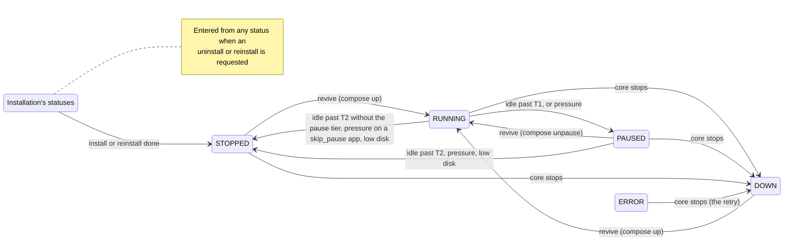

# Service concerns: concepts

The flat concerns of `shard_core/service/` share this file, one section each, in the order of the root module map, added as each concern is worked through; Terminals and pairing and the OIDC provider are not written yet. The repo-wide theory, including the invariants these sections refer to as "root", is in the root `CONCEPTS.md`.

## App runtime

App runtime is the only code that operates an installed app's containers and the only code that moves an app among the four statuses an app rests in between installation tasks (`RUNNING`, `PAUSED`, `STOPPED`, `DOWN`, the code's `_REVIVABLE_STATUS`): it revives an app when it is opened and on the control tick, pauses and stops idle apps, demotes one app per tick under memory pressure, takes every app down when the core stops, and provides the create and teardown primitives Installation calls.

### Files

`app_tools.py` holds the docker primitives. It also hosts three things other modules import that change no container: the manifest reader (`get_installed_apps_path`, `get_app_metadata`, `MetadataNotFound`, `enrich_installed_app_with_meta`), the size and version predicates that the start gate and the splash share, and the image prune. `app_lifecycle.py` holds the wake-on-access receiver and the control tick. `memory_pressure.py` reads memory pressure and pages a frozen stack out to swap. `pause_metrics.py` holds the accumulators for the **pause tier**, the `PAUSED` step between `RUNNING` and `STOPPED` that `apps.lifecycle.pause_enabled` switches on (#81). The file is kept apart from `telemetry.py` so that recording a transition does not import the controller client, whose import chain is cyclic.

Every compose call on an app goes through `util/subprocess.app_compose_command`, pinned to that app's compose file and project. The docker calls outside this module leave app containers untouched: the metrics sampler's `docker ps`, the splash and `call_peer` reading through the Docker SDK, and the registry login.

### Which statuses the runtime writes, and over what

The runtime writes only the four revivable statuses, and a write lands only on a row that still holds the status the operation was gated on. Every other status belongs to Installation. Installation takes a row by writing one of its statuses (an uninstall or reinstall request is accepted whatever the row holds) and hands it back by writing `STOPPED` at the end of an install or reinstall, by deleting it, or by leaving it in `ERROR`. Installation's statuses are its record of work in flight: the boot-time reconciliation reads them (the root invariant *Work that must survive a restart is a row*), and the worker's install and reinstall tasks refuse to start unless the row reads `INSTALLATION_QUEUED` or `REINSTALLATION_QUEUED`. A runtime write over one of them loses that record: a restart no longer resumes the work, and a reinstall still waiting in the queue is rejected when its turn comes. `UNKNOWN` is the model's default value; only the TinyDB import writes it.

A clean stop of the core also returns a row in `ERROR` to `DOWN` when its app still has a compose file. That is `ERROR`'s intended retry (root, *An app's status has one owner*), and the one write over a status outside the four revivable ones that the runtime is meant to make.

Three paths break the write rule today. The core's stop writes `DOWN` over every row whose app directory still holds a compose file, whatever its status, Installation's in-flight statuses included. `_uninstall_app` lets `docker_stop_app` and `docker_shutdown_app` write `STOPPED` and then `DOWN` over its own `UNINSTALLING` row before it deletes the row, and the tick's low-disk stop writes `STOPPED` over an `UNINSTALLING` row the same way. And every runtime write is an unconditional `UPDATE` issued after a docker call that can take seconds, so a status Installation writes in the meantime is overwritten.

The operations this module gates, and what decides how each one acts:

| Operation | Acts when the row holds | How it acts is decided by |
| --- | --- | --- |
| Revive, `start_app` | `RUNNING`, `PAUSED`, `STOPPED`, `DOWN` | The daemon's view of the containers |
| Pause, `docker_pause_app` | `RUNNING` | Nothing further |
| Unpause, `docker_unpause_app` | `PAUSED` | Nothing further |
| Stop, `docker_stop_app` | `RUNNING`, `PAUSED`, `UNINSTALLING` | The daemon, for the unfreeze before the stop |
| Down, `docker_shutdown_app` | `STOPPED`, `UNINSTALLING`, or any status with `force` | The daemon, for the unfreeze before the down |
| The control tick | Every row except `INSTALLATION_QUEUED` and `INSTALLING` | The tick's own snapshot, re-gated by each operation |

The row decides whether an operation may run; the daemon decides how a revive or a teardown acts (#185, #199). The status-to-operation mapping as a whole is one concept with one owner (root, *An app's status has one owner*).

### The revive

`start_app` is the only code that starts or wakes an app. Wake-on-access and the `always_on` branch of the control tick are its only callers. It acts only on a revivable row and then dispatches on the containers' real state. A running stack is left alone, and the row is set to `RUNNING` if it said otherwise. A paused stack is unpaused; if the unpause fails (some containers already exited), the revive falls back to `compose up -d`. Any other stack (exited, never started, or without containers) is brought up with `compose up -d`. Every path that acts ends with the row at `RUNNING` and an `on_apps_update` announcement. A revive is idempotent: on a running stack with a `RUNNING` row it does nothing. `_compose_up` recovers from two failures the Docker CLI reports by message text, a stale network reference (d66d889) and a container name already in use (#63), by running `compose down` and then `up -d` again.

A revive holds the per-app lock that Installation's uninstall and reinstall also hold across their teardown, so a revive can never recreate containers an uninstall or reinstall has just removed (#185). It runs at most once per five seconds per app: `@throttle(5)` is keyed on the app name (5c46231) and drops a call inside the window without retrying it, so a dropped revive waits for the next request, or for the next tick if the app is `always_on`. The throttle is what bounds the cost of waking an app. Every admitted request spawns a revive task, and without the throttle a page load of thirty parallel requests would start thirty compose processes. The revive reads the row fresh on every call that passes the throttle.

`ensure_app_is_running` is a receiver of `on_request_to_app`, which `/internal/auth` sends after it has admitted a request, and the handler awaits its receivers. Everything the receiver does before it spawns the revive task therefore runs on the auth path and is bound by the root invariant *The auth path does no per-request database work*. Today it is not met: while disk is not low, `size_is_compatible` reads the profile from `kv_store` through the pool on every admitted request. The receiver and the tick's `always_on` branch are two of the three sites of the root invariant *An app is started only where it can run*; the receiver refuses to revive on low disk, on a shard too small for the app, and on a shard too old for it. It records the access in `last_access_dict` only when those checks pass. That dictionary is the tick's idle clock; it lives in the process only (root, *Work that must survive a restart is a row*, and #133).

### The control tick

`control_apps` runs in a loop with `apps.lifecycle.refresh_interval` seconds between passes. It reads every row except those in `INSTALLATION_QUEUED` or `INSTALLING` once, runs one pass per app concurrently, and then makes at most one pressure demotion. A pass decides on the snapshot, and each operation it calls re-reads the row and re-applies its own gate, so a stale snapshot can cost an action but cannot cause one the row no longer permits.

Within one app's pass the order is fixed. Low disk stops the app and ends the pass; it applies to `always_on` apps too. An `always_on` app is then handed to `start_app` on every tick, provided the size and version predicates pass. Because the revive dispatches on the real state, an `always_on` app whose row says `RUNNING` while its containers are gone comes back without anyone opening it (#239). Every other app is placed by its idle time against two thresholds. T1, the pause threshold, is the manifest's `lifecycle.idle_for_pause` or `apps.lifecycle.default_idle_for_pause`. T2, the stop threshold, is the manifest's `lifecycle.idle_for_stop` or `apps.lifecycle.default_idle_for_stop`. With `apps.lifecycle.pause_enabled` off, or for an app that declares `skip_pause`, a `RUNNING` app is stopped at T2. With the flag on, a `RUNNING` app is paused at T1 and a `PAUSED` app is stopped at T2; #227 proposes dropping the timed stop of a paused app and leaving that transition to pressure alone. The manifest validator requires T1 below T2 only when the manifest sets both, so an app with an explicit T1 above the global T2 pauses at T1 and stops one tick later (#226).

With the flag off no code pauses an app, and the idle pass never stops a `PAUSED` row: such a row waits for a request, for low disk, or for the core's stop. That is the backout behaviour #145 chose for switching the tier off. Because the flag reaches shard_core through its environment, switching it also restarts the core, and a clean stop takes every app down.

Under memory pressure, with the flag on and the [PSI](https://docs.kernel.org/accounting/psi.html) `some avg10` value of `/host/pressure/memory` above `apps.lifecycle.psi_threshold`, the tick demotes one app by one tier and leaves the rest to the next tick, so a spike frees memory gradually. The victim is the [least recently used](https://en.wikipedia.org/wiki/Cache_replacement_policies#LRU) app, chosen among `RUNNING` apps first and among `PAUSED` apps only when no running candidate is left; pausing costs a user less than stopping, and paused apps would otherwise mostly look least recently used. `always_on` apps are never demoted. Neither is an app accessed within `RECENT_ACCESS_GRACE`, five seconds. A `RUNNING` victim that declares `skip_pause` is stopped. The grace must not be shorter than the revive throttle's window: an app demoted inside that window would have its next revive dropped, and the request would wait on a frozen stack.

An app whose manifest the tick cannot read must not cost the shard its demotion (root, *One app's unreadable manifest costs only that app*), because the demotion is what the pause tier relies on to free memory when the host runs short. The code does not meet this yet (#280): each pass and the demotion read the app's manifest first, the per-app passes run under an `asyncio.gather` without `return_exceptions`, and a single row without a readable `app_meta.json` (an `ERROR` row whose download failed, a reinstall that failed after deleting the old files) makes every tick end before the demotion, while the other apps' passes still run. `write_traefik_dyn_config`, which reads the same manifests, skips such an app with a warning.

### Pausing and paging out

A pause freezes the stack with `compose pause` and then pages its memory out. For each container `compose ps` lists, it writes the container's `memory.current` to the cgroup's [`memory.reclaim`](https://docs.kernel.org/admin-guide/cgroup-v2.html), off the event loop because the write blocks while the kernel pages out. Asking for all of `memory.current` practically always reclaims less than asked, and the kernel then answers `EAGAIN`, so `EAGAIN` is the expected end of a page-out and only other errors are logged as warnings. The recorded pause latency includes the page-out. An unpause is a `compose unpause`; the kernel pages memory back in as the app touches it.

The tier depends on two host mounts that the core's compose file must provide: the host cgroup v2 tree, read-write at `/sys/fs/cgroup`, and `/proc/pressure` at `/host/pressure`. The controller's core-version compose file mounts both (freeshard-controller#246). This repository's own `docker-compose.yml` mounts neither. It maps `PAUSE_ENABLED` only because the controller injects that variable, and #183 left it out of the self-hosting template on purpose. Without them, pressure reads 0.0 and never triggers a demotion, and a pause freezes the stack without paging it out, with one warning per container. `find_cgroup` is shared with Observability's metrics sampler.

### Teardown and the core's stop

`docker_stop_app` and `docker_shutdown_app` both unfreeze the stack first when the daemon reports it paused, because a frozen container can be neither stopped nor removed. A failed unpause (a partly paused stack) is logged and the teardown continues. This unfreeze is deliberately not recorded as a pause-tier transition: the stack is on its way down, not back to `RUNNING`. The allow-lists in the table above are also what keeps the control tick's low-disk stop, which calls `docker_stop_app` on every row the tick reads, off an app that is being reinstalled. That is why #199 passed `force` to the reinstall's teardown and left the lists unwidened. `set_status=False` lets a caller that owns the row's status for the whole of its task, today only the reinstall, change the containers alone; the primitive still announces. `force` exists for the two callers that must tear down whatever the row says: the reinstall and the core's stop.

`get_app_container_state` reduces a stack to one state: `paused` if any container is paused, `running` if all are running, `missing` if there are none, `exited` otherwise. It reports `missing` also when `compose ps` or `docker inspect` fails, so that a probe hiccup degrades a revive into a plain `up` (9f03ca6). A caller cannot take `missing` as proof that the containers are gone. It raises `ComposeFileNotFound` when the app has no compose file.

When the core stops, the lifespan first stops the background tasks, the tick and the installation worker among them, then calls `docker_shutdown_all_apps(force=True)`, and closes the database only after that. Every app with a compose file is taken down, whatever its status, so no app container outlives the core that manages it. The controller relies on this when it upgrades or moves a shard (freeshard-controller#494). A row in a revivable status becomes `DOWN`, which is what it then is, and so a clean restart does not leave `RUNNING` rows for the first tick to count as idle since the epoch. Revives already in flight are not part of the stop: their tasks sit in `app_lifecycle.background_tasks`, which the lifespan never awaits, and the down takes no lock.

The pause, stop and down primitives take no lock either. A revive that races a pause can leave the row at `PAUSED` over running containers; the next revive that passes the throttle finds them running and sets the row back, and that divergence is tolerated. A runtime write that replaces one of Installation's statuses is not tolerated (see above).

### Pause-tier telemetry

`pause_metrics` accumulates only while `telemetry.enabled` is set. It keeps per-app transition counts, the first 1000 pause and the first 1000 unpause latencies, and the first 120 pressure snapshots of a reporting interval. `telemetry.send_telemetry` packages them as the `pause_tier` field and resets them after a successful send; a restart loses them like every other counter. Transitions are recorded as `running_to_paused` for each pause, `paused_to_running` for each real unpause (a revive of a paused stack included), and `<status>_to_stopped` for each stop that writes its status. Cold starts and downs are not counted. The model's docstring, copied from the controller into `data_model/backend/`, describes `pause_tier` as absent from shards with the flag off; a stop records its transition whatever the flag says, and an uninstall's stop records `uninstalling_to_stopped`.

### Image prune

`docker_prune_images` runs `docker image prune -fa`, which removes every image no container references: with an age filter of `apps.pruning.max_age` hours on the `apps.pruning.schedule` cron schedule when `apps.pruning.enabled` is set, and without a filter from `POST /protected/settings/prune-images`. An app in `DOWN` has no containers, so a prune can remove its images and its next revive then pulls them again.

### Boundaries

App runtime owns the transitions among the four revivable statuses, every docker operation on an app's containers, the page-out of a frozen stack, the control tick and its pressure demotion, the pause-tier accumulators, and the image prune. It hosts the manifest reader and the size and version predicates for the rest of shard_core.

It relies on Utilities for `app_compose_command`, which pins every compose call to one app's file and project and never relies on the working directory, and for `throttle`, the signals and `PeriodicTask`, whose catch-all keeps the tick running after a pass raises. It relies on the HTTP surface to send `on_request_to_app` only for admitted requests, the wake path's only trigger. It relies on Installation to create an app's containers with `docker_create_app_containers` while the row is in one of Installation's statuses, to hand the row over by writing `STOPPED`, and to hold the per-app lock across its own teardown. It relies on the composition root to start the tick after the boot-time reconciliation and the profile refresh, and to stop it before taking the apps down. From Observability it reads the disk snapshot's `disk_space_low`. Controller integration's telemetry sender reads and resets the accumulators, and from Controller integration it reads the stored profile for the size predicate (the root's *Deployment mode is explicit* records how that predicate infers the mode). From the host it needs the cgroup v2 tree, PSI and swap.

Of the root invariants it keeps true:

- *Every change to an installed app is announced*: its four write sites (`_mark_running`, `docker_pause_app`, `docker_stop_app`, `docker_shutdown_app`) announce.
- *An app is started only where it can run*: two of the three sites are here.
- *An app's status has one owner*: most of the sites the root lists are here, five gates in `app_tools.py` (one of them the uncalled unpause gate) and three branches in `app_lifecycle.py` (#271).
- *One app's unreadable manifest costs only that app*, for the control tick: currently broken, because one unreadable manifest ends every tick before its demotion (#280).
- *Deployment mode is explicit*, for `size_is_compatible`: currently broken, because the predicate infers the mode from the controller's answer (#270).
- *The auth path does no per-request database work*, for its wake-on-access receiver: currently broken by the profile read.
- *Work that must survive a restart is a row*: by writing only over the revivable statuses, currently broken by the three paths above.
- *The lifespan order is load-bearing*: the tick starts in step 7, after the installation worker, and the apps go down after the background tasks have stopped and before the database closes.

### Constraints

Recorded from the maintainer on 2026-11-09, from decisions taken at triage on 2026-06-29.

**Rejected alternatives.**

- Caching the app status for the revive, reverted in PR #90's review on 2026-05-22.
- Sablier middleware to hold requests while an app cold-starts (#71).
- CRIU checkpoint and restore to remove cold-start latency (#72).

Cold-start latency is addressed by the pause tier (#81) and by reducing apps' idle footprint (#109).

