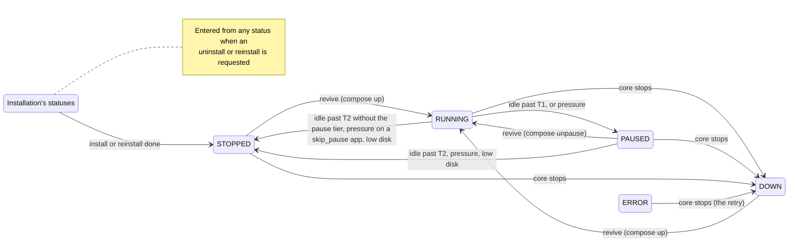
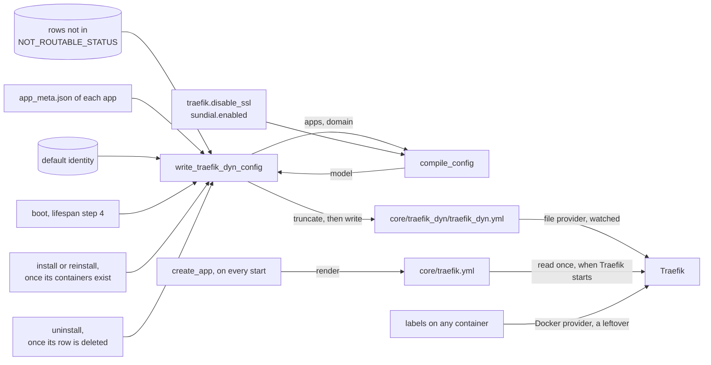
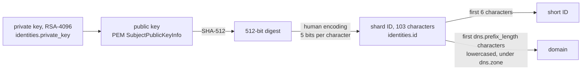

# Service concerns: concepts

The flat concerns of `shard_core/service/` share this file, one section each, in the order of the root module map, added as each concern is worked through; Terminals and pairing and the OIDC provider are not written yet. The repo-wide theory, including the invariants these sections refer to as "root", is in the root `CONCEPTS.md`.

## App runtime

App runtime is the only code that operates an installed app's containers and the only code that moves an app among the four statuses an app rests in between installation tasks (`RUNNING`, `PAUSED`, `STOPPED`, `DOWN`, the code's `_REVIVABLE_STATUS`): it revives an app when it is opened and on the control tick, pauses and stops idle apps, demotes one app per tick under memory pressure, takes every app down when the core stops, and provides the create and teardown primitives Installation calls.

### Files

`app_tools.py` holds the docker primitives. It also hosts three things other modules import that change no container: the manifest reader (`get_installed_apps_path`, `get_app_metadata`, `MetadataNotFound`, `enrich_installed_app_with_meta`), the size and version predicates that the start gate and the splash share, and the image prune. `app_lifecycle.py` holds the wake-on-access receiver and the control tick. `memory_pressure.py` reads memory pressure and pages a frozen stack out to swap. `pause_metrics.py` holds the accumulators for the **pause tier**, the `PAUSED` step between `RUNNING` and `STOPPED` that `apps.lifecycle.pause_enabled` switches on (#81). The file is kept apart from `telemetry.py` so that recording a transition does not import the controller client, whose import chain is cyclic.

Every compose call on an app goes through `util/subprocess.app_compose_command`, pinned to that app's compose file and project. The docker calls outside this module leave app containers untouched: the metrics sampler's `docker ps`, the splash and `call_peer` reading through the Docker SDK, and the registry login.

### Which statuses the runtime writes, and over what

The runtime writes only the four revivable statuses, and a write lands only on a row that still holds the status the operation was gated on. Every other status belongs to Installation. Installation takes a row by writing one of its statuses (an uninstall or reinstall request is accepted whatever the row holds) and hands it back by writing `STOPPED` at the end of an install or reinstall, by deleting it, or by leaving it in `ERROR`. Installation's statuses are its record of work in flight: the boot-time reconciliation reads them (the root invariant *Work that must survive a restart is a row*), and the worker's install and reinstall tasks refuse to start unless the row reads `INSTALLATION_QUEUED` or `REINSTALLATION_QUEUED`. A runtime write over one of them loses that record: a restart no longer resumes the work, and a reinstall still waiting in the queue is rejected when its turn comes. `UNKNOWN` is the model's default value; only the TinyDB import writes it.

A clean stop of the core also returns a row in `ERROR` to `DOWN` when its app still has a compose file. That is `ERROR`'s intended retry (root, *An app's status has one owner*), and the one write over a status outside the four revivable ones that the runtime is meant to make.

Three paths break the write rule today. The core's stop writes `DOWN` over every row whose app directory still holds a compose file, whatever its status, Installation's in-flight statuses included. `_uninstall_app` lets `docker_stop_app` and `docker_shutdown_app` write `STOPPED` and then `DOWN` over its own `UNINSTALLING` row before it deletes the row, and the tick's low-disk stop writes `STOPPED` over an `UNINSTALLING` row the same way. And every runtime write is an unconditional `UPDATE` issued after a docker call that can take seconds, so a status Installation writes in the meantime is overwritten.

The operations this module gates, and what decides how each one acts:

| Operation | Acts when the row holds | How it acts is decided by |
| --- | --- | --- |
| Revive, `start_app` | `RUNNING`, `PAUSED`, `STOPPED`, `DOWN` | The daemon's view of the containers |
| Pause, `docker_pause_app` | `RUNNING` | Nothing further |
| Unpause, `docker_unpause_app` | `PAUSED` | Nothing further |
| Stop, `docker_stop_app` | `RUNNING`, `PAUSED`, `UNINSTALLING` | The daemon, for the unfreeze before the stop |
| Down, `docker_shutdown_app` | `STOPPED`, `UNINSTALLING`, or any status with `force` | The daemon, for the unfreeze before the down |
| The control tick | Every row except `INSTALLATION_QUEUED` and `INSTALLING` | The tick's own snapshot, re-gated by each operation |

The row decides whether an operation may run; the daemon decides how a revive or a teardown acts (#185, #199). The status-to-operation mapping as a whole is one concept with one owner (root, *An app's status has one owner*).

### The revive

`start_app` is the only code that starts or wakes an app. Wake-on-access and the `always_on` branch of the control tick are its only callers. It acts only on a revivable row and then dispatches on the containers' real state. A running stack is left alone, and the row is set to `RUNNING` if it said otherwise. A paused stack is unpaused; if the unpause fails (some containers already exited), the revive falls back to `compose up -d`. Any other stack (exited, never started, or without containers) is brought up with `compose up -d`. Every path that acts ends with the row at `RUNNING` and an `on_apps_update` announcement. A revive is idempotent: on a running stack with a `RUNNING` row it does nothing. `_compose_up` recovers from two failures the Docker CLI reports by message text, a stale network reference (d66d889) and a container name already in use (#63), by running `compose down` and then `up -d` again.

A revive holds the per-app lock that Installation's uninstall and reinstall also hold across their teardown, so a revive can never recreate containers an uninstall or reinstall has just removed (#185). It runs at most once per five seconds per app: `@throttle(5)` is keyed on the app name (5c46231) and drops a call inside the window without retrying it, so a dropped revive waits for the next request, or for the next tick if the app is `always_on`. The throttle is what bounds the cost of waking an app. Every admitted request spawns a revive task, and without the throttle a page load of thirty parallel requests would start thirty compose processes. The revive reads the row fresh on every call that passes the throttle.

`ensure_app_is_running` is a receiver of `on_request_to_app`, which `/internal/auth` sends after it has admitted a request, and the handler awaits its receivers. Everything the receiver does before it spawns the revive task therefore runs on the auth path and is bound by the root invariant *The auth path does no per-request database work*. Today it is not met: while disk is not low, `size_is_compatible` reads the profile from `kv_store` through the pool on every admitted request. The receiver and the tick's `always_on` branch are two of the three sites of the root invariant *An app is started only where it can run*; the receiver refuses to revive on low disk, on a shard too small for the app, and on a shard too old for it. It records the access in `last_access_dict` only when those checks pass. That dictionary is the tick's idle clock; it lives in the process only (root, *Work that must survive a restart is a row*, and #133).

### The control tick

`control_apps` runs in a loop with `apps.lifecycle.refresh_interval` seconds between passes. It reads every row except those in `INSTALLATION_QUEUED` or `INSTALLING` once, runs one pass per app concurrently, and then makes at most one pressure demotion. A pass decides on the snapshot, and each operation it calls re-reads the row and re-applies its own gate, so a stale snapshot can cost an action but cannot cause one the row no longer permits.

Within one app's pass the order is fixed. Low disk stops the app and ends the pass; it applies to `always_on` apps too. An `always_on` app is then handed to `start_app` on every tick, provided the size and version predicates pass. Because the revive dispatches on the real state, an `always_on` app whose row says `RUNNING` while its containers are gone comes back without anyone opening it (#239). Every other app is placed by its idle time against two thresholds. T1, the pause threshold, is the manifest's `lifecycle.idle_for_pause` or `apps.lifecycle.default_idle_for_pause`. T2, the stop threshold, is the manifest's `lifecycle.idle_for_stop` or `apps.lifecycle.default_idle_for_stop`. With `apps.lifecycle.pause_enabled` off, or for an app that declares `skip_pause`, a `RUNNING` app is stopped at T2. With the flag on, a `RUNNING` app is paused at T1 and a `PAUSED` app is stopped at T2; #227 proposes dropping the timed stop of a paused app and leaving that transition to pressure alone. The manifest validator requires T1 below T2 only when the manifest sets both, so an app with an explicit T1 above the global T2 pauses at T1 and stops one tick later (#226).

With the flag off no code pauses an app, and the idle pass never stops a `PAUSED` row: such a row waits for a request, for low disk, or for the core's stop. That is the backout behaviour #145 chose for switching the tier off. Because the flag reaches shard_core through its environment, switching it also restarts the core, and a clean stop takes every app down.

Under memory pressure, with the flag on and the [PSI](https://docs.kernel.org/accounting/psi.html) `some avg10` value of `/host/pressure/memory` above `apps.lifecycle.psi_threshold`, the tick demotes one app by one tier and leaves the rest to the next tick, so a spike frees memory gradually. The victim is the [least recently used](https://en.wikipedia.org/wiki/Cache_replacement_policies#LRU) app, chosen among `RUNNING` apps first and among `PAUSED` apps only when no running candidate is left; pausing costs a user less than stopping, and paused apps would otherwise mostly look least recently used. `always_on` apps are never demoted. Neither is an app accessed within `RECENT_ACCESS_GRACE`, five seconds. A `RUNNING` victim that declares `skip_pause` is stopped. The grace must not be shorter than the revive throttle's window: an app demoted inside that window would have its next revive dropped, and the request would wait on a frozen stack.

An app whose manifest the tick cannot read must not cost the shard its demotion (root, *One app's unreadable manifest costs only that app*), because the demotion is what the pause tier relies on to free memory when the host runs short. The code does not meet this yet (#280): each pass and the demotion read the app's manifest first, the per-app passes run under an `asyncio.gather` without `return_exceptions`, and a single row without a readable `app_meta.json` (an `ERROR` row whose download failed, a reinstall that failed after deleting the old files) makes every tick end before the demotion, while the other apps' passes still run. `write_traefik_dyn_config`, which reads the same manifests, skips such an app with a warning.

### Pausing and paging out

A pause freezes the stack with `compose pause` and then pages its memory out. For each container `compose ps` lists, it writes the container's `memory.current` to the cgroup's [`memory.reclaim`](https://docs.kernel.org/admin-guide/cgroup-v2.html), off the event loop because the write blocks while the kernel pages out. Asking for all of `memory.current` practically always reclaims less than asked, and the kernel then answers `EAGAIN`, so `EAGAIN` is the expected end of a page-out and only other errors are logged as warnings. The recorded pause latency includes the page-out. An unpause is a `compose unpause`; the kernel pages memory back in as the app touches it.

The tier depends on two host mounts that the core's compose file must provide: the host cgroup v2 tree, read-write at `/sys/fs/cgroup`, and `/proc/pressure` at `/host/pressure`. The controller's core-version compose file mounts both (freeshard-controller#246). This repository's own `docker-compose.yml` mounts neither. It maps `PAUSE_ENABLED` only because the controller injects that variable, and #183 left it out of the self-hosting template on purpose. Without them, pressure reads 0.0 and never triggers a demotion, and a pause freezes the stack without paging it out, with one warning per container. `find_cgroup` is shared with Observability's metrics sampler.

### Teardown and the core's stop

`docker_stop_app` and `docker_shutdown_app` both unfreeze the stack first when the daemon reports it paused, because a frozen container can be neither stopped nor removed. A failed unpause (a partly paused stack) is logged and the teardown continues. This unfreeze is deliberately not recorded as a pause-tier transition: the stack is on its way down, not back to `RUNNING`. The allow-lists in the table above are also what keeps the control tick's low-disk stop, which calls `docker_stop_app` on every row the tick reads, off an app that is being reinstalled. That is why #199 passed `force` to the reinstall's teardown and left the lists unwidened. `set_status=False` lets a caller that owns the row's status for the whole of its task, today only the reinstall, change the containers alone; the primitive still announces. `force` exists for the two callers that must tear down whatever the row says: the reinstall and the core's stop.

`get_app_container_state` reduces a stack to one state: `paused` if any container is paused, `running` if all are running, `missing` if there are none, `exited` otherwise. It reports `missing` also when `compose ps` or `docker inspect` fails, so that a probe hiccup degrades a revive into a plain `up` (9f03ca6). A caller cannot take `missing` as proof that the containers are gone. It raises `ComposeFileNotFound` when the app has no compose file.

When the core stops, the lifespan first stops the background tasks, the tick and the installation worker among them, then calls `docker_shutdown_all_apps(force=True)`, and closes the database only after that. Every app with a compose file is taken down, whatever its status, so no app container outlives the core that manages it. The controller relies on this when it upgrades or moves a shard (freeshard-controller#494). A row in a revivable status becomes `DOWN`, which is what it then is, and so a clean restart does not leave `RUNNING` rows for the first tick to count as idle since the epoch. Revives already in flight are not part of the stop: their tasks sit in `app_lifecycle.background_tasks`, which the lifespan never awaits, and the down takes no lock.

The pause, stop and down primitives take no lock either. A revive that races a pause can leave the row at `PAUSED` over running containers; the next revive that passes the throttle finds them running and sets the row back, and that divergence is tolerated. A runtime write that replaces one of Installation's statuses is not tolerated (see above).

### Pause-tier telemetry

`pause_metrics` accumulates only while `telemetry.enabled` is set. It keeps per-app transition counts, the first 1000 pause and the first 1000 unpause latencies, and the first 120 pressure snapshots of a reporting interval. `telemetry.send_telemetry` packages them as the `pause_tier` field and resets them after a successful send; a restart loses them like every other counter. Transitions are recorded as `running_to_paused` for each pause, `paused_to_running` for each real unpause (a revive of a paused stack included), and `<status>_to_stopped` for each stop that writes its status. Cold starts and downs are not counted. The model's docstring, copied from the controller into `data_model/backend/`, describes `pause_tier` as absent from shards with the flag off; a stop records its transition whatever the flag says, and an uninstall's stop records `uninstalling_to_stopped`.

### Image prune

`docker_prune_images` runs `docker image prune -fa`, which removes every image no container references: with an age filter of `apps.pruning.max_age` hours on the `apps.pruning.schedule` cron schedule when `apps.pruning.enabled` is set, and without a filter from `POST /protected/settings/prune-images`. An app in `DOWN` has no containers, so a prune can remove its images and its next revive then pulls them again.

### Boundaries

App runtime owns the transitions among the four revivable statuses, every docker operation on an app's containers, the page-out of a frozen stack, the control tick and its pressure demotion, the pause-tier accumulators, and the image prune. It hosts the manifest reader and the size and version predicates for the rest of shard_core.

It relies on Utilities for `app_compose_command`, which pins every compose call to one app's file and project and never relies on the working directory, and for `throttle`, the signals and `PeriodicTask`, whose catch-all keeps the tick running after a pass raises. It relies on the HTTP surface to send `on_request_to_app` only for admitted requests, the wake path's only trigger. It relies on Installation to create an app's containers with `docker_create_app_containers` while the row is in one of Installation's statuses, to hand the row over by writing `STOPPED`, and to hold the per-app lock across its own teardown. It relies on the composition root to start the tick after the boot-time reconciliation and the profile refresh, and to stop it before taking the apps down. From Observability it reads the disk snapshot's `disk_space_low`. Controller integration's telemetry sender reads and resets the accumulators, and from Controller integration it reads the stored profile for the size predicate (the root's *Deployment mode is explicit* records how that predicate infers the mode). From the host it needs the cgroup v2 tree, PSI and swap.

Of the root invariants it keeps true:

- *Every change to an installed app is announced*: its four write sites (`_mark_running`, `docker_pause_app`, `docker_stop_app`, `docker_shutdown_app`) announce.
- *An app is started only where it can run*: two of the three sites are here.
- *An app's status has one owner*: most of the sites the root lists are here, five gates in `app_tools.py` (one of them the uncalled unpause gate) and three branches in `app_lifecycle.py` (#271).
- *One app's unreadable manifest costs only that app*, for the control tick: currently broken, because one unreadable manifest ends every tick before its demotion (#280).
- *Deployment mode is explicit*, for `size_is_compatible`: currently broken, because the predicate infers the mode from the controller's answer (#270).
- *The auth path does no per-request database work*, for its wake-on-access receiver: currently broken by the profile read.
- *Work that must survive a restart is a row*: by writing only over the revivable statuses, currently broken by the three paths above.
- *The lifespan order is load-bearing*: the tick starts in step 7, after the installation worker, and the apps go down after the background tasks have stopped and before the database closes.

### Constraints

Recorded from the maintainer on 2026-11-09, from decisions taken at triage on 2026-06-29.

**Rejected alternatives.**

- Caching the app status for the revive, reverted in PR #90's review on 2026-05-22.
- Sablier middleware to hold requests while an app cold-starts (#71).
- CRIU checkpoint and restore to remove cold-start latency (#72).

Cold-start latency is addressed by the pause tier (#81) and by reducing apps' idle footprint (#109).

## Routing

Routing decides what Traefik does with every request that reaches the shard. It compiles every router, middleware and service shard_core needs, and the request for the one certificate they share, into a single file built from the routable apps, the default identity's domain and two settings. It rewrites that file at boot and whenever an install, reinstall or uninstall has finished with the app's containers, and it renders the static configuration Traefik starts with.

### Files

`service/traefik_dynamic_config.py` holds `compile_config`, which turns its inputs into the dynamic configuration without touching the database or the disk; it reads `traefik.disable_ssl` and `sundial.enabled` from the settings. `data_model/traefik_dyn_config.py` is the model it fills, generated in 2022 from the Traefik v2 file-provider JSON schema and then patched by hand with `authResponseHeadersRegex` (deddb3d). That patch is why `scripts/generate_traefik_dyn_config_model.py` refuses to run: a regeneration would drop the field the app middleware depends on. `write_traefik_dyn_config` and `NOT_ROUTABLE_STATUS` live in `app_installation/util.py`; the writer gathers the inputs, calls `compile_config` and writes the file. The static configuration is `data/traefik.yml`, or `data/traefik_no_ssl.yml` when SSL is disabled, rendered by `_copy_traefik_static_config` in `app_factory.py`.

### Two configurations, read at different times

The static configuration holds the entrypoints, the providers, the certificate resolver and the API. shard_core renders it on every process start, in `create_app` before the lifespan runs, to `core/traefik.yml`; its one template variable is `traefik.acme_email`. Traefik reads it once, when Traefik itself starts, from `$XDG_CONFIG_HOME/traefik.yml` ([v2.11 configuration overview](https://doc.traefik.io/traefik/v2.11/getting-started/configuration-overview/)): both compose files, this repository's and every core-version compose of the controller, set `XDG_CONFIG_HOME=/core` and mount the shard's `core/` directory at `/core` in Traefik as well as in shard_core. The dynamic configuration is `core/traefik_dyn/traefik_dyn.yml`, written under `settings().path_root` like everything else shard_core writes. Traefik's file provider watches the directory `/core/traefik_dyn` and reloads on every change. The paths inside the static file are Traefik's own view, as the root invariant *Paths are resolved on the side that uses them* requires.

Both compose files start Traefik only once shard_core reports healthy, which it can do only after the lifespan has finished, so a full start of the stack gives Traefik a freshly rendered static file and a written dynamic file. A restart or recreate of shard_core alone leaves Traefik on the static file it started with. A core upgrade takes the whole stack down and up, so a changed template reaches Traefik then. A change to `traefik.disable_ssl` or `traefik.acme_email` that recreates only shard_core does not reach it. For `disable_ssl` the two files then disagree: the dynamic file moves every router to the entrypoint and TLS setting of the new mode while Traefik still runs the old one, and the shard serves nothing until Traefik restarts.

The dynamic file is the complete routing table: Traefik routes what shard_core writes there and nothing else. The [Docker provider](https://doc.traefik.io/traefik/v2.11/providers/docker/) that the static configuration still enables is a leftover of the label routing that ended in 2022, when the app routers moved into the file (2568cad). It is to be removed together with Traefik's Docker-socket mount, which only the provider uses (root, *Constraints*, decided 2026-11-10, #274). *(Confirmed 2026-11-10 — the code cannot tell a leftover provider from one kept for containers outside this repository.)* No app in the store's history and no core service in any compose file carries a Traefik label. Until the provider is removed, the file is not the complete table: a labelled container on the host can add routers beside the file's, and on a shared host the provider picked up a neighbour's containers (#196).

### Entrypoints and certificates

The static configuration defines three entrypoints: `http` on :80, `https` on :443 and `mqtt` on :8883, the ports the root's Constraints allow Traefik alone to publish. The API's insecure mode opens one more listener, published nowhere but reachable from the `portal` network (root, #198). With SSL, `http` redirects every request to `https` at the entrypoint. Traefik implements that redirect as a router of priority MaxInt−1 ([v2.11 entrypoints](https://doc.traefik.io/traefik/v2.11/routing/entrypoints/)), so no router bound to `http` is ever reached, and every HTTP router binds `https`. The manifest's vocabulary differs from these names: an `entrypoint_port` of `http` means HTTPS on 443, and `mqtt` means MQTT over TLS on 8883.

`http` and `https` carry a `readTimeout` of 300 seconds and no `writeTimeout`, so that connections which never complete a request are reaped while long downloads and server-sent events run on (fd1d05b, #108). The `mqtt` entrypoint is TCP, where these timeouts do not apply.

Every router, HTTP and TCP alike, names the resolver `letsencrypt` and the same `tls.domains`: the shard's domain, with the SAN `*.<domain>`. `tls.domains` takes precedence over a router's Host rule ([v2.11 ACME](https://doc.traefik.io/traefik/v2.11/https/acme/)), so Traefik requests one certificate per shard, covering the domain, every app subdomain and `traefik.<domain>`, and installing an app needs no new certificate. A wildcard can be issued only over the DNS-01 challenge, so the resolver has to use a DNS challenge, as the README explains. Nothing ties the two files together on this point. The certificate and the ACME account live in `core/acme.json`.

The DNS provider is fixed in the template as `azure`, and the template ships inside the image. Traefik v2.11 documents `azure` as deprecated in favour of `azuredns`; the lego bundled with recent v2.11 patches refuses it unless `LEGO_AZURE_BYPASS_DEPRECATION=true` is set, and later patches removed it (#146). This holds the hosted shards off current v2.11 patches, and their compose sets that variable. This repository's compose runs v3.6 and sets neither the variable nor any DNS credentials, so as shipped, with SSL enabled, its resolver obtains no certificate.

### SSL disabled

`traefik.disable_ssl`, which the compose file sets from `DISABLE_SSL` in `.env` and the README reserves for local testing, switches both configurations. The static template becomes `traefik_no_ssl.yml`: `http` and `mqtt` only, with no `https`, no redirect and no resolver. Every HTTP router binds `http` and carries no `tls`. The two templates repeat their shared parts (the providers, the API, the timeouts), so a change to one of those has to be made in both, as fd1d05b did. A TCP router then loses its TLS but keeps its `HostSNI(<app>.<domain>)` rule, and Traefik accepts a host name in `HostSNI` only on a router with TLS ([v2.11 routers](https://doc.traefik.io/traefik/v2.11/routing/routers/)), so in this mode an app's MQTT entrypoint has no route. The same flag decides the scheme of the OIDC issuer and of the shard URL in the welcome log, outside this module.

### Which router serves a request

The file always holds five routers: `shard_core_public`, `shard_core_private` and `shard_core_management` for the three `/core/` prefixes, `traefik` for the dashboard, and the catch-all. Each routed app adds `<app>_http` if it has an HTTP entrypoint and `<app>_mqtt` if it has an MQTT entrypoint, each with a service of the same name. No fixed router or service name ends in `_http` or `_mqtt`, so no app name can collide with them.

| Request | Routers whose rule matches | Served by |
| --- | --- | --- |
| `<domain>/core/public/...`, `/core/protected/...` or `/core/management/...` | that core router, the catch-all | the core router |
| any other path on `<domain>` | the catch-all | the UI |
| `traefik.<domain>/...` | the dashboard router, a core router for `/core/...`, the catch-all | the dashboard |
| `<app>.<domain>/core/...` of a routed app | the app's router, the core router, the catch-all | whichever rule is longer (#191) |
| any other path of a routed app | the app's router, the catch-all | the app |
| any other host, the bare IP and subdomains without a router included | a core router for `/core/...`, the catch-all | shard_core for `/core/...`, the UI otherwise (#230) |

Only the catch-all carries an explicit priority, 1. Every other router has Traefik's default priority, the length of its rule string ([v2.11 routers](https://doc.traefik.io/traefik/v2.11/routing/routers/)). The dashboard's rule is longer than every core router's for any domain of nine characters or more, and longer than the rule an app named `traefik` would get, so such an app is routed but never reached; the name is reserved nowhere else.

The core routers carry no Host matcher, so they answer on every host. For `/core/public` that is load-bearing: the controller's provisioning reads the shard's `whoareyou` at its bare IP address, before the shard's DNS record exists. On an app's host, `<app>.<domain>`, the app's router serves every path: no client calls `/core/...` on an app's host, and both UIs call it on the host they are served from, the shard's domain. The code meets this only through rule length, which holds on `config.toml`'s zone but not on every zone a self-hoster may choose (#191).

An app has one host, so it can have one router of each kind. A manifest that lists two entrypoints of the same kind gets the last one, silently; no store app lists two.

### Middleware chains

The core routers apply `strip` first, which removes `/core/` so the path arrives as `/public/...`, `/protected/...` or `/management/...`, where the HTTP surface mounts its routers. They then apply the admission middleware the root's table lists. An app's HTTP router applies `app-error` and then `auth`.

`auth` asks `/internal/auth` and copies headers back with `authResponseHeadersRegex: ^X-Ptl-.*`. Traefik strips every request header that matches the expression and then copies the matching headers of the auth response onto the request ([v2.11 ForwardAuth](https://doc.traefik.io/traefik/v2.11/middlewares/http/forwardauth/)). So a per-path header in an app's manifest reaches the app only when its name starts with `X-Ptl-`, as every store app's does. Traefik passes the request's host and URI to `/internal/auth` as `X-Forwarded-Host` and `X-Forwarded-Uri`, and the middleware leaves `trustForwardHeader` unset. The HTTP surface takes the app's name from the first label of that host, the label the rule `Host(<app>.<domain>)` matched. A browser sends the host in lower case while the router's host and the app's row keep the name as written, so an app whose name contains a capital letter, which the zip validation allows, cannot be reached.

`app-error` hands every response with a status in 500–599, or 401, to shard_core's `/internal/app_error/{status}`, which renders the splash. Traefik forwards the client's Host header to it by default ([v2.11 ErrorPages](https://doc.traefik.io/traefik/v2.11/middlewares/http/errorpages/)), which is how the splash knows which app it is for. Because `app-error` comes before `auth`, it also covers the forwardAuth's own 401 and turns it into the "Access Denied" page. Since 8f9b4c3 (#235) all other client errors reach the browser as the app sent them. An app's own 401 is still replaced, and #236 proposes deciding by the client's `Accept` header instead.

No router forwards to shard_core outside the three `/core/` prefixes. The only requests that reach `/internal` through Traefik are those Traefik makes itself: the three forwardAuth checks and the error page. This is what keeps `/internal` unrouted (root, *Admission is decided at the proxy*).

### MQTT

An MQTT entrypoint becomes a TCP router on the `mqtt` entrypoint, matching the SNI `<app>.<domain>`. Traefik terminates TLS with the shard's certificate and opens a plain TCP connection to `<container_name>:<container_port>`, which is 1883 for the store's mosquitto. This TCP router carries no middleware, so the connection is admitted without asking shard_core. It never reaches `/internal/auth` either, so MQTT traffic neither wakes a stopped app nor counts as an access on the control tick's idle clock. An app whose clients arrive only over MQTT is therefore reachable only if its manifest declares `always_on`. The store's authoring guide asks this of messaging apps, mosquitto declares it, and nothing in shard_core checks it. When no routed app has an MQTT entrypoint, the TCP section is left out of the file, because, as the code records, Traefik cannot handle the empty objects (d36ba31).

### The root UI

The catch-all is named `web-terminal` whatever it serves: `PathPrefix(/)` at priority 1, pointed at the `sundial` service when `sundial.enabled` is set and at `web-terminal` otherwise. Both services are always defined, the unused one referenced by no router, and only the tests read the router's name. Sundial replaces web-terminal at the root and is not mounted beside it (see Constraints); it serves at `/` natively, so the swap needs no prefix stripping (PR #244). Settings are read once per process, so the switch takes effect at the boot that follows the change, whose rewrite carries it. Both UIs call the API at `/core/...` on the host they are served from and open an app at `<app>.<location.host>`, which is the app's host only when the UI is served from the shard's domain.

### When the file is rewritten

`write_traefik_dyn_config` reads every row whose status is not in `NOT_ROUTABLE_STATUS` (`INSTALLATION_QUEUED`, `ERROR`, `UNINSTALLATION_QUEUED`, `UNINSTALLING`) and loads each one's manifest. A manifest it cannot load is skipped with a warning, so that one broken row cannot stop the boot (155ee52, #158). It then reads the default identity, compiles, and writes the whole file. It has three callers. The lifespan calls it at step 4, after the reconciliation of interrupted installs and uninstalls (root, *The lifespan order is load-bearing*). The worker calls it at the end of `_install_app_from_zip`, once the app's containers exist (4c94e5e moved it after their creation), which every store install, zip install and reinstall passes through. And `_uninstall_app` calls it after deleting the row and before announcing the change. The boot's write completes before the worker starts, and the worker runs one task at a time, so two writes never overlap.

The routed set is therefore a snapshot taken at the last write. No status write rewrites the file, and `/internal/auth` admits a request without looking at the app's status, so `NOT_ROUTABLE_STATUS` takes effect only at the next write; #200 (its fourth item) proposes rewriting on every `on_apps_update`. `INSTALLING` and `REINSTALLING` stay routable because the install writes the file while the row holds them, and the row then becomes `STOPPED` without another write. An app being uninstalled keeps its router until its row is gone, unless a write from an earlier task in the queue, or a boot, drops it first. A reinstall that fails leaves its app routed in `ERROR` until the next write, which may come from an unrelated install. A clean stop's `DOWN` over an `ERROR` row (root, *An app's status has one owner*) gets the app routed again at the next boot, provided its manifest is still readable.

The domain is read at every write as well, and nothing writes when it changes. `POST /protected/identities/{id}/make-default` changes the default identity and announces `on_identity_update`, which the routing does not receive. The routers keep naming the old domain until the next write, which then moves every router, and the certificate request, to the new one. The settings change only with a restart, which the boot's write covers.

Traefik applies a write when its file provider is notified of it. After each reload it waits two seconds by default before taking further changes, and keeps only the latest of those ([v2.11 providers](https://doc.traefik.io/traefik/v2.11/providers/overview/)). The install sets `STOPPED` and announces it right after its write, so a client that opens the app straight away can reach the catch-all before the app's router exists (#230). The write itself truncates the file and then fills it in two writes (#228). A reload that lands in between sees no routers at all, shard_core's own included. A write that fails part-way leaves only a fragment of the file, and the previous configuration is lost.

### Boundaries

Routing owns the dynamic file and everything in it: the routers and their precedence, the middleware chains, the services and the certificate request. It also owns the routability filter and the static templates with their render. It keeps no state between writes; every write recomputes the whole file from its inputs.

It relies on Installation to call the writer once an app's containers exist and once a row has been deleted, and on the composition root to call it at step 4 and to run `create_app` before the lifespan. It reads manifests through App runtime's `get_app_metadata` and the domain through Identity's default identity and the `dns` settings. It relies on the HTTP surface for the four `/internal` endpoints its middlewares name, and for mounting the HTTP surface's routers at the paths `strip` leaves. From the compose files it needs the container names `shard_core`, `web-terminal` and `sundial` on the `portal` network, `core/` mounted at `/core` in both Traefik and shard_core, `XDG_CONFIG_HOME=/core`, Traefik starting after shard_core is healthy, the three published ports, and the DNS provider's credentials. From each app it needs a `container_name` on `portal` for every entrypoint, a name in lower case, per-path headers named `X-Ptl-*`, at most one entrypoint of each kind, and `always_on` if the app is reached only over MQTT. From the controller it needs the DNS record for the domain and a Traefik that still accepts `azure`.

Of the root invariants it keeps true:

- *Admission is decided at the proxy*: it compiles every router shard_core has, every HTTP app router carries `auth`, and `/internal` is reached through Traefik only by Traefik's own checks and the error page. Until the leftover Docker provider is removed, a labelled container can add routers beside these.
- *Un-pairing takes effect on the next request*: the dashboard sits behind `auth-private`.
- *An app's status has one owner*: `NOT_ROUTABLE_STATUS` is one of its sites, and it takes effect only when the file is written.
- *Paths are resolved on the side that uses them*: the static file's paths are Traefik's, the writer's are shard_core's.
- *The lifespan order is load-bearing*: the boot's write follows the reconciliation, and the static file is rendered before the lifespan begins.
- The Traefik v2/v3 constraint: the dynamic file loads under both, with the dashboard's `HostRegexp` as the one rule v3 reads differently. The static file's `azure` provider holds the hosted shards off current v2.11 patches and keeps this repository's v3.6 compose from obtaining a certificate.

### Constraints

From the written record, each decided by the maintainer:

- The root UI is switched between web-terminal and Sundial by a configuration override from the controller, and is never served at a path of its own (PR #171).
- shard_core does not proxy app traffic to enrich the splash page with the app's own response (PR #92, for #91).
- `data_model/traefik_dyn_config.py` is never regenerated from the schema, because the model was patched by hand (deddb3d).

## Identity and signing

Identity and signing owns the shard's RSA identities and their avatar images, derives the shard's ID and domain from the default identity, and signs every call to the controller and every `/internal/call_peer` request with it. What the rest of shard_core and every counterparty build on is that the shard's ID is the hash of its public key: the ID names the shard and authenticates it at once, so the key cannot change without the shard becoming another shard.

### Files

`identity.py` creates the default identity on first boot, reads it, updates an identity's name and description, switches the default, and seeds the default identity's name from the controller's profile when a pairing leaves one terminal. `crypto.py` wraps the `cryptography` package for RSA-4096 key generation, PEM serialization and the hash ID, and `human_encoding.py` turns the hash into characters; its `decode` has no caller outside the tests. Both were copied from the `common_py` library when shard_core dropped that dependency (433d371). The copy brought along a raw RSA-PSS sign and verify pair over SHA-256 and two AES-OFB helpers, which nothing outside the tests has ever called. `signed_call.py` signs outgoing HTTP requests. `assets.py` is a file store under `core/assets/`, and `avatar.py` finds an identity's avatar in it. `data_model/identity.py` holds four models: `Identity`, the stored row plus the computed `short_id`, `public_key_pem` and `domain`; `OutputIdentity`, what HTTP responses carry; `SafeIdentity`, what app templates see; and `InputIdentity`, the body of `PUT /protected/identities`. The routes that expose all of this, `web/protected/identities.py` and `web/public/meta.py`, belong to the HTTP surface.

### The shard ID

The ID is computed once, when `Identity.create` generates the key, and stored as the row's primary key; nothing on the shard recomputes its own ID from the key afterwards. The encoding maps every 5 bits to one of 32 characters, `abcdefghjklnpqrstvwxyz0123456789`, and pads the last group with zero bits, so a 512-bit digest becomes 103 characters, all lowercase.

The ID is a self-certifying name (root, *Pattern glossary*).

The derivation is a wire contract. The controller recomputes IDs with its own copy of the library that `crypto.py` and `human_encoding.py` were copied from, so the hash, the PEM serialization of the public key and the alphabet must stay as they are on both sides. A change to any of them breaks every recomputation of an ID: a new shard would fail the controller's check, and every existing peer key would be rejected. The stored ID itself is never recomputed. Nothing checks the two copies against each other, and the tests derive IDs only from freshly generated keys, so they would pass after such a change. The copies are kept in step by hand: both repositories pin `bitstring<5`, because bitstring 5 removed the `BitArray(bytes=...)` form that `human_encoding.encode` uses (6eb1ef8). The alphabet is module state, set by `init()` when the module is imported; calling `init()` again replaces it for the whole process, which only the tests do.

### The short ID and the domain

The short ID, the ID's first 6 characters, is the shard's name outside the shard. It is the key ID of every signature the shard makes, the prefix under which the controller and peers look the shard up, the DNS label the controller creates for a hosted shard, `portal.short_id` in app templates, and what people exchange to peer. The controller keeps it unique among the shards it manages (freeshard-controller#350).

The domain is not stored on the shard. `Identity.domain` computes it from the settings on every access: the ID's first `dns.prefix_length` characters, lowercased (a no-op for this alphabet), under `dns.zone`. A change of zone therefore takes effect at the next boot without touching a stored row. On a hosted shard the controller creates the DNS record from the first 6 characters whatever `prefix_length` says, and its uniqueness check mirrors that default, so `prefix_length` must stay 6 there; nothing sets it to anything else. Peers and both UIs address another shard as `https://<short ID>.freeshard.cloud` regardless of either setting (`peer.update_peer_meta`), and `call_peer` relays to `https://<app>.<id>.freeshard.cloud/<rest>` with the ID the caller passes. That holds for hosted shards only; the owner of a self-hosted shard would have to hand out its address (#167).

Every consumer of the default identity reads it at its own time:

| Consumer | Reads the default identity | Sees a change |
| --- | --- | --- |
| `whoareyou`, `GET /protected/identities/default`, `signed_request` | On every request or call | At once |
| The cookie domain a pairing sets | On every pairing | At once |
| `portal` in the per-path header templates of `/internal/auth` | Through `_identity_cache` | At the next `on_identity_update` |
| The Traefik dynamic config: app routes, dashboard rule, certificate domains | On every write: boot, install, reinstall, uninstall | At the next write |
| `portal` in compose templates and OIDC redirect URIs | On every render: every app at boot, one app at its install or reinstall | At the next render |
| The OIDC provider's issuer | Once per process, at the first OIDC request | At the next restart |
| The owner user's display name | Once, when the owner row is created | Never |

Outside the boot-time database paths, `on_identity_update` follows every write that can change the default identity's row (`init_default_identity`, `make_default`, `update_identity`), and its one receiver drops `_identity_cache`. That keeps the auth path's identity lookup out of the database (root, *The auth path does no per-request database work*). Nothing else reacts to the signal, which is sound only because the key does not change.

### One identity for the life of the shard

`init_default_identity` creates the first identity, flagged default, when the `identities` table is empty, and returns the default otherwise. It runs after the snapshot restore and the TinyDB import, so a restored shard keeps its key, ID and domain (root, *A backup restores the shard as it was*). Exactly one row is flagged default. The schema does not enforce this: `is_default` has no unique index, `get_default` returns whichever flagged row Postgres yields first, and a table without a flagged row makes every reader of the default identity raise, the boot included. Every reader also needs the default row to load as an `Identity`, and today the identity update does not guarantee that. The code keeps the single flag: the first identity is created flagged, and `make_default` clears one flag and sets the other in a single transaction.

The shard's key and its ID are fixed for the shard's life, and its domain follows from the ID and the zone setting (see Constraints). The counterparties are built on it. The controller binds the key to the full ID and checks it when a shard moves (freeshard-controller#345, #480). Peers pin a peer's key to its full ID after first contact; today the peer binding compares only the typed prefix, usually the short ID, which the Peers section records as a violation of that decision (see Peers).

Two operations contradict this. `PUT /protected/identities` without an `id` creates a further identity with its own key, and `POST /protected/identities/{id}/make-default` makes it the default. A further identity has no function: nothing signs with it, since `signed_request`'s `identity` parameter has had no caller since it was added (ff9d825); nothing publishes it; and neither web-terminal nor Sundial creates, lists or switches identities. A switch cuts the shard off from everything above. The controller knows no shard under the new short ID and answers every signed call with 401, so the next profile refresh stores no profile, which the size gate reads as admitting every app (root, *Deployment mode is explicit*). `whoareyou` changes at once, and new pairings set their cookie for a domain the browser is not on. On a hosted shard the app routes and the certificate move at the next Traefik write to a name with no DNS record, and the templates and the OIDC issuer follow at the next boot.

### What is public and what is secret

An identity is the shard's public profile. `GET /public/meta/whoareyou` publishes the default identity without authentication as an `OutputIdentity`: ID, name, description, `is_default`, public key and domain. The Public page of both UIs warns that name and description are public, and migration 0005 dropped the identity's email column because a personal address has no place there (see Constraints). The controller, peers and both UIs read the endpoint: a peer parses the whole `OutputIdentity` on every refresh, and the UIs read it to show the shard and to notice that it is back after a restart. Its fields are therefore an interface. The default identity's avatar is public as well, at `GET /public/meta/avatar`.

The private key leaves the `identities` table in two directions only: into `signed_request`, and into `core/db_snapshot.json`, which the backup writes before each run, keeps on disk between runs and carries off the shard encrypted. Both hold it in the clear, as the shard holds most of its secrets; the owner's email confirmation token and the OIDC codes and tokens are stored only as digests. #211 discusses that posture for the OIDC signing key, and why the AES-OFB helpers in `crypto.py`, an unauthenticated mode, are no answer to it. What keeps the key out of HTTP responses is the response model alone. Every route that returns an `Identity` declares `OutputIdentity`, and FastAPI drops the fields that model lacks; a route that returned an `Identity` without one would publish `private_key`.

Apps see the default identity as a `SafeIdentity`, rendered as `portal` into compose templates, per-path header templates and OIDC redirect URIs, and carrying no private key (0fc7cac). Its four fields, `portal.domain`, `portal.id`, `portal.short_id` and `portal.public_key_pem`, are documented for app developers ([docker-compose template](https://docs.freeshard.net/developer_docs/docker_compose_template/)), so renaming or dropping one breaks published apps. All four are public, so none of them is a secret; per-app secrets come from the templates' `secret()` function (#138).

### Signing

`signed_request` is `requests.request` with a signing hook, run in a worker thread. On every call it reads the default identity from the database, and the hook signs with [HTTP Message Signatures](https://www.rfc-editor.org/rfc/rfc9421.html#section-3.3.1) as `rsa-pss-sha512`, with the short ID as key ID. A signature covers the method, the authority, the target URI including its query, the `Date` header and, for a request with a body, a SHA-256 `Content-Digest` of it; `Content-Type` is not covered. It carries a `created` time and no nonce or expiry. A verifier must reject a replayed signature and one older than the call needs; neither the controller's (freeshard-controller#519) nor `peer.verify_peer_auth` does today. The request is sent with `stream=True`, which `/internal/call_backend` and `/internal/call_peer` need to pass the answer through as it arrives (5359ad2, #38), and with no timeout, so the caller waits as long as the counterparty holds the connection (root, *The lifespan order is load-bearing*). Callers catch the exception types of `requests`, so the HTTP client is part of the interface.

The authority a shard's signature carries, and how far shard_core may lend it, are set out in the root's *The controller is one signed counterparty*. App usage reports, which still go to the old backend (#208), are signed too. Of the exchanges with the controller and peers, the one without a signature is the peer-key refresh.

### The owner's name from the profile

`enrich_identity_from_profile` receives `async_on_first_terminal_add`, which the pairing route sends when a pairing leaves exactly one terminal. It refreshes the profile and, when the profile names an owner, sets the default identity's name to it, which seeds the shard's public profile with the name the controller recorded when it assigned the shard (798d758, "enrich default identity from profile during first pair"). The seed belongs to the shard's first pairing; afterwards the name is the owner's to edit on the Public page. The code meets this only at the first pairing. The signal fires again whenever every device has been removed and one is paired again, and the name is then reset to the controller's record over whatever the owner set. The same handler writes the owner's candidate address; People and owner email specifies that transition. What the handler does when the profile refresh fails is in that section too.

### Avatars

An identity has at most one avatar, the file `core/assets/avatars/<ID>.<extension>`, which lies under `core/` and so travels with the backup. `find_avatar_file` finds it by the ID; more than one file for an identity is logged and treated as none. An upload replaces the identity's previous avatar whatever that one's extension. Avatars are served from the shard's own origin: the default identity's to anyone at `/public/meta/avatar`, any identity's to a terminal at `/protected/identities/{id}/avatar`. So an avatar operation touches only the file of the identity it names, and an avatar is inert image data. The upload does not guarantee either today.

### Boundaries

Identity and signing owns the `identities` rows and the key material in them, the ID derivation and its codec, the signature on every request the shard sends as itself, the four identity models, and the avatar files.

It relies on Database for the `identities` table and for one transaction per `db_conn()` block, committed when the block exits. Others reach the table past this module: the HTTP surface inserts new identities itself (`put_identity`), and five sites read the default identity from `database/identities` directly, bypassing `get_default_identity`: the auth handler, the pairing route, the owner bootstrap, and the template render and the Traefik write in `app_installation/util.py` (root, Unresolved forks, *Layering*). It relies on the HTTP surface to declare `OutputIdentity` on every route that returns an identity, and on Backup for the only off-shard copy of the key. From Controller integration it uses `refresh_profile` and the profile's owner fields. The pairing route sends the signal the enrichment receives, and Terminals and pairing mints terminal IDs with `human_encoding.random_string`, which draws from the non-cryptographic `random` module (#253). People and owner email receives the pending email the enrichment seeds; its owner row took its display name from the default identity once, when the row was created, and the two names are independent after that. The controller, peers and both UIs read `whoareyou`. The controller and Peers recompute IDs, Peers with this module's code and the controller with the library it was copied from.

Of the root invariants it keeps true:

- *The auth path does no per-request database work*, for the identity lookup: every write to the default identity's row sends `on_identity_update`, the only invalidation of `_identity_cache`.
- *A backup restores the shard as it was*: the first identity is generated only on an empty table, after the restore.
- *The controller is one signed counterparty*: every request the shard sends as itself carries the default identity's signature and short ID.
- *The lifespan order is load-bearing*: the default identity exists before the owner user, the Traefik config and the compose templates, which are all built from it.

### Constraints

From the written record:

- Shard keys are never rotated, so a shard's key and ID are fixed for its life, and its domain follows from the ID and the zone setting (the maintainer ruling recorded in freeshard-controller#345, 2026-07-04).
- No personal address goes on an identity, because `whoareyou` publishes it (migration 0005, #220).
