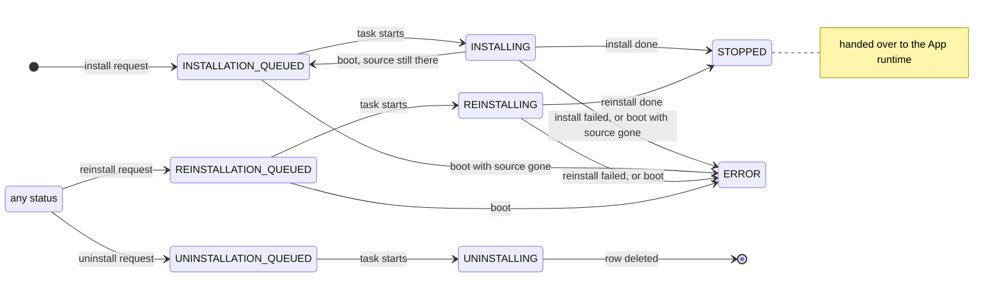

# Installation: concepts

Installation is the only code, apart from the boot-time database paths, that inserts or deletes an `installed_apps` row or creates or removes an **app directory**, `core/installed_apps/<name>/`. It turns install, uninstall and reinstall requests into tasks that one worker runs in order against that row, renders each app's compose file from the template the app ships, and at boot resumes or settles the tasks a restart interrupted.

## Files

`__init__.py` holds the request side: the four request functions, the boot reconciliation, the initial apps and the registry logins. `worker.py` holds the queue, the worker and the four task bodies. `util.py` holds the row helpers, the status writer `update_app_status`, the store existence check and the compose render; `write_traefik_dyn_config` and its exclusion set `NOT_ROUTABLE_STATUS` also live there but belong to Routing. `app_zip.py` defines the app zip format, `app_secrets.py` the `secret()` helper for templates, and `exceptions.py` the module's six exceptions, four of which the HTTP surface maps to status codes.

## Requests

An install from the store needs the app in the store and no row for it. It inserts the row in `INSTALLATION_QUEUED` with installation reason `store` (`config` for an initial app) and queues an "install from store" task. An install from an uploaded zip needs no row. The upload route has already validated the zip and taken the app's name from its manifest, so an invalid upload leaves no row, no directory and no task (4361519); the zip is moved into the app directory and the row inserted with reason `custom`. An uninstall needs a row, and a reinstall needs a row and the app in the store; both write their queued status over whatever the row holds. Every request announces the change (root, *Every change to an installed app is announced*) and returns before its task runs.

The callers are `POST`, `DELETE` and `POST .../reinstall` on `/protected/apps/{name}` and the upload `POST /protected/apps`, which web-terminal and Sundial call (the upload and `DELETE`, which app-repository's smoke test also calls); `POST /management/apps/{name}`; and the first boot's initial apps. Both UIs reinstall to update: they offer Update when the store lists an `app_version` that differs from the installed manifest's, and their update-all reinstalls only apps in a revivable status. They offer Remove whatever the row's status, so an uninstall can be requested while another task for the app runs.

## The worker

One worker runs the tasks one at a time, in the order they were queued, and a task that raises is logged and followed by the next. That order is load-bearing in three ways. The Traefik dynamic config is rewritten whole by the install, reinstall and uninstall tasks and otherwise only by the boot, before the worker starts, so two writes never interleave. The compose render reads an app's secrets, mints the missing ones and persists them without a lock, which is correct only because two renders of one app never overlap. And the worker is the only thing that keeps an install and an uninstall of one app from running at once; the per-app lock (App runtime) serializes a revive against an uninstall or reinstall, not tasks against each other.

An uninstall or reinstall request is accepted whatever task the row is in, and the queued status it writes is how the app's other tasks learn they were superseded. An install or reinstall task starts only if the row still reads its own kind's queued status, `INSTALLATION_QUEUED` or `REINSTALLATION_QUEUED` (`assert_app_status`); an uninstall task starts whatever the row reads. So a queued install is dropped when an uninstall or reinstall is requested behind it, a queued reinstall is dropped when an uninstall is requested behind it or when an earlier reinstall has already handed the row back, an uninstall always runs, and a reinstall queued behind an uninstall finds no row. A running install or reinstall is not superseded: its last write lands over a later request's queued status, so a reinstall requested meanwhile is dropped and an uninstall requested meanwhile runs after it. A dropped task leaves a log line and nothing else.

The queue lives in memory and is shown at `GET /protected/stats/tasks`. The core's stop cancels the running task at its next `await`, killing any docker or compose process it runs.

## The statuses Installation owns

Seven of the twelve statuses are Installation's, and they are its record of work in flight. Installation also writes `STOPPED`, once per install or reinstall, to hand the row over; the App runtime writes only the four revivable statuses (see its *Which statuses the runtime writes, and over what*). `UNKNOWN` is the model's default, which only the TinyDB import writes, for a record without a status.

| Status | Written by | Records | Routed | At boot |
| --- | --- | --- | --- | --- |
| `INSTALLATION_QUEUED` | The install request, as the row's first status; the boot, when it resumes an interrupted install | An install that waits for the worker. Its source is the zip in the app directory, or the store when the reason is `store`, `config` or `unknown`. | No | Resumed, or `ERROR` when its source is gone |
| `INSTALLING` | The task, when it starts | An install in progress; the app's files may be partly in place | Yes | As for `INSTALLATION_QUEUED` |
| `UNINSTALLATION_QUEUED` | The uninstall request, over any status | An uninstall that waits | No | Re-enqueued |
| `UNINSTALLING` | The task, when it starts | An uninstall in progress; the row is its tombstone until the delete | No | Re-enqueued |
| `REINSTALLATION_QUEUED` | The reinstall request, over any status | A reinstall that waits; the installed version is untouched | Yes | `ERROR` |
| `REINSTALLING` | The task, when it starts | A reinstall in progress; the old files may be gone | Yes | `ERROR` |
| `ERROR` | A failed install or reinstall task; the boot | A task that failed or could not be resumed, its cause in `status_message` | No | Kept |

Routed means included in the next write of the Traefik config; writing a status changes no router by itself. `INSTALLING` and `REINSTALLING` must be routed, because the task writes the app's router while the row still reads one of them and writes `STOPPED` only afterwards (155ee52). Both UIs treat exactly the six queued and in-progress statuses as busy and draw a spinner in the app's place.

A task hands the row to the App runtime in one of three ways: an install or reinstall that succeeds writes `STOPPED`, an uninstall deletes the row, and a task that fails leaves it in `ERROR`. An install creates the app's containers (`compose up --no-start`) and does not start them; the app starts on its first request, or on the next control tick if it is `always_on`.

Every `ERROR` that Installation writes carries its cause in `status_message`, and every other status write, the runtime's included, clears it, so the message is non-null only on an `ERROR` row. The API returns it and app-repository's smoke test reports it; neither UI shows it. What the UIs show is `on_app_install_error`, which a failed install or reinstall task broadcasts once and the boot's `ERROR` writes do not. A task dropped by its precondition writes nothing, and neither does a task that fails before it has written its in-progress status. How an app leaves `ERROR` is recorded in the root's *An app's status has one owner*.

## What the boot needs to find

Because the queue lives in memory, a task a restart interrupted survives only as its row's status (root, *Work that must survive a restart is a row*). `reconcile_interrupted_uninstalls` and `reconcile_interrupted_installs` read nothing but the status and, for an install, its installation reason and whether its zip is still in the app directory. They enqueue without awaiting any task, and they run before the boot's Traefik write, so a row they reset to a status that is not routed gets no router (e6a642c). An interrupted uninstall is re-enqueued as it stands: the uninstall tolerates a row that is gone and files that are gone, so running it twice is harmless (7cf1073). An interrupted install is reset to `INSTALLATION_QUEUED` and resumed from its zip when the zip is still there, from the store when its reason is `store`, `config` or `unknown`, and set to `ERROR` otherwise. An interrupted reinstall is set to `ERROR`, as the root's Constraints decide. That includes a reinstall that was still queued, whose installed version is intact, so a working app stays offline until the user retries it or the next clean stop returns it to `DOWN`.

For this to work, the row must read the status of its task from the request until the task's last write. Three paths break that today, all recorded from the App runtime side: the uninstall's own teardown writes `STOPPED` and then `DOWN` over `UNINSTALLING`; runtime writes issued after a docker call land over a status Installation wrote in the meantime; and a clean stop writes `DOWN` over every row whose app directory holds a compose file. A row without one keeps its status across a clean stop, because the take-down finds no compose file and writes nothing. What a clean stop leaves for the next boot therefore depends on how far the task had come:

| In flight at a clean stop | Compose file | Row after the stop | Next boot |
| --- | --- | --- | --- |
| A queued install, or an install that had not rendered its compose file | No | Unchanged | Resumed, or `ERROR` when its source is gone |
| An install that had rendered its compose file | Yes | `DOWN` | Not resumed. The boot's Traefik write and the first revive's `compose up -d` finish it. |
| A queued uninstall, or one that had not removed the app directory | Yes | `DOWN` | Not resumed; the app stays installed |
| An uninstall that had removed the directory but not the row | No | Unchanged: `DOWN` from its own teardown, or `UNINSTALLING` if the teardown failed | A row without files, or re-enqueued |
| A queued reinstall, or one that had not removed the old files | Yes | `DOWN` | Not resumed; the old version stays |
| A reinstall between removing the old files and rendering the new ones | No | `REINSTALLING` | `ERROR` |
| A reinstall that had rendered its new compose file | Yes | `DOWN` | Not resumed. The first revive starts the new version. |

A clean stop thus drops a queued or early uninstall or reinstall and leaves the app in its installed version, and lets a late install or reinstall finish on first use. After an unclean stop the take-down has not run, and the reconciliation finds every row still in a status of its task, apart from those the first two paths above have overwritten.

## Install

An install from the store first downloads `<name>.zip` into the app directory; any answer but 200 fails the task with `AppDoesNotExist`. From there both installs run the same steps: validate the zip, extract it, announce so the terminals see the manifest, delete the zip, render the compose file, create the containers, write the Traefik config, and hand the row over as `STOPPED`.

The zip gate, `validate_app_zip`, runs on every install path, so a store zip is held to the same rules as an upload. The archive must carry `app_meta.json` and `docker-compose.yml.template` at its root or inside one top-level directory (macOS `__MACOSX/` and `.DS_Store` entries are ignored), the manifest must validate against the running `AppMeta`, and its name must match `[a-zA-Z0-9][a-zA-Z0-9_-]{0,63}`. Extraction writes no member outside the app directory (8e4532c). For an upload the manifest's name becomes the app's name. For a store install the requested name is used and the manifest's is not compared with it. app-repository's `agents.md` requires the two to be equal ("Must match folder name"), and nothing enforces it. The row's name is the one that counts: the directory, the compose project and the router all derive from it.

An install does not check whether the app can run on this shard. Size and version are checked when the app is started (root, *An app is started only where it can run*), and the store is meant to hide apps the shard cannot run, as decided on #242. An install takes no per-app lock: until it writes `STOPPED`, its row is in a status no revive acts on.

## Reinstall

A reinstall is an update in place, and both UIs use it as one. It keeps the row with its installation reason, and the app's secrets, OIDC client and data; it replaces only the app directory, always with the store's current zip. It holds the per-app lock from its first status write to its last. It tears the old stack down with `docker_shutdown_app(force=True, set_status=False)`, because no teardown gate accepts `REINSTALLING` (#199). That refusal is load-bearing: the control tick's low-disk stop calls `docker_stop_app` whatever the row's status, and only that gate keeps it off an app mid-reinstall, so the reinstall forces its own teardown. And it deletes the old files only after the daemon confirms the old stack is gone, so a teardown that failed ends the reinstall in `ERROR` with the old install intact (093d82e).

The code does not meet the last part when the probe itself fails. `_teardown_left_containers` takes `get_app_container_state`'s `missing` as that confirmation, and the probe also answers `missing` when `compose ps` or `docker inspect` fails (App runtime, *Teardown and the core's stop*). A docker failure at that moment lets the reinstall delete the files of a stack that may still exist, and the new install then meets the old containers, which is the #199 damage reached by another route.

A reinstall reads the store whatever the row's installation reason. An uploaded app has no source of its own once installed, since its zip is deleted after extraction, so its reinstall fails unless the store has an app of that name. A custom-installed app that has a store counterpart is replaced by the store's version only through an explicit replace-with-store-app action, which is offered whatever the two versions are. *(Confirmed 2026-11-10 — the code cannot tell an intended update path from an incidental one.)* The code does not meet this yet: no such action exists, and both UIs' version-based Update and their Reinstall on an `ERROR` row replace a custom build implicitly, because a reinstall never looks at the installation reason.

## Uninstall

An uninstall leaves no container, no app directory and no row, whatever the row held when it was requested, and running it again does no harm: it tolerates a row that is already gone and an app directory without a compose file. It holds the per-app lock across the whole teardown, so a revive cannot recreate a container between the stop and the row's delete (#185). The delete cascades to the app's OIDC client and its codes and tokens (migration 0004). The app's data directory, `user_data/app_data/<name>`, and its secrets stay: shard_core neither creates nor removes that directory, and nothing deletes `app_secrets` rows, so installing the app again finds its data and the secrets that data was set up with, as decided on #138.

The uninstall tears down through the status-gated primitives `docker_stop_app` and `docker_shutdown_app`, where the reinstall has used `force` since #199. That is why it writes `STOPPED` and `DOWN` over its own `UNINSTALLING` before the row is deleted, and why `docker_stop_app` accepts `UNINSTALLING`, which also lets the control tick's low-disk stop write over an uninstalling row (both recorded from the App runtime side). And it leaves the teardown to what the row reads at each gate, which a concurrent status write can change, so the containers can outlive the uninstall.

## The compose file

An app's `docker-compose.yml` is derived and never edited. `render_docker_compose_template` renders it from the app's `docker-compose.yml.template` at every install and reinstall, and `render_all_docker_compose_templates` re-renders every app that has a template at every boot, so a change of DNS zone, default identity or host path reaches every installed app at its next `compose up` (0cf179b). The template sees this context:

| Name | Value |
| --- | --- |
| `fs.app_data` | `<path_root_host>/user_data/app_data/<name>` |
| `fs.all_app_data` | `<path_root_host>/user_data/app_data` |
| `fs.shared` | `<path_root_host>/user_data/shared` |
| `fs.installation_dir` | `<path_root_host>/core/installed_apps/<name>` |
| `portal` | The default identity as `SafeIdentity`: `domain`, `id`, `short_id`, `public_key_pem` |
| `oidc` | `client_id`, `client_secret` and `issuer` when the manifest declares `oidc` and `oidc.enabled` is set, otherwise `None` |
| `secret('<name>')` | The app's secret of that name |

The context is a published contract. The developer documentation lists every name but `oidc`, and the store's templates use all of them but `fs.installation_dir`, `portal.public_key_pem` and `oidc`. Because every boot re-renders every installed template with the running core, the context can only grow: a name that disappears changes apps that are already installed. Jinja's default undefined renders a missing attribute as an empty string, so `{{ fs.app_data }}/data` would mount `/data` from the host, and if the `secret` callable itself were missing from the context, every template that calls it would fail to render.

`secret('<name>')` returns the app's secret of that name and mints one, 32 characters from `[A-Za-z0-9]`, on first reference. New secrets are persisted before the compose file is written, so a failed persist leaves no file with values that were never stored. Reading, minting and persisting are not atomic and the insert ignores a conflict, which is correct only because two renders of one app never overlap (see *The worker*). Secrets are never rotated, are kept on uninstall and travel in the database snapshot (#138). Scoping them to one app is no boundary against a hostile template, which the unsandboxed Jinja environment lets read any app's secrets (root, Constraints, #264).

When the manifest declares `oidc` and the provider is enabled, the render registers the app's OIDC client, or refreshes its configuration and keeps its credentials across re-renders and reinstalls. With the provider disabled the render logs a warning and passes `oidc` as `None`.

One app whose compose file cannot be rendered costs only that app, never the boot. A single broken app row must never keep the core from booting (#158), and an installed app that a downgrade invalidates is to be left inactive like one the shard is too small for (#242). The code meets this in the Traefik write, which skips such an app with a warning (155ee52), but not in the boot re-render. `render_all_docker_compose_templates` renders the apps one after another without a guard, and the lifespan calls it without one, so a template without a readable manifest, a manifest the running `AppMeta` rejects, or a template that uses a feature the running core lacks aborts the boot, and every boot after it.

## The app store and the zip

The store is the blob container in `apps.app_store`. A store app's zip lives at `<base_url>/<container_name>/master/all_apps/<name>/<name>.zip`, and a 200 to a GET of it is what "the app exists in the store" means; the check made at request time downloads the whole zip. app-repository uploads its `apps/` directory there on every push to its main branch, under both `master/` and `main/`. Its commit messages call `master/` the old branch name, which the frontend still reads, and keep both current while the frontend moves to `main/` (ccbb320, 7f3b013). shard_core and Sundial read `master/`, and so does web-terminal's first-run prompt for its listing; only web-terminal's Apps view reads its listing from `main/`. The upload never deletes, so an app removed from app-repository stays installable. shard_core has installed only from `master/` since 4c94e5e removed per-install store branches in 2024, so web-terminal's store-branch switch changes only the listing it shows.

At boot, before the worker and the control tick can pull an image, the core logs in to every registry in `apps.registries`. A failed login is logged and the boot goes on (4d6e30f).

## Initial apps

`apps.initial_apps` is installed once and never again. The `initial_apps_installed` flag in `kv_store` records that this is done, so an initial app the owner uninstalls stays uninstalled (#28). The flag travels in the database snapshot, so a restored shard does not reinstall them.

Queuing an initial app is a store install, whose request-time check calls the store. A first boot comes up whether or not it can queue its initial apps. An initial app the store does not have is skipped with a warning; one that could not be queued because the store did not answer is retried on a later start, and the flag stays unset until no such app is left. *(Confirmed 2026-11-10 — the code cannot tell a deliberate dependency on the store from an unconsidered one.)* The code does not meet this yet. An unreachable store or a missing app raises out of `refresh_init_apps` with the flag unset, and the lifespan does not catch it, so the boot fails, and so does every later start until the store answers, or for as long as an initial app is missing from it. The existence check also treats any answer but 200 as "not in the store", so it cannot yet tell a missing app from a store error. The apps queued before the failing one keep their rows, which the next boot's reconciliation resumes.

## Boundaries

Installation owns the `installed_apps` row from insert to delete, apart from the four revivable statuses; the app directory and everything in it; the queue and its worker; `status_message`; the compose render and its context; app secrets; the app zip format; the store download; the registry logins; the initial apps; and the boot reconciliation.

It relies on the App runtime for the container primitives (`docker_create_app_containers`, the teardowns with `force` and `set_status`, `get_app_container_state`), for the per-app lock, and for the manifest reader `get_app_metadata`. It relies on Routing's `write_traefik_dyn_config` to compile the routers, with `NOT_ROUTABLE_STATUS` keeping `INSTALLING` and `REINSTALLING` routed; on the Database for `installed_apps`, `app_secrets`, `kv_store` and the cascade from `oidc_clients`; on Identity and signing for the default identity, which the context passes as `portal`; and on the OIDC provider's `ensure_app_client`. From Utilities it takes the signals and `app_compose_command`, whose `ComposeFileNotFound` is how a teardown learns there is nothing to tear down. It relies on the composition root to run the reconciliation before the Traefik write and the re-render and the initial apps before the worker starts, and to cancel the worker before the take-down; and on the HTTP surface to validate an upload before calling it and to map its exceptions to 400, 404 and 409.

Outside shard_core it depends on the store's layout, on app-repository publishing only manifests the cores in use can validate and only templates within the documented context, on the developer documentation as the published statement of that context, and on web-terminal and Sundial reading the statuses as this file describes.

Of the root invariants it keeps true:

- *Every change to an installed app is announced*: `update_app_status`, the two inserts and the delete announce. The delete's announcement is skipped when the Traefik write before it raises.
- *An app's status has one owner*: the reconciliation's two filters and the worker's three preconditions are here, and `NOT_ROUTABLE_STATUS`, Routing's set, sits in `util.py`.
- *Paths are resolved on the side that uses them*: the compose render is `path_root_host`'s only reader.
- *Work that must survive a restart is a row*: the reconciliation, currently broken by the three paths in *What the boot needs to find*.
- *The lifespan order is load-bearing*: its boot steps enqueue without awaiting a task, and the reconciliation precedes the Traefik write. Two of its boot steps can abort the lifespan: the re-render, for one app, and on a first boot the initial apps, for the store.
- *A backup restores the shard as it was*: the app secrets and the initial-apps flag travel in the database snapshot.

## Constraints

From the written record, each with its source:

- App secrets are never rotated, are kept on uninstall and upgrade, and are not encrypted at rest for now (#138, PR #173).
- The attribute form `{{ secret.name }}` was rejected for the callable `secret('name')`, because Jinja reads a hyphenated name after a dot as a subtraction (PR #173).
- The store's `master/` path is a stopgap that app-repository keeps current next to `main/`, and the intended end state is every reader on `main/` (app-repository ccbb320, 7f3b013).
- Installation never decides whether an app may run on this shard: the store hides an app the shard cannot run, and the start gate leaves an installed one inactive (#242).
- A template may mount the Docker socket only read-only, and no host path beyond the `fs` variables. This is checked when an app is submitted to the store, not by the render (developer docs, "Limitations").
