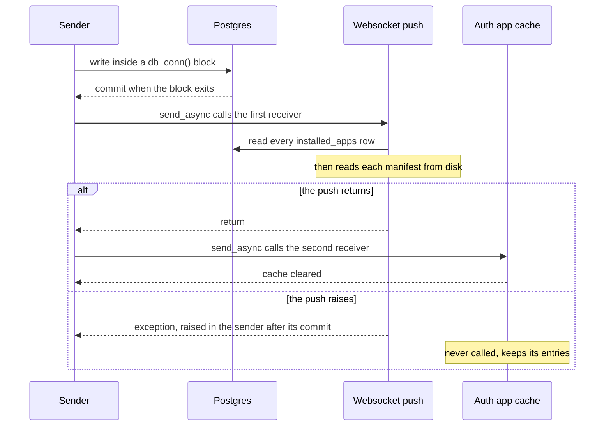

# Utilities: concepts

Utilities holds the primitives the rest of shard_core is built from: the loops that run its background tasks, the signal objects every announcement passes through together with the rules of their delivery, the process runner behind every docker call and the command builder that pins each compose call to one app's file and project, the revive throttle, the rate-limit window, the reader of the running version, and the words of the backup passphrase. None of it decides when it is used; that belongs to the callers named below, whose theories are in their own files.

## Files

`async_util.py` holds `BackgroundTask`, the three-method interface the lifespan starts and stops, and its two loops, `PeriodicTask` and `CronTask`. `signals.py` declares twelve blinker `Signal` objects and nothing else. `subprocess.py` holds the process runner `subprocess`, the compose command detection, `app_compose_command`, `normalize_project_name`, and the exceptions `SubprocessError`, `ComposeFileNotFound` and `ComposeProjectNotAllowed`. `misc.py` holds `throttle`, `SlidingWindow`, `get_freeshard_version`, `format_error` and `str_to_bool`. `passphrase.py` draws the passphrase's dice and looks up its words.

| Primitive | Callers |
| --- | --- |
| `PeriodicTask`, `CronTask` | The composition root's task set, `app_factory._make_background_tasks` |
| `BackgroundTask` | `WSWorker` subclasses it; `InstallationWorker` has the same three methods without subclassing it |
| `subprocess` | App runtime's compose calls, `docker inspect` and image prune; `memory_pressure.reclaim_compose_stack`; the metrics sampler's `docker ps`; the registry login |
| `app_compose_command` | `app_tools._app_compose` and `memory_pressure.reclaim_compose_stack`, which between them make every compose call on an app |
| `normalize_project_name` | `app_compose_command`, and the metrics sampler, which finds an app's containers by their compose project label |
| `throttle` | `app_tools.start_app` only |
| `SlidingWindow` | The owner email send budget, the confirm-email route's miss counter, the OIDC token endpoint |
| `get_freeshard_version` | `freeshard_version_is_compatible` and `GET /public/meta/version` |
| `format_error` | The websocket's `backup_update` and `app_install_error` messages |
| `generate_passphrase_numbers`, `get_passphrase` | `backup.ensure_backup_passphrase` |
| `str_to_bool` | None. af1d04b added it to parse `traefik.disable_ssl` from the old settings library, and e2c06a7 replaced that library |

## Signals

The root records the observer pattern behind the signals and the rule that each signal is synchronous or asynchronous throughout. This section records what a send promises its receivers and its sender.

### Delivery

A send calls the signal's receivers one at a time inside the sender's own call, and the sender continues only after the last receiver has returned. A receiver's work is therefore its sender's latency. The first pairing's response waits for the controller call in `enrich_identity_from_profile` (#194), `PUT /protected/peers` waits for the unsigned GET in `update_peer_meta`, which has no timeout, and every request `/internal/auth` admits waits for the receivers of `on_request_to_app` (root, *The auth path does no per-request database work*). Receivers that would hold their sender for long hand the work on: `ensure_app_is_running` starts the revive as a task of its own and returns (262c59c), and every websocket receiver puts its message on the `WSWorker` queue, which sends it later, so no sender waits for a terminal (the queue dates from b4ab649 in 2023, and cdad15b made `broadcast_message` synchronous). The two websocket receivers that reload a table make that read inline.

blinker calls the receivers of a send in an order it leaves undefined ([blinker](https://blinker.readthedocs.io/en/stable/#blinker.Signal.send)). It iterates a set of the receivers' object IDs, so the order follows their memory addresses: it is stable per build and entry point, and any change to the code can alter it. In the current build `on_apps_update` calls the websocket push before the `/internal/auth` cache invalidation, `on_request_to_app` calls `update_last_access`, `ensure_app_is_running` and `telemetry.record_request` in that order, and `on_terminal_auth` calls `update_terminal_last_connection` before `record_request`. No receiver may depend on running before or after another receiver of its signal, and none does today.

A receiver's exception ends the send. It propagates into the sender, and the receivers after the raising one are not called. blinker states this as an assumption that correctly implemented receivers do not raise, so a receiver handles its own failure and never raises into its sender. *(Convention — https://blinker.readthedocs.io/en/stable/#blinker.Signal.send)*

The code does not meet this yet. Seven receivers do I/O without catching its failure: the websocket pushes `send_apps_update` and `send_terminals_update`, `update_terminal_last_connection`, `update_last_access`, `ensure_app_is_running`, `enrich_identity_from_profile` and `peer._on_peer_write`. The apps push raises on a pool timeout, on a connection that a Postgres restart has broken, and on a manifest that is valid JSON but that the running core's `AppMeta` rejects, because `enrich_installed_app_with_meta` catches only `MetadataNotFound`. When it does, the `/internal/auth` app cache is not cleared, and the exception reaches a sender whose write has already committed. The installation worker writes the final `STOPPED` inside the install's `try`, so an install whose closing announcement raises is recorded as `ERROR`, and an uninstall whose `UNINSTALLING` announcement raises ends before its teardown. A single manifest the core rejects makes every announcement raise. When the terminals push raises, a pairing or un-pairing that has committed answers 500, and the pairing leaves a terminal row whose cookie no device received; a rename answers 500 and is rolled back, because `edit_terminal` sends inside its block. On the auth path a raising receiver turns the forwardAuth answer into a 500, which denies the request (#190), and the first pairing's receiver fails the pairing (#194).

### Payload and registration

Every send passes its payload as blinker's one positional argument, the sender, and no send passes keyword arguments; a payload of two values travels as a tuple (`on_app_install_error`). Each receiver takes exactly that one parameter, named `_` where it ignores it. No receiver is connected for a particular sender, so every receiver gets every send. Receivers are module-level functions, connected by decorator when their module is imported, and blinker holds them by weak reference: a receiver defined inside a function or as a lambda would be dropped without notice once it is collected. Importing `app_factory` attaches all of them before the lifespan's first send (Composition root).

### What each signal carries

Three signals carry no payload and announce that state may have changed: `on_apps_update`, `on_terminals_update` and `on_identity_update`. Their receivers read the state again from its source, or drop a cache that will. An announcement is therefore idempotent. A second one costs one more reload (`uninstall_app` announces twice), a missing one leaves receivers stale, and one sent before its sender's commit makes them reload the old state (Database records the two senders that do, `init_default_identity` and `edit_terminal`). Each `on_apps_update` makes the websocket push read every row and every app's manifest and send the whole list to every terminal, and both UIs replace their app and terminal lists with what such a push carries. The other nine signals carry an event.

| Signal | Sent with | Sent by | Payload | When | Receivers |
| --- | --- | --- | --- | --- | --- |
| `on_apps_update` | `send_async` | `update_app_status`; the two inserts and the uninstall's delete; `_mark_running`, `docker_pause_app`, `docker_stop_app`, `docker_shutdown_app`; `uninstall_app` again after its status write; the install once it has unpacked the zip | None | After the writing block has committed. The install's send follows no row write and announces that the manifest can now be read; `docker_shutdown_app` with `set_status=False` announces without writing | The websocket push (`apps_update`), the `/internal/auth` app cache |
| `on_terminals_update` | `send_async` | Pairing, `edit_terminal`, un-pairing | None | After the commit, except in `edit_terminal`, which sends inside its block | The websocket push (`terminals_update`) |
| `on_identity_update` | `send_async` | `init_default_identity`, `make_default`, `update_identity` | None | After the commit, except in `init_default_identity`, which sends inside its block at boot | The `/internal/auth` identity cache |
| `on_terminal_add` | `send` | Pairing | The new `Terminal` | After the commit | The websocket's `terminal_add`, on which both UIs close their pairing dialog |
| `async_on_first_terminal_add` | `send_async` | Pairing, when the inserting transaction counts one terminal | The new `Terminal`, unused | After the commit | `enrich_identity_from_profile` |
| `on_terminal_auth` | `send_async` | `authenticate_terminal` (forwardAuth for `/core/protected`) and `/internal/auth` | The `Terminal` row the JWT names, read for this request | On every request with a valid cookie; in `/internal/auth` before the path's access is checked | `update_terminal_last_connection`, `telemetry.record_request` |
| `on_request_to_app` | `send_async` | `/internal/auth`, once it has admitted a request | The auth cache's own `InstalledApp` | After the admission, before the response | `update_last_access`, `ensure_app_is_running`, `telemetry.record_request` |
| `on_app_install_error` | `send` | The worker's three install and reinstall failure branches | `(exception, app name)` | After the `ERROR` write has committed and been announced | The websocket's `app_install_error` |
| `async_on_peer_write` | `send_async` | `PUT /protected/peers` | A `Peer` built from the request's ID and name | After the commit | `peer._on_peer_write` |
| `on_peer_auth` | `send` | `/internal/auth`, on a valid peer signature | The `Peer` | Before the access check | None |
| `on_backup_update` | `send` | The callback of a finished backup run | The run's exception, or none | After the run; a successful run has committed its report | The websocket's `backup_update` |
| `on_disk_usage_update` | `send` | The disk sampler | The `DiskUsage` snapshot | After every sample, every 30 seconds, whether or not it changed | The websocket's `disk_usage_update` |

`update_last_access` writes `installed_apps.last_access` without announcing it; how it keeps the auth cache's row in step is in `shard_core/data_model/CONCEPTS.md`, *Last access*.

Signal names do not tell a signal's kind; the root records how the `async_` prefix stopped tracking it (*Every change to an installed app is announced*). The table above is authoritative for which signals are asynchronous.

## Background tasks

`BackgroundTask` is the interface the lifespan drives. `start()` begins the work and does nothing when it has already begun, `stop()` cancels it, and `wait()` returns once it has ended and swallows the cancellation. The lifespan stops every task and then waits for each (Composition root). `wait()` before `start()` fails; the lifespan never calls it that way. `InstallationWorker` implements the three methods without subclassing the interface. `WSWorker.wait` returns once its message task has ended, without awaiting its heartbeat task (Composition root).

A `PeriodicTask` runs its function as soon as it starts and again `delay` seconds after each run returns. Its runs never overlap and never catch up: a slow run delays the next. An `Exception` from a run is logged at error level, by type and message without a traceback, and the loop goes on (4a652d8). That catch-all is what keeps the control tick alive when a pass raises (App runtime), and the samplers, the telemetry sender and the peer key refresh alike. A cancellation is not an `Exception`, so `stop()` ends a run at its current await.

A run that never returns stops its task for good, because the next run starts only after it. Nothing bounds a run as a whole; what keeps the control tick's runs finite is the limit on each docker call inside them (see *Running commands*).

A `CronTask` validates its expression when it is constructed and raises `TypeError` for a bad one. The lifespan constructs the whole task set before it starts any task, so a bad schedule in configuration fails the boot at step 7, before any background task runs. Each round, the task computes the next occurrence after the present moment in UTC, whatever the container's time zone (croniter reads a float start time as UTC), adds a delay drawn uniformly up to `max_random_delay` where one is set, and sleeps. The next round begins only after the run has returned, so runs never overlap, and an occurrence that passes while the core is down or a run is still going is skipped; nothing runs it later (Backup records what that means for the nightly run). The sleep runs on the monotonic clock for an interval computed from the wall clock, so a wall-clock step during the sleep shifts the run by the step. Since #58 a run's `Exception` is logged and the loop goes on (3dc60af). Before that, a run that raised ended its task for the life of the process without a log line, which stopped nightly backups.

## Running commands

`subprocess(*args)` runs a program directly, without a shell, captures its output, and returns its standard output decoded as UTF-8. A non-zero exit raises `SubprocessError`, whose message holds the exit code, the standard output and the standard error but not the command. Callers match on that text: `_compose_up` recognises a stale network reference and a container name already in use by their messages (App runtime). A cancellation kills the child and waits for it before the cancellation propagates (51887b6), so a stopped task leaves no docker CLI process behind it; whatever the daemon had already done by then stays done. The `cwd` parameter has had no production caller since 26ae9de pinned every compose call.

Every docker call is bounded by a limit that fits its kind: short for `ps`, `inspect` and `pause`, long or progress-based for `up` with image pulls. A call past its limit is a logged failed operation, and its caller carries on. *(Confirmed 2026-11-10 — the code cannot show whether unbounded calls were intended.)* The code does not meet this yet: no call through `subprocess` has a limit (the compose detection has its own timeout, and the Docker SDK clients use the SDK's default), and `subprocess` waits for its child until the child exits or the caller is cancelled. One compose call that never exits therefore stops the control tick for the life of the process, and with it the idle stops, the pause tier, the pressure demotion and the low-disk stop. A revive whose compose call never exits holds its app's lock, so an uninstall or reinstall of that app waits on the lock, and the installation worker, which runs one task at a time, waits with it. A `down` that never exits holds up the core's stop until Docker kills the process at the end of the grace period, and leaves that app's containers running.

`compose_command()` decides once per process, at the first compose call, whether `docker compose version` succeeds within five seconds. If it does, compose runs as the Docker CLI plugin, and otherwise as the standalone `docker-compose`, the fallback #35 asked for. The check runs synchronously and holds the event loop while it runs. Its answer holds for the life of the process, so a check that fails once commits the process to `docker-compose`, which the image no longer installs (#35), and every compose call then fails with `FileNotFoundError`, which is not a `SubprocessError`.

### Pinning a compose call to one app

`app_compose_command(app_dir)` builds every compose call on an app as `<compose> -f <app_dir>/docker-compose.yml -p <project> --project-directory <app_dir>`. Without `-f` and `-p`, compose derives the file and the project from its working directory and walks up the tree when that directory holds no compose file. App directories lie under the core's directory, so an app command whose compose file was missing resolved to the core stack, and a `stop` or `down` took the whole shard offline (#160, fixed by #161). The builder therefore raises `ComposeFileNotFound` before any process starts when the app's compose file is missing, and `ComposeProjectNotAllowed` when the project would be `core` or empty. The `core` refusal is reachable: the upload validation admits an app named `core` or `Core`, whose install then fails when its containers are created.

The project is `normalize_project_name(app_dir.name)`, which mirrors compose's own normalization of a directory name: lowercase, drop everything outside `[a-z0-9_-]`, strip leading `_` and `-`. It has to equal what compose derived from the directory before the pinning, or the stacks of apps installed before it would lose their containers (#161). For every name the upload validation admits today (`APP_NAME_PATTERN`: a letter or digit, then up to 63 letters, digits, `_` or `-`), it only lowercases. The metrics sampler finds an app's containers through the same function.

That each installed app has a compose project and a host name of its own depends on app names being unique ignoring case (root, *An app's name is unique ignoring case*).

## The revive throttle

`throttle(min_duration)` drops a call whose positional arguments equal those of a call accepted within the last `min_duration` seconds, and returns `None` for it without running or retrying it. Since 5c46231 each distinct argument tuple has a window of its own, so a revive of one app no longer drops another's; before, one window covered every app. Keyword arguments are not part of the key, so a caller that passed the app name by keyword would put every app back under one window; both callers of `start_app` pass it positionally. A window opens when an accepted call starts, not when it finishes. One entry per distinct argument tuple is kept for the life of the process, which for `start_app` means one per app name revived since the boot.

The throttle limits how often revives of one app begin, and the per-app lock serializes them. A revive that runs longer than the window lets the next one through to wait on the lock, and that one finds the stack running and does nothing (App runtime). In the review of #90 the maintainer asked whether the new auth caches made the throttle unnecessary, and it was kept (see *Constraints*): every admitted request to an app that may run starts a revive, and without the throttle a page load of thirty parallel requests runs thirty of them, each with its compose calls.

The window is measured on the wall clock (`time.time()`), where `SlidingWindow` uses the monotonic clock. A backward step of the clock extends every open window by the step, so a revive of an app revived just before the step is dropped until the clock has caught up.

## The rate-limit window

`SlidingWindow(limit, window)` grants at most `limit` attempts in any moving period of `window` seconds, measured on the monotonic clock. `try_acquire()` records an attempt only when it grants it, so refused attempts do not prolong a lockout, and it is named for the slot it spends, so that no caller calls it twice to branch. `reset()` empties it. A window lives in memory and is shared by every caller of the endpoint it guards: a shard has one owner, and a budget per client would only give an attacker a fresh one per source address. Three windows exist. The owner email budget covers the verification mails of the whole process and is charged before anything is written (People and owner email). The confirm-email route's window is charged only when a token does not match, so a flood of guesses can never keep the owner from confirming. The OIDC token endpoint's window is charged for every token request and is emptied when the provider initializes.

## Smaller helpers

`get_freeshard_version()` is the single source of the running version. It reads the version of the installed `shard_core` distribution, the metadata the API's OpenAPI version shows too, so it follows `pyproject.toml` only after a reinstall. The start gate, `freeshard_version_is_compatible`, and `GET /public/meta/version` both use it; Sundial's store reads the route to hide apps the shard is too old for. It raises when the metadata is missing or is not a PEP 440 version. The start gate then treats every app that declares a requirement as incompatible, and the route answers 500.

`format_error(e)` renders an exception as `Type: message`, or as `Type` when the message is empty. It is the error text both UIs show in their toasts for a failed install and a failed backup.

`generate_passphrase_numbers(n)` draws `n` five-digit strings from five `secrets.choice` dice each, and `get_passphrase` looks each one up in `data/eff_large_wordlist.txt` and joins the words with single spaces. The list holds each of the 7776 five-dice keys exactly once, so the lookup cannot miss, and ten words, the number the backup asks for, carry about 129 bits. The file is read from the working directory, `/app` in the image (Composition root). How the passphrase is created, kept and shown is Backup's.

## Boundaries

Utilities owns how a signal is delivered, though not who sends it or when, and owns the background task loops, the process runner, the compose command detection and pinning, the project name of an app's stack, the throttle's mechanics, the rate-limit window, the version reader, the error text and the passphrase's words.

It relies on blinker 1.9 for sequential delivery and for the check that a receiver's kind matches the send, on croniter for the schedule, and on a Docker CLI that has the compose plugin. It relies on every sender to announce after its commit (Database) and on every receiver to handle its own failure. It relies on the composition root to import every receiver module, to start and stop the tasks in its order, and to run with the repository root as the working directory, and on Installation to keep the names of installed apps distinct as compose projects.

Of the root invariants it keeps true:

- *Every change to an installed app is announced*: the delivery of `on_apps_update`. An announcement reaches the auth cache only when every receiver called before the invalidation returns, which the websocket push does not always do.
- Each signal is synchronous or asynchronous throughout: `signals.py` declares the signals, and every sender and receiver matches the kind the table above gives.
- *The lifespan order is load-bearing*: `stop()` cancels, `wait()` waits for the end, and a cancelled `subprocess` kills its child, so the take-down that follows the tasks races none of their docker calls.
- *Work that must survive a restart is a row*: the throttle's windows, the rate-limit windows and the compose detection live in the process and start empty.
- *An app is started only where it can run*: `get_freeshard_version` is the version predicate's source.

## Constraints

From the written record, each with its source:

- No app compose command depends on the working directory. Each one names the app's compose file, project and project directory, and none runs when the app's compose file is missing (agents.md; #160; PR #161).
- The pinned project name equals compose's own normalization of the app directory name, so the stacks of apps installed before the pinning keep their containers (PR #161).
- When the compose plugin is missing, compose runs as the standalone `docker-compose` (#35, opened by the maintainer).
- The revive stays throttled even with the auth caches in place (PR #90's review, merged by the maintainer).
